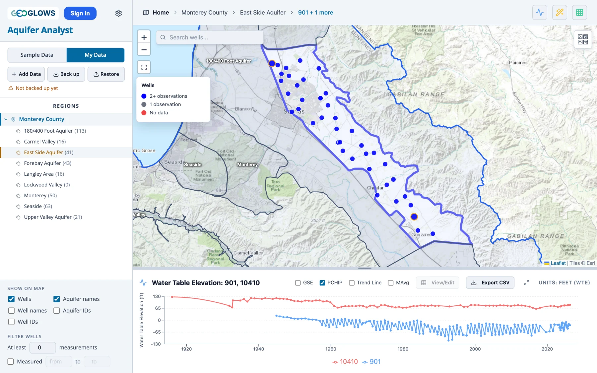
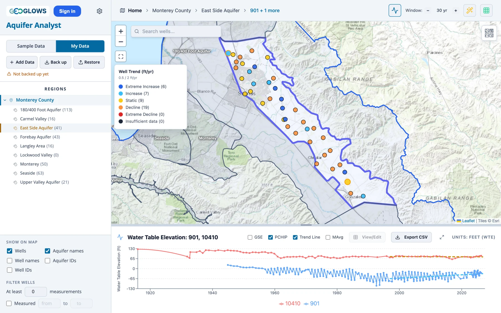
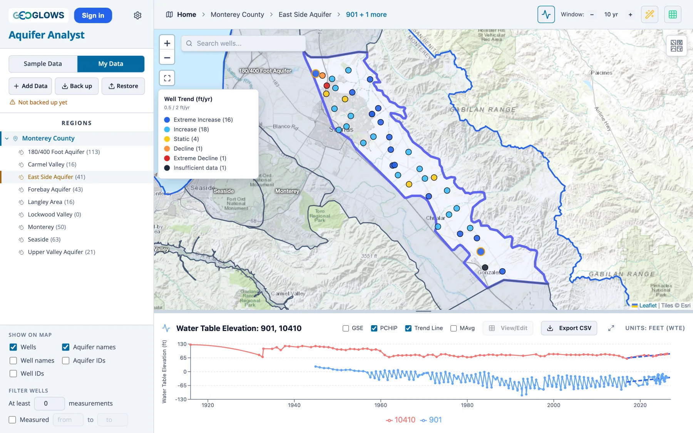
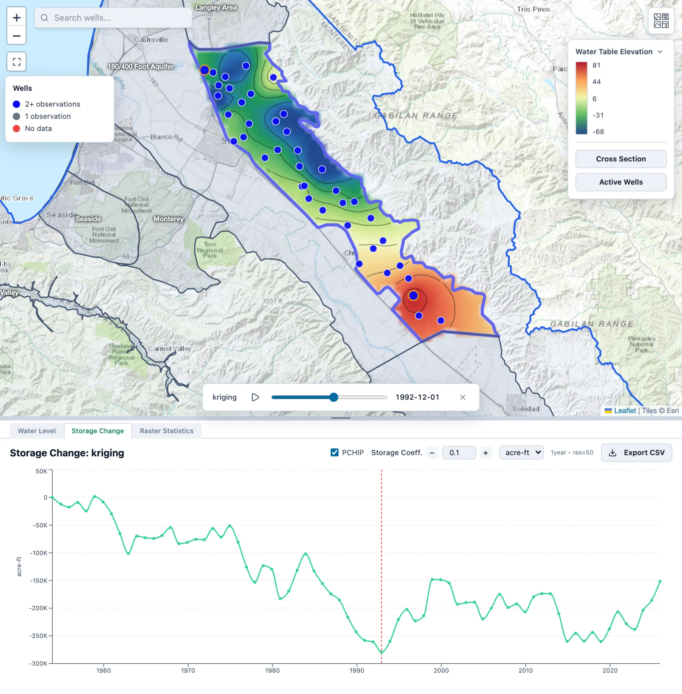
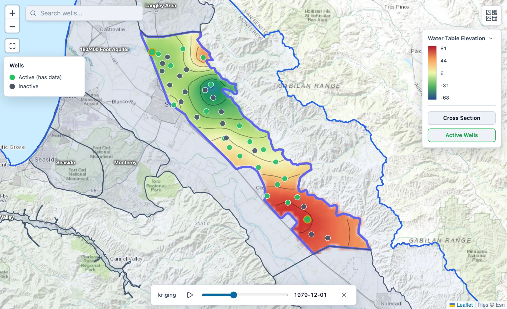
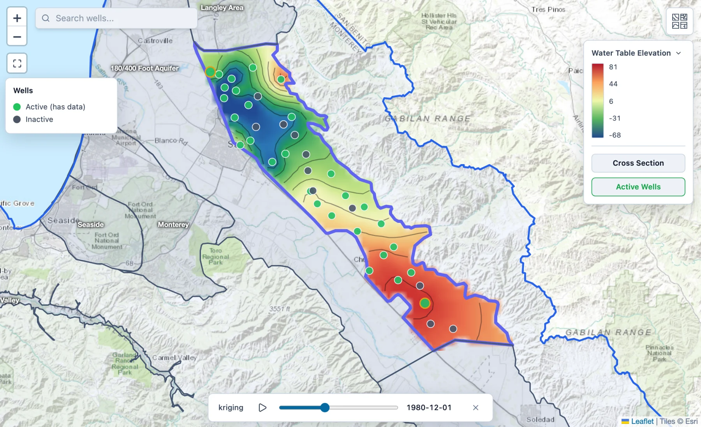
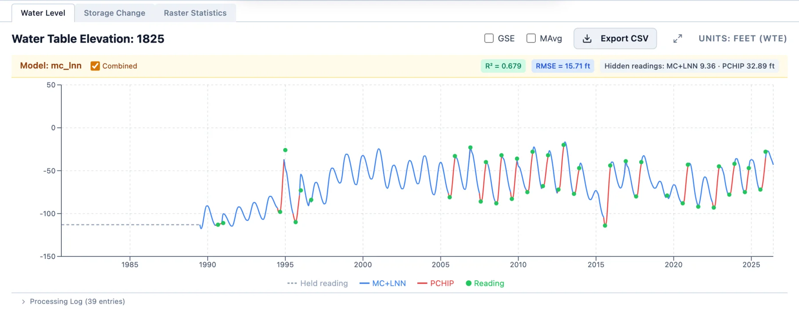
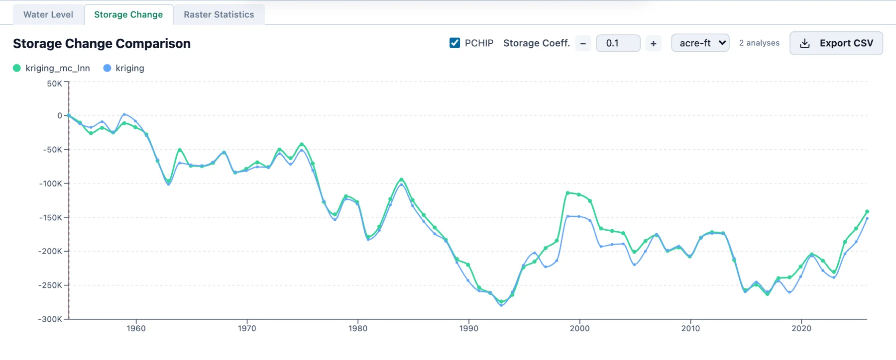
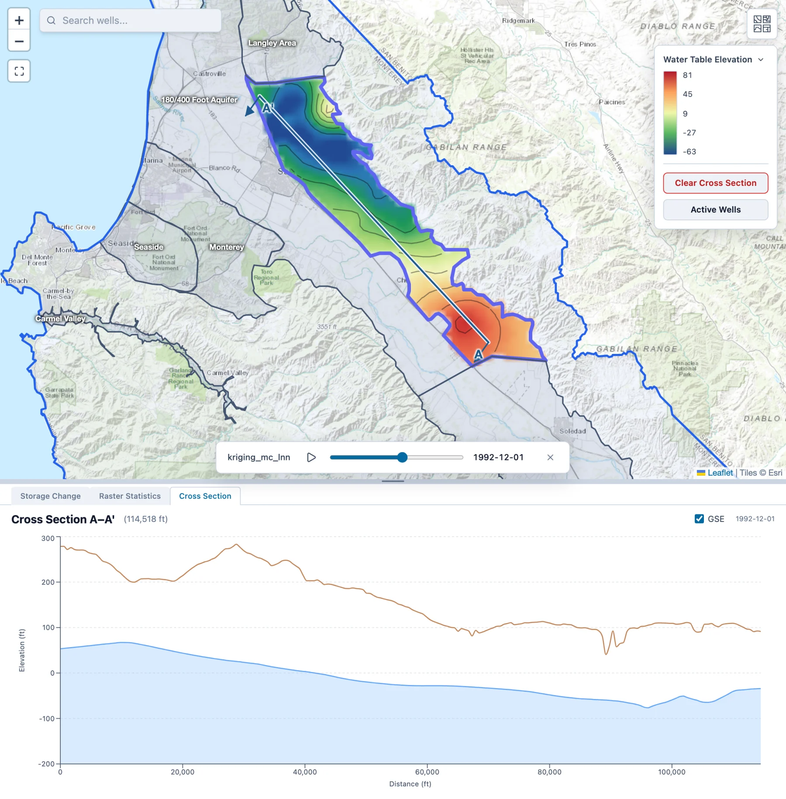

# The East Side Aquifer, Salinas Valley

This case study takes one aquifer through the app from start to finish: two of its wells, the trends of all of them, water table maps
from the measurements, a gap-filling model, maps from the model, the storage change of both sets, and a cross section. The East Side
Aquifer is a subbasin of the Salinas Valley groundwater basin in Monterey County, California (Bulletin 118 number 3-004.02), a strip of
233 km² (57,600 acres) along the foot of the Gabilan Range from Salinas to Gonzales. Its water levels come from California DWR's
Periodic Groundwater Level Measurements, the same records Part 2 imports.

Each step links to the page that covers it in full. The numbers are the ones the app gives for this data, and a run of your own with
the same settings gives the same maps and model.

## The region

If you worked through Part 2, the Monterey County region is already in your My Data (see [Regions and
Aquifers](../data/regions-aquifers.md)). Otherwise download [monterey-county.zip](../../static/files/aquiferx/monterey-county.zip), the
region as Part 2 leaves it, switch the panel to **My Data** and click **Restore** (see [Sample Data and My
Data](../start/my-data.md#backing-up-and-restoring)). Restore adds the region and leaves the rest of My Data as it is.

Open Monterey County, then East Side Aquifer. It has 41 wells, with 3,100 readings from January 1916 to June 2026.

## Two wells

Click well 901, near Salinas at the aquifer's northwest end, and Shift-click 10410, near Gonzales at the southeast end, to chart both
(see [Exploring a Region](../start/exploring.md)).

10410, 299 ft deep, was first read in January 1916, at 126.5 ft. Its level stood between 115 and 120 ft in the 1940s, fell to about
78 ft by 1960, and has stayed between 61 and 84 ft since.

901, 385 ft deep, lies in the low of the water table. Its first reading, in November 1944, was 24 ft above sea level. From 1960 it was
read each August and again in November or December, and the August reading is the year's low, 30 to 60 ft below the later one, which gives
its curve the zigzag in the figure. Its late-year level stayed near sea level through the 1950s and 1960s, fell to −17 ft in 1980 and to
−50 ft in 1990 and 1991, and has been between −43 and −19 ft since 1998. Its lowest reading, in August 1992, was −111 ft.

## Trends

**Analyze Trends** with its 30-year window, in November 2026, puts 19 of the 41 wells in Decline, 9 Static, 7 Increase and 6 Extreme
Increase (see [Trends](../timeseries/trends.md)). Their median rate is −0.35 ft a year, which classes the aquifer as Decline.

Cut to 10 years, the window starts in November 2016, near the lows of the storage curve below, and 34 wells are rising: 16 Extreme
Increase and 18 Increase, against 4 Static, 1 Decline and 1 Extreme Decline. One well has no readings two years apart in the window and
shows as Insufficient data. The median rate is +1.58 ft a year, Extreme Increase. The 30-year window takes in the fall from 1998 to
those lows and the rise since, and the 10-year window the rise alone. The window always ends on the day you open it, so your counts
can differ a little.

## Maps from the measurements

Click **Spatial Analysis** and run it with the defaults (see [Running a Spatial Analysis](../spatial/running.md)):

- Most readings fall in December (38%), so the maps are dated December 1st, one a year from 1953 to 2025: 73 maps.
- 36 wells have 5 or more readings spread over 5 years or more, and 5 are left out. Each well's first and last readings are held for
  up to 10 years.
- **Wells at One Place** finds one place, two wells 4.3 m apart finished at 370 and 680 ft, and keeps the 370 ft well, whose readings
  differ from those of nearby wells by 5.2 ft against the other's 22.6 ft (see [Wells at One Place](../spatial/places.md)).
- Kriging on 50 columns makes a grid of 50 by 49 cells about 620 m on a side, 602 of them inside the outline.

The run takes a few seconds and opens the maps, with the storage change chart below them.

December 1992 is the lowest map. The water table runs from 73 ft at the southeast end to −100 ft in the low near Salinas. The storage
curve, with a storage coefficient of 0.1 (see [Storage Change](../spatial/storage.md)), shows the aquifer losing about 280,000 acre-ft
from December 1953 to December 1992, a fall of 48.5 ft averaged over its 57,600 acres. The losses came in spells, 1959 to 1962, 1976 and
1977, and 1984 to 1992, and the years after each made part of it good again, as in 1963, 1978 and 1983. After 1992 the curve rose to
−148,000 acre-ft by 1998, fell to −260,000 in 2014 and stayed near it until 2018, and stood at −152,000 in December 2025: nearly half the
water lost by 1992 had come back.

## A step that is not water

The largest one-year fall on the curve, 53,000 acre-ft, comes from December 1979 to December 1980. Turn on **Active Wells** on the
map's card and step from 1979 to 1980 (see [Viewing the Maps](../spatial/maps.md#what-the-map-shows)): seven
wells near Salinas turn from gray to green.

{ width="49%" }
{ width="49%" }

The seven were first read in August 1990, between −54 and −113 ft. The hold carries each first reading back 10 years, so from the 1980
map on they bring 1990's levels into the low near Salinas, which the maps until then drew from fewer wells. The 21 wells on both maps
changed by +0.1 ft at the median from 1979 to 1980. The low did deepen through the 1980s, as 901's December level fell from −17 to
−50 ft, but the maps show the seven wells' share of that fall all at once, in 1980.

A smaller step of the same kind comes in 2005, when five wells first read in March 2015 join the maps: the curve gains 20,000 acre-ft
while the wells already on the maps changed by −0.1 ft at the median. Before reading a step in a storage curve as water gained or lost,
check with Active Wells whether wells joined or left the maps that year (see
[Storage Change](../spatial/storage.md#reading-the-curve)).

## Filling the gaps

Click **Impute Gaps** and run it with the defaults (see [Running an Imputation](../imputation/running.md)). It fills the same 36 wells,
all of them by MC+LNN, in about 15 seconds on a laptop. In the hidden-readings check MC+LNN came closer than PCHIP at 27 of the 29 wells
checked, with a median RMSE of 7.92 ft against PCHIP's 16.39 ft (see
[Reading the Results](../imputation/results.md#the-hidden-readings-check)).

Well 1825, near Salinas, was read each August and December from 1990, with no readings from August 1996 to August 2005. PCHIP across
that gap joins two August lows and stays near −84 ft, so on the maps from the measurements the well's December value from 1996 to 2004
is about −83 ft. MC+LNN fills the gap with the yearly swing of the wells around it, and its December values lie between −64 and
−28 ft. The other six wells first read in August 1990 have the same gap.

Before 1990 the chart shows the first reading held, dashed. 1825 has readings in 41 months, fewer than 60, so MC+LNN fills only the
12 months before its record and holds the first reading for the rest of the 10 years (see
[How MC+LNN Works](../imputation/method.md#beyond-the-record)). The seven wells that join the maps in 1980 have readings in 34 to 42
months each, so the model carries their 1990 levels back to 1980 as well.

## Maps from the model

Run Spatial Analysis again, choose **Imputed Data**, and keep the other defaults: the same 73 December maps, from the model's 36 wells
(see [Reading the Results](../imputation/results.md#using-a-model-for-water-table-maps)). The title starts as `kriging`, which the first
set has taken, so give it another, such as `kriging_mc_lnn`. With the new maps open, Shift-click `wte_kriging` in the tree to add the
first set's curve to the chart (see [Storage Change](../spatial/storage.md#comparing-sets-of-maps)).

The two curves follow each other closely: by December 1992 the maps from the model lose 274,000 acre-ft, against 280,000. They part
most from 1996 to 2005, where the model's curve stands up to 34,000 acre-ft higher. The seven wells near Salinas account for it: in
December 1998 the model puts them 11 to 69 ft above the PCHIP lines between their August lows, while the other 22 wells on that map
differ by a median of 2 ft, up or down. Both curves keep the step in 1980. In December 2025 the model's curve stands at −141,000
acre-ft.

## A section along the valley

Open the model's maps, move to December 1992, click **Cross Section** and draw a line from the southeast end of the aquifer to the low
near Salinas, then check **GSE** (see [Cross Sections](../spatial/cross-sections.md)).

The line is 114,518 ft (21.7 miles) long. In December 1992 the water table along it stands at 53 ft at A, a little higher 10,000 ft on,
falls below sea level about 42,000 ft from A, and is lowest, at −76 ft, about 96,000 ft from A, near Salinas. The ground falls from
275 ft at A to about 100 ft over the last 50,000 ft. Pointing at the chart gives the depth to water at each point: up to 250 ft under the
higher ground of the first 40,000 ft, and between about 105 and 180 ft from 60,000 ft on. The section follows the slider, so moving
through the dates shows the water table along the line year by year.

## What the case study shows

- From 1953 to 1992 the East Side Aquifer lost about 280,000 acre-ft at a storage coefficient of 0.1, in three spells of falling levels,
  and by 2025 nearly half of it had come back. The storage coefficient scales every number on the curve, so the size of the loss is only
  as good as that one value.
- The largest step on the curve came from wells joining the maps with readings held from ten years later. Active Wells finds such a step
  in a few clicks.
- Gap filling changed the curve most where wells read only in August and December went years without a reading.
- A 30-year trend window and a 10-year one give opposite signs here, and both are right about their own years.