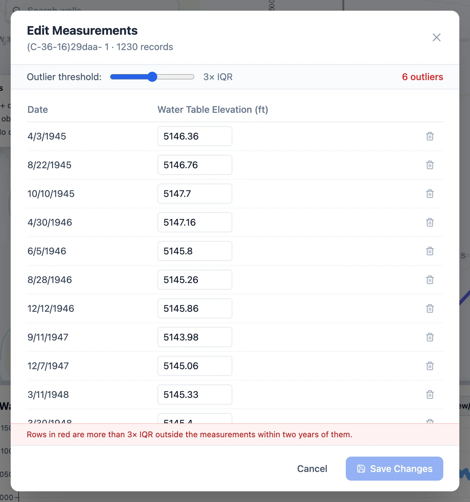
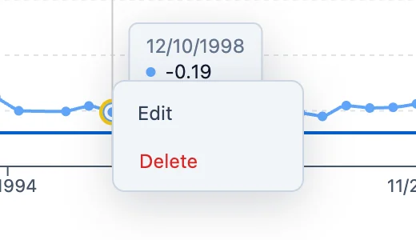

# Editing and Exporting

Measurements can be corrected or deleted in a table of a well's record or straight from the chart. Saved changes cannot be undone, so
back up first if you might want the original values again. In a Sample Data region, editing offers to copy the region to My Data, where
you can make the change.

## The measurement table

{ align=right width="400" }

With one well selected, **View/Edit** in the chart panel opens **Edit Measurements**: every measurement of the current data type, by
date.

- To correct a value, type the new one in its box.
- To delete a measurement, click the bin at the end of its row. The row is struck through, and clicking the bin again restores it.
- **Save Changes** saves the edits and deletions together, and **Cancel** leaves the record as it was.

**Outlier threshold** highlights values far from the measurements around them in time. For each value, the app takes the measurements
within two years either side, or the six nearest when there are fewer, without the value itself. With their quartiles Q1 and Q3 and
interquartile range IQR = Q3 − Q1, the value is flagged when it is below Q1 − k·IQR or above Q3 + k·IQR. The slider sets k from 1 to 5,
3 to start with, and the count of flagged values is at the right.

Comparing each value with its neighbors in time keeps a long rise or decline from being flagged. The water table at the well above fell
from an elevation of 24 ft in 1944 to −111 ft in 1992, and the check flags 3 of its 196 values: one 26 ft below the median of the
values around it, and two 36 and 47 ft above. A flagged value is a reading to look at on the chart, which may be a real event such as a
pumping test, so check before deleting it.

## On the chart

{ align=right width="260" }

Right-click a measurement point on the chart for its menu:

- **Edit** opens a box with the date and value. Type the new value and press **Enter** or click **Save**.
- **Delete** asks you to confirm, then removes the measurement.

Each change is saved as soon as you make it. This is the quickest way to deal with a single bad reading you can see on the chart.

## Removing data in bulk

Larger removals are made where the data came in or in the region tree:

- **Replace all**, when importing measurements, deletes the region's measurements of the types being imported (see
  [Measurements](measurements.md#measurements-already-in-the-region)).
- **Replace All**, when importing wells or aquifers, deletes the region's wells, measurements and, for aquifers, the aquifers too (see
  [Wells](wells.md#uploading-a-wells-file) and [Regions and Aquifers](regions-aquifers.md#adding-aquifers)).
- **Custom Data Types** deletes a custom type with all its measurements (see
  [Water Quality](water-quality.md#custom-data-types)).
- **Delete** in the menu of an aquifer or a region in the tree (see
  [Regions and Aquifers](regions-aquifers.md#changing-a-region)).

## Exporting

**Export CSV** in the chart panel downloads what the chart shows for the selected wells: one row per measurement, with its date as
YYYY-MM-DD, value, well ID, well name and aquifer ID, so the file can be imported again. The file is named after the first well and the
data type. With a gap-filling model open for one well, it downloads the model's monthly series instead (see Part 4).

To take a whole region elsewhere, use **Download** in the region's menu, or **Back up** for all of My Data. Both make a zip file of the
region's own files, which other software can read and Aquifer Analyst can restore (see
[Sample Data and My Data](../start/my-data.md#backing-up-and-restoring)).
