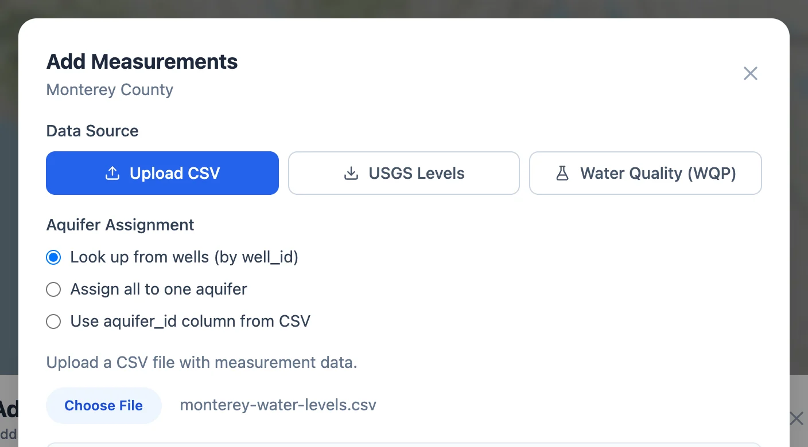
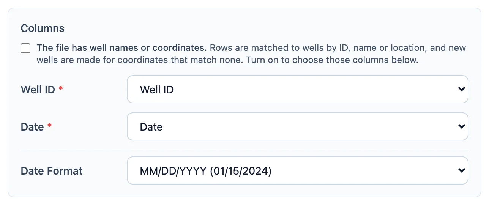
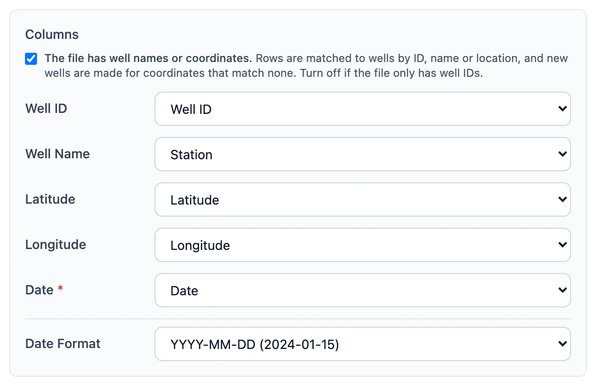
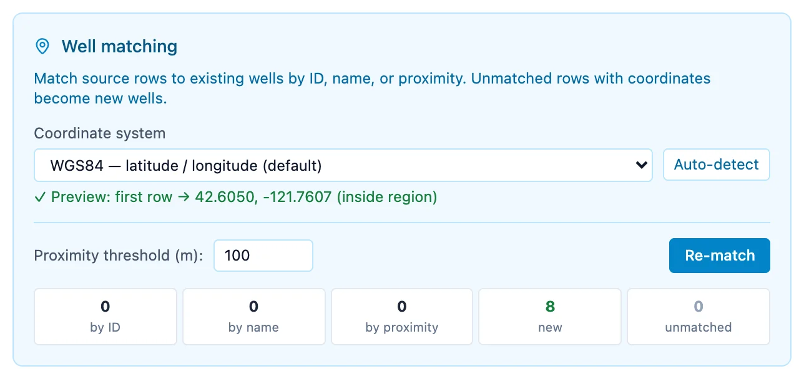
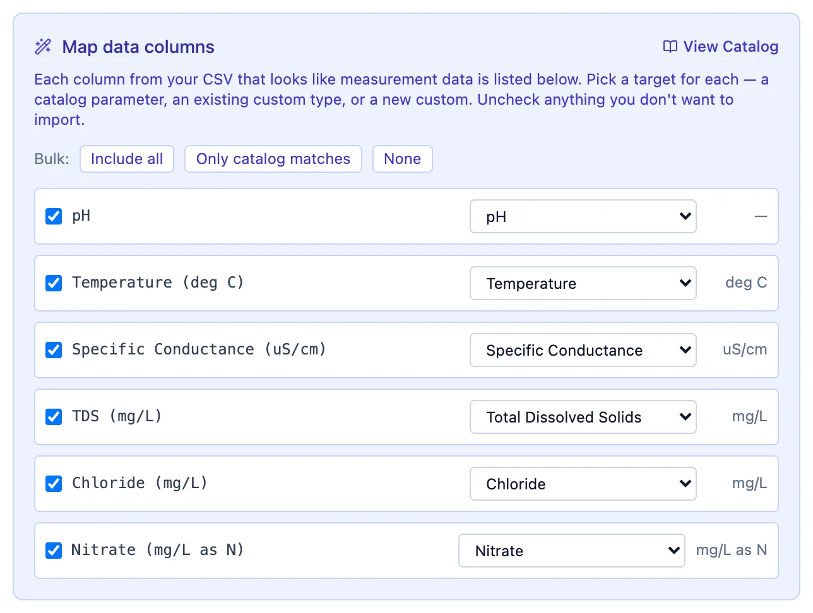
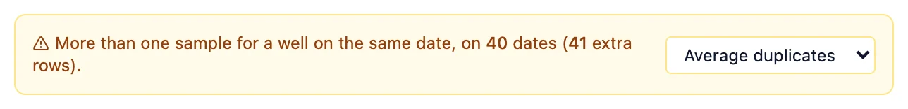
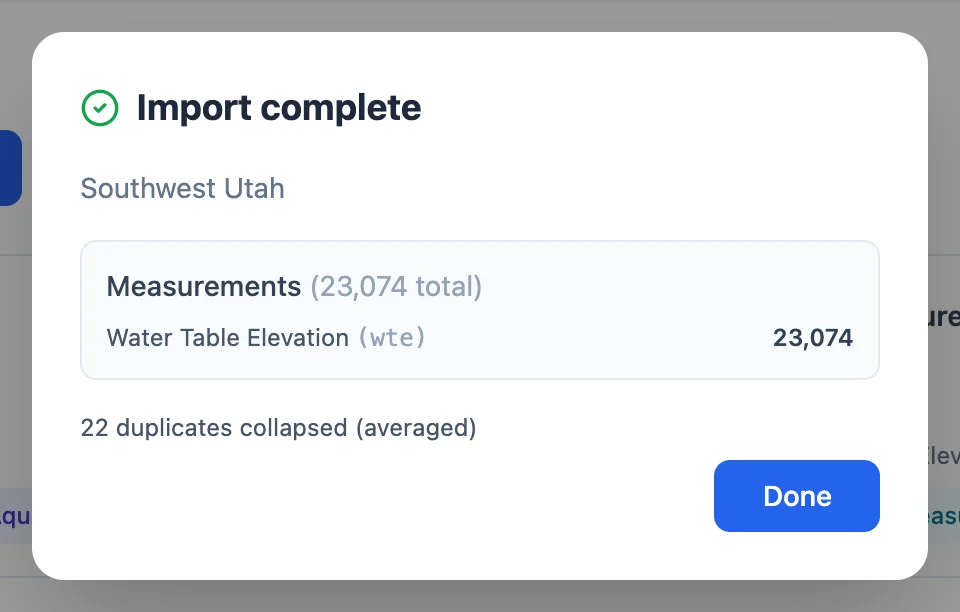

# Measurements

On the **Measurements** card of the Add Data window, **Add Measurements** opens a window with up to three sources:

- **Upload CSV**, for your own files
- **USGS Levels**, water levels for wells with USGS IDs, in a region in the United States that has wells
- **Water Quality (WQP)**, water quality results from the Water Quality Portal, in a region in the United States, covered on the
  [Water Quality](water-quality.md#downloading-from-the-water-quality-portal) page

A region with no wells can still take a measurements file, if the file has well names or coordinates: the import makes the wells.

{ width="704" }

## Uploading a measurements file

In a region with more than one aquifer, **Aquifer Assignment** comes first. **Look up from wells**, the default, gives each measurement
the aquifer of its well, and is almost always what you want. The other two choices put every measurement in one aquifer, or take the
aquifer from a column of the file.

**Choose File** then loads the CSV file, and the window fills in with the panels below. Each shows what the importer guessed, and you can
change any of it before **Save Measurements**.

### Columns

The **Columns** panel says which column holds the well, the date and, when there is one, the aquifer ID, with the **Date Format** read
from the first dates (see [Preparing Your Files](preparing-files.md#dates)).

{ width="644" }

The box at the top, **The file has well names or coordinates**, decides how rows find their wells:

- **Off:** the file has only well IDs, and each must match a well already in the region. Rows whose well is not found are listed in a
  warning and skipped.
- **On:** the panel adds the well name, latitude and longitude, and rows are matched to the region's wells by ID, name or location, as
  described next. Wells that match nothing are created.

The importer sets the box from the file: on when the region has no wells yet, or when the file has a name or coordinate column.

With the box on, the well ID is optional, since a name or a pair of coordinates can identify a well. This file of water quality samples
gives each well's ID in the Water Quality Portal, its name in a **Station** column, and its latitude and longitude.

{ width="644" }

### How rows find their wells

With the box on, the **Well matching** panel works out which well each row belongs to. It decides once for each well in the file, and
tries in order:

1. **By ID.** The well ID equals the ID of a well in the region. A USGS site number matches with or without its `USGS-` prefix.
2. **By name.** The name equals a well's name, ignoring capitals, spaces and punctuation.
3. **By proximity.** The coordinates are within the **Proximity threshold** of a well, 100 m unless you change it. The nearest well wins.
4. **New.** The coordinates match no well, so a well is made at that spot.
5. **Unmatched.** No ID or name match and no coordinates. These rows are skipped.

The coordinates go through the same **Coordinate system** picker as in [Add Wells](wells.md#coordinate-systems). The counts along the
bottom show how each well was matched. **Re-match** runs the matching again after you change the threshold or the coordinate system.

{ width="644" }

Proximity matches deserve a look, since two wells can stand close together. **Review proximity matches** lists each one with the
distance, and **Reject** turns a match into a new well.

A new well keeps the well ID from the file. When the file has none, the well gets an ID that starts with `aqx-`, made from its name and
location: a well named 011S001E23N001M at 36.9526° N, 121.8345° W becomes `aqx-011s001e23n001m-36.95N121.83W`. Its ground surface
elevation is looked up as for [uploaded wells](wells.md#ground-surface-elevation), and in a region with aquifers it goes to the aquifer
it falls inside. A new well that falls inside no aquifer is not made, and its rows are skipped.

New wells must keep to one well at each place in an aquifer (see
[Preparing Your Files](preparing-files.md#one-well-at-each-place)). When they would put two wells of one aquifer less than 10 m apart,
counting the region's wells, a red notice in the matching panel says how many places and wells there are, **Save Measurements** stays
off, and **Download the list of wells (CSV)** saves them. A new well inside more than one aquifer outline is refused the same way, since
its location cannot say which aquifer it is in; add such wells first with [Add Wells](wells.md#wells-at-one-place) and an Aquifer ID
column. Fix the file and choose it again.

### Data columns

Every column not used for the well, the date or the aquifer is listed in **Map data columns**. Each row has a box to include the column,
the type of data it will be saved as, and the unit of that type. The importer suggests the type from the column name:

- **Water Table Elevation** for names such as `value`, `wte`, `water level`, `elevation` or `head`
- **a catalog parameter** for its name, code or abbreviation, a chemical symbol such as `NO3` or `As`, or a close misspelling such as
  `Sulphate`
- **a custom type** already used in this region or another of yours

A column it cannot place is left unchecked. To import it, choose **+ New custom type** and give it a code, name and unit (see
[Water Quality](water-quality.md#custom-data-types)). **Include all**, **Only catalog matches** and **None** set every box at once,
and **View Catalog** lists the parameters with their units.

When a column name ends in a unit, such as `Nitrate (mg/L)`, and the unit differs from the catalog's, a warning appears under the row.
The app does not convert units, so convert the values before importing if they differ.

{ width="644" }

**Depth to water.** When a column is going in as water table elevation, a box under the list converts depth to water below the ground
into elevation: each value is subtracted from the well's ground surface elevation. Depths at wells without an elevation are skipped and
counted in the summary.

### Duplicates

When the file has more than one row for a well on the same date, a notice says how many, with a choice of what to keep: **Average
duplicates**, the default, **Keep maximum**, or **Keep all**. The report after saving lists each of them with the value it became (see
[Saving](#saving)).

{ width="644" }

In the Monterey County water levels, 40 well-dates have two or three readings, taken at different times of the day. At 34 of them
the readings are equal, and at the other 6 they differ by 0.05 ft or less.

### Measurements already in the region

When the region already has measurements of a type in the file, the window asks what to do with them. A measurement is the same one when
it is for the same well on the same date.

- **Add new only**, the default, keeps what is there and skips measurements the region already has.
- **Add and update** adds the new ones and overwrites the values of those it already has.
- **Replace all** deletes the region's measurements of those types and keeps only this import. The app asks you to confirm.

### Saving

{ align=right width="480" }

**Save Measurements** writes the measurements, any new wells and any new custom types, then shows a summary: wells created and matched,
measurements saved for each type, and duplicates collapsed. Below that it counts what was left out, with the reason: new wells outside
every aquifer, new wells a [Water Quality Portal download](water-quality.md#wells-at-one-place) left out at a place that has another
well, rows whose well could not be found, values that are not numbers, depths at wells without an elevation, and measurements
the region already had, which **Add new only** skips and **Add and update** overwrites.

**Download the details** saves those rows as a CSV file, one line each, with the row's number as a spreadsheet shows it, the well, date,
data type and value, and what happened to it: `averaged to 24.5`, `skipped`, `replaced 23.9`. In a file with blank lines, the numbers
fall behind the spreadsheet's by one for each blank line above the row, since the importer skips blank lines.

## Downloading water levels from the USGS

**USGS Levels** downloads the water levels the USGS has measured in the region's wells, or in one aquifer's wells with **Download Scope**.
It works for wells whose IDs are USGS monitoring location IDs, such as `USGS-373236113111401` from a
[USGS well download](wells.md#downloading-wells-from-the-usgs), or the same site number without the prefix. IDs of other agencies in the
same form, such as `AZ014-…`, work too. It needs the same API key as the well download.

The USGS reports depth to water below the land surface. The app converts each depth to a water table elevation with the well's ground
surface elevation, so measurements of wells without one are dropped.

After the download, a **Data Quality Report** counts the records received, kept and dropped. It lists what it fixed, such as dates with
no day, which it sets to the first of the month, and what it dropped: dates it could not read, impossible values, repeated measurements
on the same date, and wells without an elevation. **Data Range** gives the first and last dates, and **Trim** keeps only the measurements
between the dates you set.

To bring a region's USGS water levels up to date later, download again with **Add new only**, or with **Add and update** to also pick
up values the USGS has revised.
