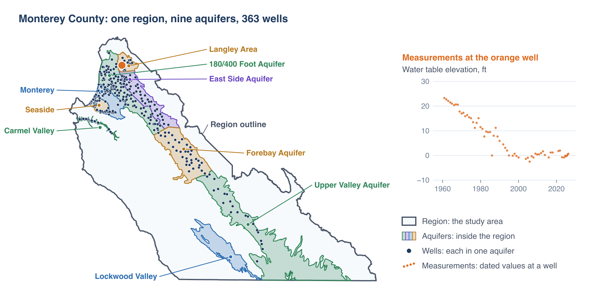
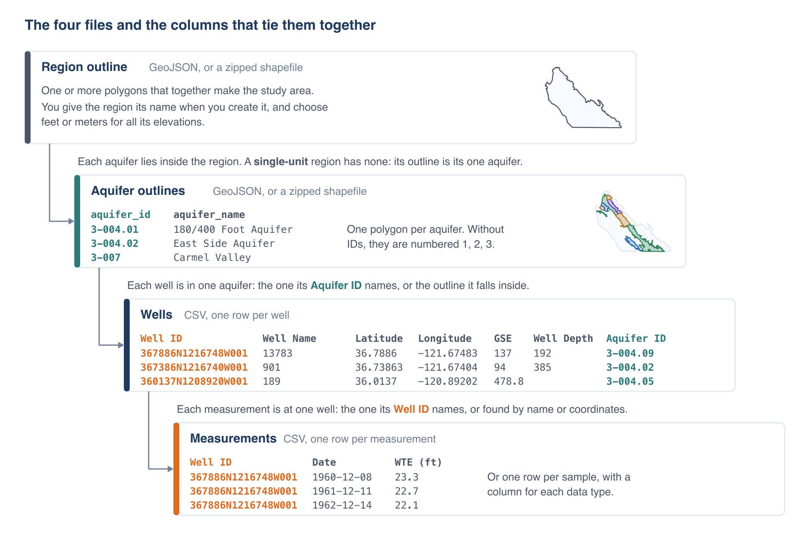

# Preparing Your Files

A region in Aquifer Analyst is built from four kinds of file: an outline of the region, outlines of the aquifers in it, a table of
wells, and tables of measurements. For regions in the United States, wells and measurements can also be downloaded from the USGS and
the Water Quality Portal instead (see [Wells](wells.md), [Measurements](measurements.md) and [Water Quality](water-quality.md)).

Column names in your files do not have to follow any convention. Each importer shows which column it will use for each field, guessed
from common names, and you can change any of them.

## How the files fit together



The region outline marks out the study area, and the aquifer outlines divide it into the aquifers you want to map and analyze
separately. Each well belongs to one aquifer, and each measurement is a dated value at one well, of one data type: a water table
elevation, a nitrate concentration, and so on. A single-unit region has no aquifer outlines, and its wells go straight into the region
(see [Regions and Aquifers](regions-aquifers.md#single-unit-or-with-aquifers)).



Two columns tie the tables to the outlines and to each other. A well's **Aquifer ID** names its aquifer, and a measurement's **Well ID**
names its well. The app can do without either: it can place each well in the aquifer whose outline it falls inside, and find each
measurement's well by name or coordinates, making a new well where none matches.

## Practice files

[aquifer-analyst-practice.zip](../../static/files/aquiferx/aquifer-analyst-practice.zip) holds the files the pictures in Part 2 come
from, so you can follow along in My Data. They make two regions in California from public data, neither of them in the Sample Data:

- **Monterey County**, a region with nine aquifers: the county's outline from the US Census Bureau, the outlines of the nine
  groundwater basins and subbasins in California DWR's Bulletin 118 that lie wholly inside it, 363 of DWR's monitoring wells with their
  ground surface elevations and, for 325 of them, their depths, and 70,268 water levels from 1916 to 2026.
- **Pajaro Valley**, a single-unit region: the outline of the Pajaro Valley subbasin, and 1,564 water quality samples from 161 wells,
  1971 to 2023, from the Water Quality Portal. Each row gives its well's ID, name, location and, for 103 of the wells, depth, and the
  import makes the wells from them.

The README.txt in the zip says where each file comes from.

## Outlines

The region outline and the aquifer outlines are polygons, in either of two formats:

- **GeoJSON** (`.geojson` or `.json`), with Polygon or MultiPolygon features
- **a zipped shapefile** (`.zip`) holding the `.shp`, `.shx` and `.dbf` files, and the `.prj` file that says what coordinate system
  the shapefile uses

A region outline can have more than one feature; together they make up the region. An aquifer file has one feature per aquifer, with an
attribute holding the aquifer's name and, if you have them, an attribute holding its ID.

The app keeps every outline in longitude and latitude (WGS 84). A zipped shapefile is converted from whatever system its `.prj` file
describes. GeoJSON is longitude and latitude by definition, but files saved by some older software name another system in a `crs`
member; the app converts those, looking the system up on [epsg.io](https://epsg.io){:target="_blank"} if it doesn't know it. A file
whose coordinates are plainly not longitude and latitude, and that does not say what they are, is refused with a message. Zip it as a
shapefile with its `.prj`, or reproject it in QGIS, and import it again.

## Tables

Wells and measurements come as CSV files: plain text, one row per line, with a header row naming the columns. Commas or tabs both work;
the app decides which from the header row. Spaces at the start and end of a cell are ignored, and a cell in quotes can hold a comma.

From Excel, use **Save As** and pick **CSV UTF-8**.

### Wells

| Field | Needed | What it holds |
|-------|--------|---------------|
| Well ID | yes | An identifier unique within the region |
| Well name | no | A name for labels and charts; the ID is used when there is none |
| Latitude | yes | Latitude, or the northing (Y) in a projected system |
| Longitude | yes | Longitude, or the easting (X) in a projected system |
| Ground surface elevation | no | In the region's unit; looked up from an elevation model when the file has none |
| Well depth | no | How far the finished well goes below the ground, in the region's unit; lets a map use the wells in a range of depths |
| Aquifer ID | no | Which aquifer each well is in; the app can work this out from the locations instead |

```
Well ID,Well Name,Latitude,Longitude,GSE,Well Depth,Aquifer ID
367886N1216748W001,13783,36.7886,-121.67483,137,192,3-004.09
367386N1216740W001,901,36.73863,-121.67404,94,385,3-004.02
360137N1208920W001,189,36.0137,-120.89202,478.8,,3-004.05
```

Coordinates in a projected system are converted when you import the file; [Wells](wells.md#uploading-a-wells-file) explains how to
pick the system.

### Measurements

A measurements file has a date and a value on each row, and a way to tell which well the value belongs to: a well ID that matches a
well already in the region, or a well name or coordinates, which the app matches to the wells it has or uses to make new ones.

The values can be laid out in either of two ways. In **long form**, each row holds one measurement:

```
Well ID,Date,WTE (ft)
367886N1216748W001,1960-12-08,23.3
367886N1216748W001,1961-12-11,22.7
367886N1216748W001,1962-12-14,22.1
```

In **wide form**, each row is one sample, with a column for each thing measured. Water quality data often comes this way:

```
Well ID,Station,Latitude,Longitude,Well Depth,Date,pH,Temperature (deg C),Specific Conductance (uS/cm),TDS (mg/L),Chloride (mg/L),Nitrate (mg/L as N)
USGS-365709121500401,011S001E23N001M,36.9525833,-121.8345,200,2013-02-05,7.2,17,210,147,10.7,0.458
USGS-365709121500401,011S001E23N001M,36.9525833,-121.8345,200,2018-04-04,7,17.5,233,177,12.1,0.497
USGS-365722121441601,011S002E22P001M,36.9562222,-121.7378056,300,2013-02-06,7.7,17,538,313,28.1,0.077
```

The importer offers every column it has not used for the well or the date as a column of data, and suggests what each one holds: water
level, one of the standard water quality parameters, or a new type of your own (see [Measurements](measurements.md#data-columns)). A
unit in parentheses after the name, as in `TDS (mg/L)`, helps it check that the values are in the unit the app expects.

**Water levels** are water table elevations, in the region's unit, measured from the same datum as the ground surface elevations. If your
file holds depth to water below the ground instead, the importer can convert it, using each well's ground surface elevation.

**Water quality values** must be in the unit the app uses for that parameter, listed in the [catalog](water-quality.md#the-catalog).
Convert them before importing if they are not, for example arsenic in mg/L to µg/L, or nitrate as the ion to nitrate as N.

**A value that is not a number**, such as `<0.05`, `ND`, `dry` or `12,5`, is skipped, and the summary after the import says how many
were and shows a few. If results below a detection limit matter to your work, decide how to record them and enter numbers before
importing. Write decimals with a point.

### Dates

Every date needs a day, month and year, all in one format throughout the file. The importer reads these formats:

| Format | Example |
|--------|---------|
| YYYY-MM-DD | `2024-01-15` |
| MM/DD/YYYY | `01/15/2024` |
| DD/MM/YYYY | `15/01/2024` |
| M/D/YYYY | `1/15/2024` |
| D/M/YYYY | `15/1/2024` |

A two-digit year is read as 1950 to 1999 from `50` to `99`, and 2000 to 2049 from `00` to `49`.

The importer guesses the format from the first dates in the file. A date such as `03/04/2020` could be either March 4 or April 3; if
any of the dates it looks at has a first number over 12, it reads the file as day first, and otherwise as month first. Check the
**Date Format** it picked before saving, and change it if your file puts the day first.

## Units

Each region measures lengths in feet or in meters, chosen when you create it. Ground surface elevations and water table elevations in your
files must be in that unit. Elevations the app looks up or downloads are converted to it. The unit can be changed only until the region
has wells.
