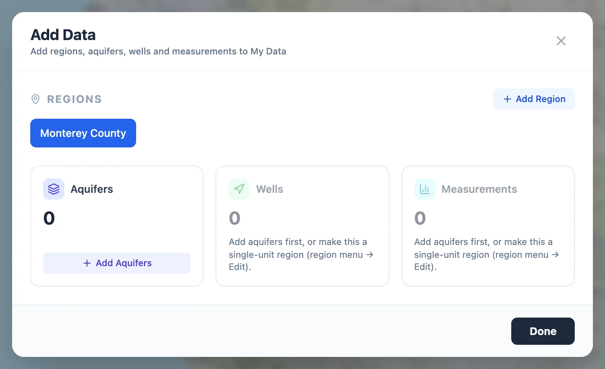
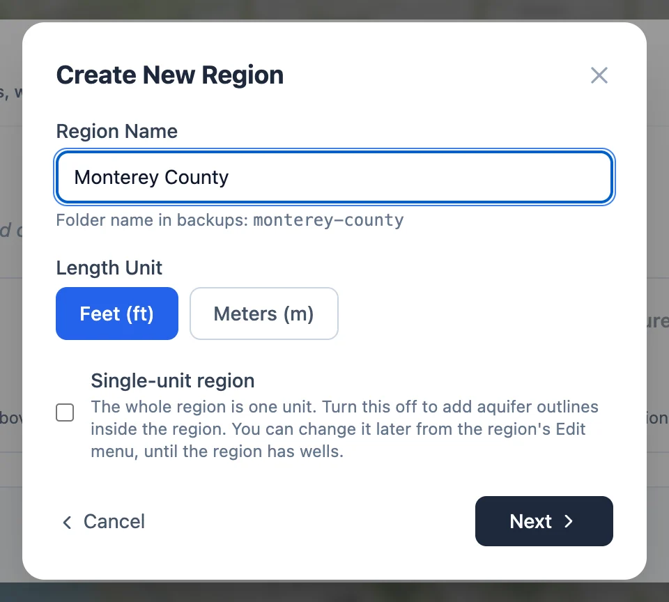
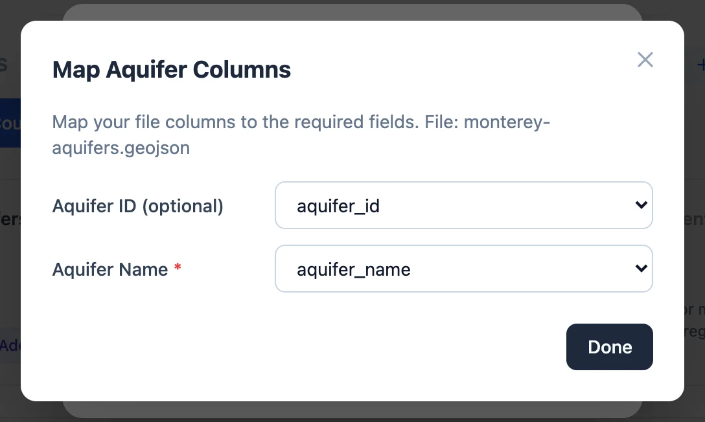
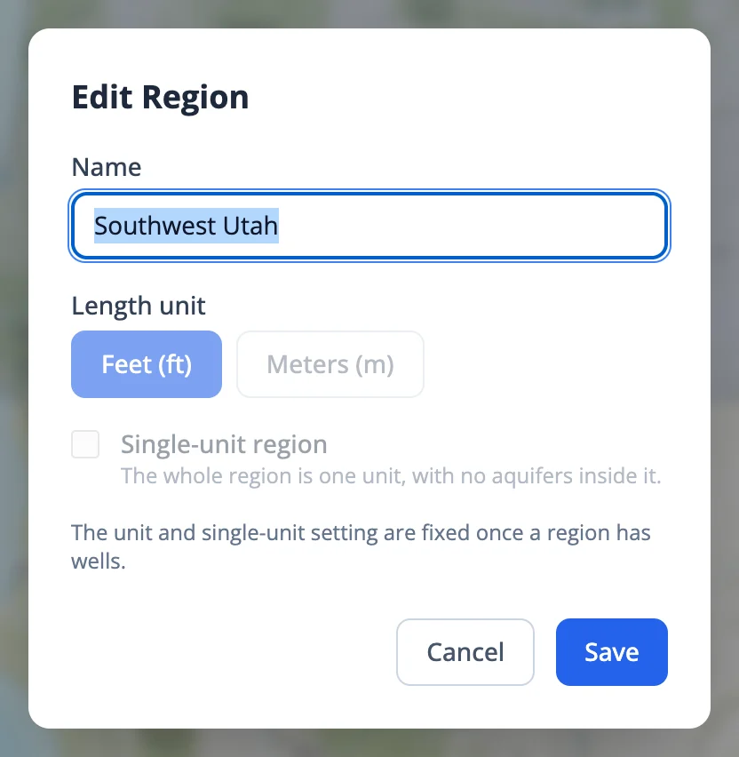

# Regions and Aquifers

## The Add Data window

Everything you add goes into My Data. Switch the panel to **My Data** and click **Add Data**, or **Add a region** while My Data is empty,
to open the **Add Data** window. To add to a Sample Data region, copy it to My Data first (see
[Sample Data and My Data](../start/my-data.md#copying-a-sample-region)).

{ width="800" }

The buttons along the top are your My Data regions. Click one to choose it, or **Add Region** to make a new one. The three cards below
add to the chosen region and show how many aquifers, wells and measurements it has, with the measurements broken down by data type.

A card that cannot be used yet is dimmed, with the reason under it:

- No region is chosen.
- **Aquifers** is unavailable in a single-unit region, which has no aquifers inside it.
- **Wells** and **Measurements** wait for aquifers in a region that is not single-unit, because each well has to belong to one.

The window only adds. Renaming and deleting are in the menus of the region tree, described [below](#changing-a-region).

## Creating a region

{ align=right width="480" }

**Add Region** opens **Create New Region**:

- **Region Name.** Any name. Under it is the name of the region's folder in backups and downloads, made from the name; if that is
  taken, a number is added.
- **Length Unit.** Feet or meters, for ground surface elevations, water table elevations, and the maps and storage figures computed from
  them.
- **Single-unit region.** On by default. See the next section.

**Next** asks for the outline, a GeoJSON file or a zipped shapefile (see [Preparing Your Files](preparing-files.md#outlines)).
**Create Region** saves the region and chooses it in the Add Data window.

### Single-unit or with aquifers

A **single-unit** region is one aquifer: its outline is also the aquifer's outline, and wells go straight into it. Use it for a study
area you treat as a whole, such as one basin.

Turn single-unit off when the region holds several aquifers, such as a state or a large river basin, and you want to explore and map each
one separately. The region then needs an aquifer file before it can take wells. Water table maps, storage change and gap filling all
work one aquifer at a time, so draw the aquifers the way you want those results divided.

Both choices, and the length unit, can be changed in **Edit** until the region has wells. After that they are fixed, because the wells
and measurements already saved depend on them.

## Adding aquifers

On the **Aquifers** card, **Add Aquifers** asks for a GeoJSON file or a zipped shapefile with one feature per aquifer. The **Map Aquifer
Columns** window then asks which attribute holds each aquifer's name, which is required, and which holds its ID, which is optional.
**Edit Column Mapping** opens it again. **Save Aquifers** adds them.

{ width="544" }

Aquifers without an ID are numbered 1, 2, 3 and so on, after the highest number already in use. Give your own IDs when your wells or
measurements files say which aquifer each row belongs to, so the two match.

When the region already has aquifers, the window asks what to do with them:

- **Append** adds the new aquifers and skips any whose ID the region already has.
- **Replace All** deletes every aquifer in the region, with all its wells and measurements, and saves the new ones in their place. The
  app asks you to confirm, and it cannot be undone.

### Aquifers at different depths

Wells at one place that draw from different depths, such as the shallow and deep zones of a layered aquifer, can stay in one aquifer,
and a water table map then uses one of them at each place (see [Preparing Your Files](preparing-files.md#wells-at-one-place)). To map
each depth, make each depth an aquifer of its own, with its own wells and water table maps.

Put the outline in the aquifer file once for each depth, as separate features with their own names and IDs, such as `Salinas 180 ft`
and `Salinas 400 ft`. Then add the wells from a file with an Aquifer ID column that gives each well the ID of its depth, and choose
**Use aquifer_id column from CSV** (see [Wells](wells.md#uploading-a-wells-file)). A well inside both outlines cannot be placed by its
location, so **Assign by location** refuses it, and a USGS or Water Quality Portal download leaves it out and lists it with its depth
(see [Wells](wells.md#wells-in-two-aquifers-in-a-download)). Give such wells an Aquifer ID and add them from a file.

A single-unit region has only one aquifer, so make a region that will be split by depth with single-unit off.

## Changing a region

{ align=right width="416" }

The menu of a My Data region in the tree, the three dots that appear when you point at it, has:

- **Edit.** Its name, length unit and whether it is single-unit. The unit and single-unit are fixed once the region has wells. Turning
  single-unit on removes the region's aquifers, and turning it off leaves the region with no aquifers until you add some.
- **Hide Region** and **Show Region.** Take the outline off the map and put it back.
- **Download.** The region as a zip file, in the layout of a backup.
- **Delete.** The region and everything in it, including saved water table maps and gap-filling models. It cannot be undone, so back up
  first if you might want any of it.

An aquifer's menu has **Rename** and **Delete**. Deleting an aquifer deletes its wells and their measurements too.
