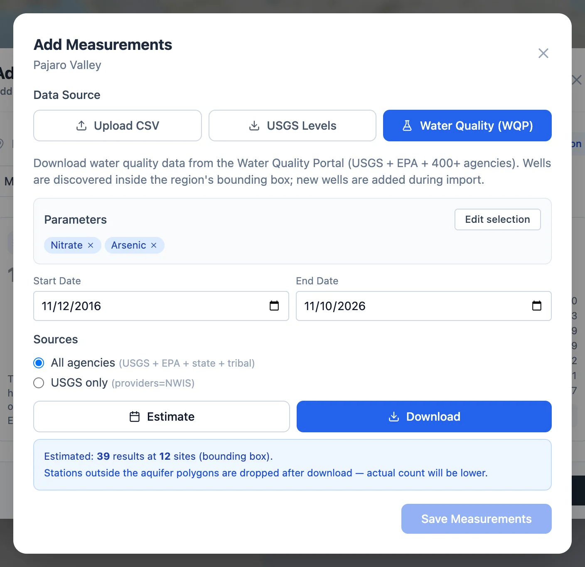
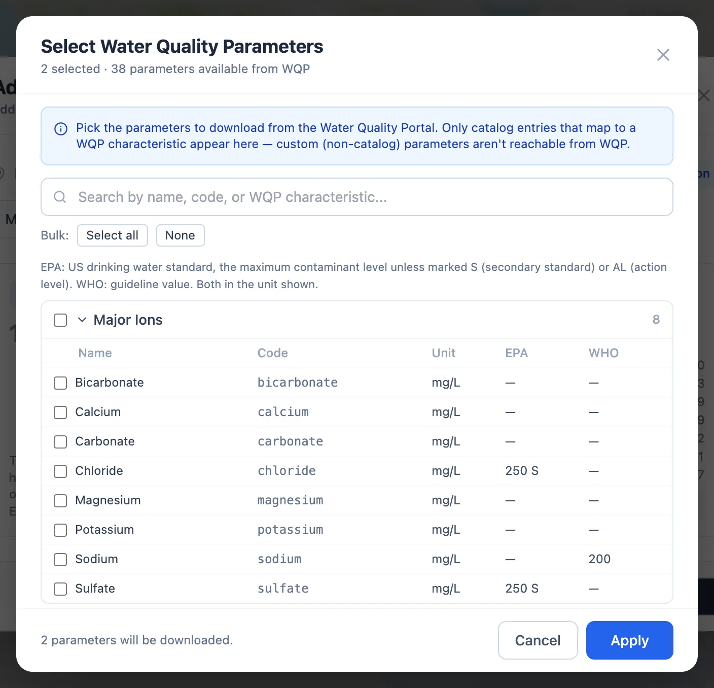

# Water Quality

## Data types

Every region has one built-in type of measurement, **water table elevation**, in the region's length unit. Anything else measured in a
well is another **data type**: one of the standard parameters in the app's **catalog**, or a **custom type** you define for a region. A
type belongs to a region once the region has measurements of it, and from then on it appears in the **Data type** list of the panel (see
[Exploring a Region](../start/exploring.md#data-types)). Each type's measurements are kept in their own file in the region,
`data_nitrate.csv` for nitrate.

## The catalog

The catalog holds 38 standard parameters, each with a fixed code and unit. Values in a file you import must already be in that unit,
since the app converts the units of [Water Quality Portal](#downloading-from-the-water-quality-portal) downloads but not of your own
files. **View Catalog** in Add Measurements and **Browse Catalog** in the Custom Data Types window list the parameters, with a search
box.

For reference, the catalog also gives the US EPA drinking water standard and the WHO guideline value where one exists, in the
parameter's unit. The EPA value is the enforceable maximum contaminant level unless it is marked **S**, a secondary standard set for
taste, odor or staining, or **AL**, the action level that calls for treatment of lead and copper.

| Group | Parameter | Code | Unit | EPA | WHO |
|-------|-----------|------|------|-----|-----|
| Physical | pH | `ph` | — |  |  |
|  | Temperature | `temperature` | deg C |  |  |
|  | Specific Conductance | `conductivity` | µS/cm |  |  |
|  | Turbidity | `turbidity` | NTU |  | 5 |
|  | Total Dissolved Solids | `tds` | mg/L | 500 S | 1000 |
|  | Hardness | `hardness` | mg/L |  |  |
| Nutrient | Nitrate | `nitrate` | mg/L as N | 10 | 11.3 |
|  | Nitrite | `nitrite` | mg/L as N | 1 | 0.91 |
|  | Ammonia | `ammonia` | mg/L as N |  |  |
|  | Phosphorus | `phosphorus` | mg/L as P |  |  |
|  | Total Nitrogen | `total_nitrogen` | mg/L as N |  |  |
|  | Total Phosphorus | `total_phosphorus` | mg/L as P |  |  |
| Major Ions | Calcium | `calcium` | mg/L |  |  |
|  | Magnesium | `magnesium` | mg/L |  |  |
|  | Sodium | `sodium` | mg/L |  | 200 |
|  | Potassium | `potassium` | mg/L |  |  |
|  | Chloride | `chloride` | mg/L | 250 S |  |
|  | Sulfate | `sulfate` | mg/L | 250 S |  |
|  | Bicarbonate | `bicarbonate` | mg/L |  |  |
|  | Carbonate | `carbonate` | mg/L |  |  |
| Minor Metals | Arsenic | `arsenic` | µg/L | 10 | 10 |
|  | Iron | `iron` | µg/L | 300 S |  |
|  | Manganese | `manganese` | µg/L | 50 S | 400 |
|  | Lead | `lead` | µg/L | 15 AL | 10 |
|  | Copper | `copper` | µg/L | 1300 AL | 2000 |
|  | Zinc | `zinc` | µg/L | 5000 S |  |
|  | Chromium | `chromium` | µg/L | 100 | 50 |
|  | Selenium | `selenium` | µg/L | 50 | 40 |
| Minor Non-metals | Fluoride | `fluoride` | mg/L | 4 | 1.5 |
|  | Boron | `boron` | µg/L |  | 2400 |
|  | Silica | `silica` | mg/L |  |  |
| Microbiological | E. coli | `e_coli` | CFU/100mL | 0 | 0 |
|  | Fecal Coliform | `fecal_coliform` | CFU/100mL |  |  |
|  | Total Coliform | `total_coliform` | CFU/100mL |  | 0 |
| Other | Dissolved Oxygen | `dissolved_oxygen` | mg/L |  |  |
|  | Alkalinity | `alkalinity` | mg/L |  |  |
|  | Biochemical Oxygen Demand | `bod` | mg/L |  |  |
|  | Chemical Oxygen Demand | `cod` | mg/L |  |  |

Nitrogen and phosphorus compounds are measured as the nitrogen or phosphorus they contain, the usual convention in the United States:
10 mg/L of nitrate as N is about 44 mg/L of the nitrate ion. The WHO sets its nitrate and nitrite values for the whole ion, 50 mg/L and
3 mg/L, which the table gives as N.

## Custom data types

A parameter the catalog does not have, such as trichloroethylene or a lab's own index, can be imported as a **custom type**. In **Map
data columns** of Add Measurements, set the column's type to **+ New custom type** and fill in:

- **Code.** Lowercase letters, digits and underscores, up to 20 characters, such as `tce`. It names the type's file and cannot be a
  catalog code.
- **Name.** As it appears in the Data type list and on charts.
- **Unit.** As it appears beside the name.

A custom type is created only by importing data for it. Once it exists, other regions' imports suggest it for columns with the same name,
so codes stay consistent across your regions.

The gear on the **Measurements** card of the Add Data window opens **Custom Data Types**, which lists the region's custom types. There
you can rename one, change its unit, or delete it along with all its measurements. Changing the unit changes only the label shown with
the values.

## Downloading from the Water Quality Portal

The [Water Quality Portal](https://www.waterqualitydata.us){:target="_blank"} (WQP) gathers results from the USGS, the EPA and more than
400 state, tribal and local agencies. For a region in the United States, the **Water Quality (WQP)** source in Add Measurements downloads
results for wells inside the region.

{ width="704" }

1. **Pick parameters** opens the list of catalog parameters the portal carries. Tick the ones you want and click **Apply**.
2. **Scope**, in a region with aquifers: all of them, or one.
3. **Start Date** and **End Date**: the last ten years unless you change them.
4. **Sources**: all agencies, or the USGS only.
5. **Estimate** asks the portal how many results and sites match. It counts the whole rectangle around the region, so the download, which
   keeps only wells inside the aquifer outlines, ends with fewer. A query over 250,000 results is refused; narrow the dates, the
   parameters or the scope.
6. **Download** fetches the results.

{ width="704" }

The portal's results come from many laboratories, reported in different units and often several to a sample. The download cleans them
in four steps:

- **Non-numeric results** are dropped. A result below the detection limit, which the portal reports as text, is lost this way.
- **Sample fraction.** Where the catalog prefers one fraction, results for the other, or with none given, are dropped. It keeps filtered
  results, which the portal labels **Dissolved**, for nitrate, nitrite, ammonia, phosphorus, the major ions, the metals, fluoride, boron
  and silica, and unfiltered results, labeled **Total**, for total nitrogen and total phosphorus.
- **Units.** Each result is converted to the catalog's unit: mg/L to µg/L, degrees Fahrenheit to Celsius, mS/cm to µS/cm, and nitrogen
  and phosphorus compounds reported as the ion (`mg/l asNO3`) to N or P. A result whose conversion is uncertain is dropped, such as
  nitrate in plain `mg/l`, which some laboratories report as N and others as the ion, or dissolved oxygen in percent saturation.
- **Duplicates.** Of the results left for a well, date and parameter, the first is kept.

A **WQP cleanup** note counts what was dropped at each step, and under **Details** lists the units converted and dropped.

The results then go through the [well matching](measurements.md#how-rows-find-their-wells) of an uploaded file, by ID only. A portal
site that is also a well in the region, such as one from a [USGS well download](wells.md#downloading-wells-from-the-usgs), matches it by
ID, and a USGS site number matches with or without its `USGS-` prefix. Every other site becomes a new well, with the portal's site ID,
which starts with the code of the agency that runs the site, and the well depth the portal gives, where it gives one. Matching by name
or proximity could join a nested well, at the place of a well in the region but at another depth, to that well's record.

A site inside more than one aquifer outline, as where an aquifer is split by depth, can't be placed by its location. Unless it is a well
the region already has, the download leaves it out with its results, as a [USGS well download](wells.md#wells-in-two-aquifers-in-a-download)
does, and **Download the list of wells (CSV)** saves those sites with their depths and an empty `aquifer_id` column. Add them with
**Add Wells** and their aquifer IDs, then download again: their results then match the wells by ID.

**Save Measurements** saves them, as for an upload.
