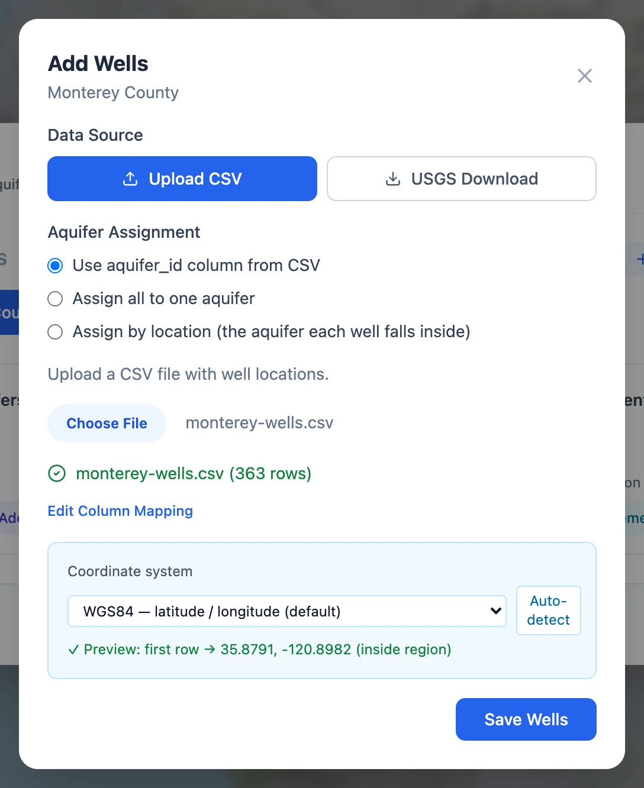
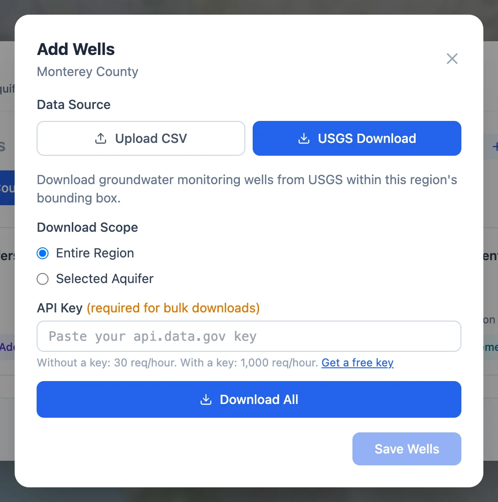

# Wells

On the **Wells** card of the Add Data window, **Add Wells** opens a window with two ways to add wells to a region in the United
States: **Upload CSV** and **USGS Download**. Elsewhere it takes an upload.

Wells can also come in with their measurements, when the measurements file has well names or coordinates (see
[Measurements](measurements.md#how-rows-find-their-wells)). A separate wells file is the better route when you have one, because it carries
your own well IDs and any surveyed ground elevations.

## Uploading a wells file

{ align=right width="380" }

1. **Aquifer Assignment.** In a region with more than one aquifer, choose how each well finds its aquifer:
    - **Use aquifer_id column from CSV**, when the file has a column of aquifer IDs matching the region's
    - **Assign all to one aquifer**, picked from a list
    - **Assign by location**, the aquifer whose outline the well falls inside

    A region with one aquifer puts every well in it, and a single-unit region needs no choice.

2. **Choose File.** Pick the CSV file. The **Map Well Columns** window asks which column holds the well ID, name, latitude, longitude,
   ground surface elevation and, with the first assignment choice, the aquifer ID. The ID, latitude and longitude are required.
   **Edit Column Mapping** opens it again.

3. **Coordinate system.** The panel converts the coordinates to latitude and longitude. Under the system in use, a preview shows where
   the first well lands, with a check mark when it is inside the region and a warning when it is not. See the
   [next section](#coordinate-systems).

4. **Ground surface elevation.** When the file has no elevation column, the app looks one up for each well (see
   [below](#ground-surface-elevation)).

5. **Save Wells.** Rows without a well ID or usable coordinates are skipped. In a region with aquifers, so are wells that end up in
   none of them, such as wells outside every aquifer outline when assigning by location; a notice above the elevation panel counts them
   before you save.

When the region already has wells, an **Import Mode** choice appears above the file:

- **Append** adds the wells in the file and skips any whose ID the region already has.
- **Replace All** deletes every well in the region, and all of the region's measurements, before saving the new wells. The app asks you
  to confirm.

### Coordinate systems

The menu starts at **WGS84 — latitude / longitude**, the usual choice, and also lists Web Mercator and the UTM zone the region lies in.
**Enter an EPSG code** takes the number of any other system, such as `26912` for NAD83 / UTM zone 12N, and **Look up** fetches its
definition from [epsg.io](https://epsg.io){:target="_blank"}.

When the first wells land outside the region, the app runs **Auto-detect** on its own. It tries, in order, latitude and longitude, the
systems in the menu, the UTM zone of the region's center, and the systems epsg.io lists for that spot, and keeps the first that puts most
of the first five wells in or near the region. Two systems can both pass that test, so if you know the system your coordinates are in,
choose it yourself, and look at the wells on the map after saving.

### Ground surface elevation

The ground surface elevation (GSE) of each well matters in three places: converting depths to water into water table elevations, the
USGS water level download, which needs it for the same conversion, and the **GSE** line on the chart.

When the file has no elevation column, the lookup starts once the well ID and coordinates are mapped and the coordinates land inside
the region. When every well is in the United States, it asks USGS 3DEP, about 10 m resolution, one well at a time. 3DEP can be slow, so a
well it has not answered within 30 seconds gets the Copernicus DEM value through Open-Meteo, about 90 m, and the panel says how many did.
Outside the United States, every well gets the Open-Meteo value. Values are converted to the region's unit.

**Save Wells** does not wait for the lookup: wells it has not reached yet are saved without an elevation. If the lookup fails, **Try
again** repeats it. An elevation from a model can be off by meters, more in steep terrain, so use surveyed elevations where you have
them.

## Downloading wells from the USGS

{ align=right width="380" }

**USGS Download** gets the groundwater sites the USGS Water Data service lists inside the region's aquifers, or inside one aquifer when
**Download Scope** is set to **Selected Aquifer**. Each well gets:

- its USGS monitoring location ID, such as `USGS-373236113111401`, as the well ID
- the USGS site name
- its location
- the land surface altitude the USGS gives for the site, converted to the region's unit, as its ground surface elevation

The USGS service limits how often it can be called. Without a key it allows 30 requests an hour, enough for a small area; with a free
key from api.data.gov, which **Get a free key** links to, it allows 1,000. Paste the key in **API Key**; the browser remembers it.

**Download All** fetches the wells and shows how many it found; **Save Wells** adds them. Once the region has USGS wells, **Refresh**
fetches the list again and keeps only wells the region does not have yet.

The download brings the wells without their measurements. Add those with **USGS Levels** in Add Measurements (see
[Measurements](measurements.md#downloading-water-levels-from-the-usgs)).

