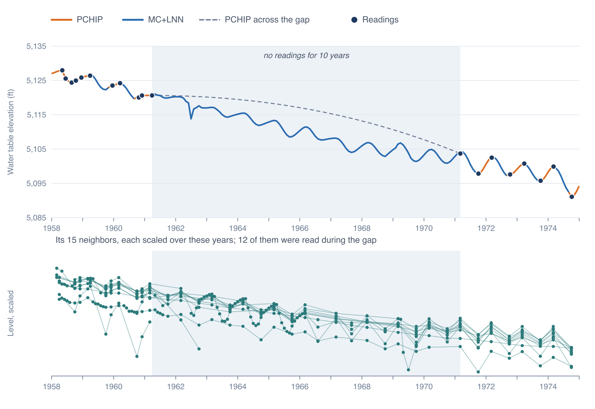

# Gaps in Well Records

A program measures a set of wells twice a year for a decade, loses its funding, and starts again years later with other wells; a well
goes dry or is replaced; a new monitoring network begins long after the old one stopped.
The records that result are runs of readings separated by gaps of months to decades, and they start and stop at different times.

In Escalante Valley-Beryl-Enterprise in the Utah sample, 213 of the 713 wells have five or more readings spread over five years or
more. Of those 213, 148 have a gap of more than two years somewhere in their record, 74 have no readings after 1957, and 35 were
read after 2020.

## Why gaps matter

The chart joins a well's readings with a PCHIP curve, and across a gap of years that curve is a smooth join that knows nothing of the
droughts, pumping seasons or recoveries in between (see [The Time Series Chart](../timeseries/chart.md#what-the-curve-can-tell-you)).
A water table map needs a value at each of its wells on the map's date, and a map made from the measurements reads that value off
the curve, so a gap carries straight into the maps. Before a well's first reading and after its last there is no curve. Such a map
holds the first or last reading for up to 10 years by default, and beyond that the well drops out. A run of maps over several decades
then draws each year from a different set of wells, and some of the change from one map to the next comes from wells joining and
leaving.

## What Impute Gaps does

**Impute Gaps** gives each well of an aquifer a value for every month, from the aquifer's first reading to its last, and saves the
series together as a model of the aquifer. Inside a well's record, a gap of less than 6 months keeps the PCHIP curve. A longer
gap is filled by MC+LNN, which estimates the well's level from other wells of the aquifer whose readings rise and fall with its own.
MC+LNN also extends the record before the first reading and after the last, up to a limit you set, 10 years to start with. Where it
cannot reach, the first or last reading is held.

(C-36-16) 3ddc- 1 in Escalante was not read between March 1961 and March 1971. The PCHIP curve crosses the gap in a smooth arc
(dashed). Twelve of the well's 15 neighbors, the wells whose readings track it most closely, were read during those years, and MC+LNN
carries their ups and downs into the gap. Most of the 17 ft decline comes in the first half of the decade, where the curve puts it
in the second, and the level rises and falls each year as the well's readings do after 1971.

You can open a model on the chart (see [Reading the Results](results.md)) and use it in place of the measurements for water table
maps (Part 5). Every well in the model has a value in every month the limit allows, so the same wells stay on the maps from one year
to the next.

Each run can also test the model on readings it never saw. It hides five years of readings from the middle of each well's record,
fills the well again without them, and compares MC+LNN and the PCHIP curve across the gap with the hidden readings. The chart gives
the result for each well and Get Info for the aquifer (see [Reading the Results](results.md#the-hidden-readings-check)).

[Running an Imputation](running.md) walks through the wizard, [How MC+LNN Works](method.md) gives the method in full, and
[Reading the Results](results.md) covers the chart and the saved model.

## How close the filled values come

A gap-filling method can be tested by hiding readings that exist, filling them, and comparing. Two tests did this with a Python copy
of the method, on every well with at least 8 readings that does not share its site with another well, in 51 aquifers of eight
regions: the three Sample Data regions and five others in the Caribbean, the Middle East and West Africa.

The first hid a stretch of 3 months, 6 months, 1, 2 or 3 years from the middle of each well's record, 16,494 stretches at 4,415
wells, and compared MC+LNN with the PCHIP curve across the gap the hiding left, at each hidden reading:

| Gap left by the hiding | Stretches | MC+LNN closer | PCHIP closer | Typical miss of MC+LNN, against PCHIP's |
|---|--:|--:|--:|--:|
| under 6 months | 1,319 | 46% | 54% | 8% larger |
| 6 to 12 months | 1,839 | 61% | 39% | 17% smaller |
| 1 to 2 years | 3,201 | 63% | 37% | 23% smaller |
| 2 to 3 years | 3,223 | 59% | 41% | 16% smaller |
| 3 to 5 years | 3,513 | 63% | 37% | 17% smaller |
| over 5 years | 612 | 57% | 43% | 11% smaller |

"Closer" compares the RMSE of the two methods over a stretch's hidden readings, and the typical miss is the median, over the
stretches, of MC+LNN's RMSE divided by PCHIP's. MC+LNN was scored on the 90% of hidden readings it could fill; at the others, both
methods are PCHIP. In gaps under 6 months PCHIP came out a little ahead, which is why Impute Gaps leaves those gaps to it, and from 6
months on MC+LNN was closer at 57 to 63% of the stretches.

The second test hid the first or the last 3, 5 or 10 years of each record, 24,354 stretches at 4,596 wells in 50 of the aquifers, and
compared MC+LNN with the nearest reading held. MC+LNN reached 55 to 58% of the hidden readings, since a well with fewer than 60
months of readings is extended only 12 months, and one with fewer than 12 not at all. Where it reached, it came closer than the held
reading at 53 to 56% of the stretches after the record, with a typical miss 5 to 8% smaller, and at 59 to 62% before it, 10 to 18%
smaller. Wells with long records did best: with 120 months of readings or more, MC+LNN was closer at 62% of the stretches after the
record and 69% before it.

The results varied from place to place. In the first test's gaps of more than a year, MC+LNN came closer at 73% of the stretches in
Utah, 65% in Oregon and 52% in Arizona, and in two of the other regions PCHIP came closer more often. The check each run makes gives the same comparison
for your own wells.

The app's MC+LNN leaves out the climate series the Python version can also read. With 3, 5 or 10 years hidden from the middle of
each record in the second test's wells, the version with soil moisture and the one without were each closer at about half the
stretches, with the same typical miss.

## What MC+LNN can and cannot know

MC+LNN learns, for each well, how its level followed its neighbors, the seasons and a steady trend over the months it was read, and
carries that into the gaps. That suits a well that rises and falls with the wells around it, through wet and dry years and the
pumping season. A change that reaches the well and not its neighbors, such as a new pump nearby or a recharge basin built beside it,
leaves no mark in the neighbors' records and does not show in the filled values. Where the neighbors themselves were not read, their
records are completed from the rest of the aquifer, and MC+LNN works from those estimates. Before the first reading and after the
last, MC+LNN drops the trend and follows the neighbors and the seasons.

### Limits of the method

- **A well needs readings in at least 12 months and neighbors that track it.** In Escalante, 58 of the 213 wells had fewer than 12
  months of readings, and they keep the PCHIP curve across every gap and their first and last readings held.
- **The series can step where MC+LNN hands over to PCHIP.** MC+LNN fills a long gap right up to the readings on either side, without
  being shifted to meet them (see [How MC+LNN Works](method.md#the-saved-series)).
- **R² and RMSE are measured at the months with readings.** There the neighbors were often read too, so the scores can make
  MC+LNN look better than it does in a long gap, where the neighbors may be estimates themselves. The hidden-readings check tests a long gap directly.
- **One neighbor's reading can move the estimate.** A lone or doubtful reading of a neighbor shows up in the wells it helps fill.
  Check your data for bad readings before you run Impute Gaps (see [Editing and Exporting](../data/editing.md)).

Treat the filled values as estimates. Look at the hidden-readings check in Get Info, and on the chart for the wells that matter most
to you, and compare the filled stretches with the readings on either side.
