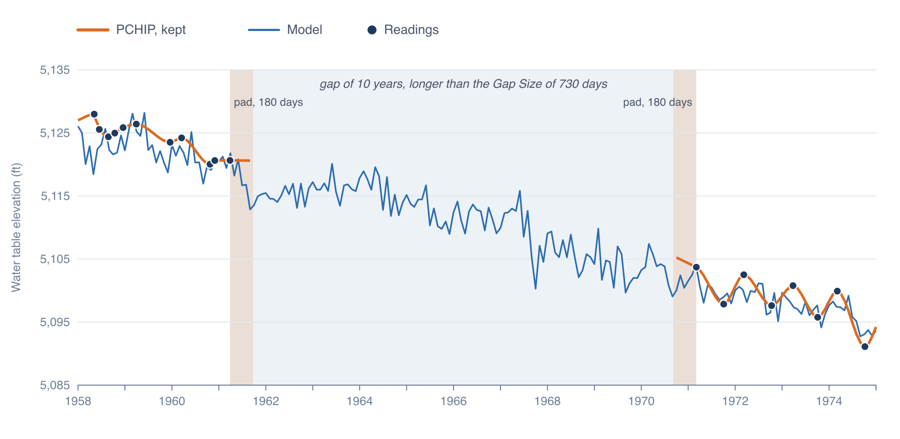

# How the Model Works

For each well, Impute Gaps reads the PCHIP curve through the readings at the first of each month where readings are close enough to
support it, trains an extreme learning machine (ELM) on those months, and fills the remaining months with the ELM. Every well is
trained on its own, against the same soil moisture series for the whole aquifer.

## The months

A model covers every month from December 1957 to the latest month of the soil moisture record, each represented by its first day. The
start is set by the soil moisture features below: the longest of them is a ten-year average, and the record begins in January 1948.

## The PCHIP months

For a well read at times *t*1 < … < *t*n, a month *m* takes the value of the well's PCHIP curve, *p*(*m*), the
same curve the chart draws (see [The Time Series Chart](../timeseries/chart.md#how-pchip-is-computed)), when two conditions hold:

- *t*1 ≤ *m* < *t*n: it lies between the first reading and the last.
- It is not inside a long gap. Where two readings in a row are more than the **Gap Size** *G* apart, the months from
  *t*k + *P* to *t*k+1 − *P* are left out, where *P* is the **Pad Size**. The curve still covers *P* at each end
  of the gap.

These are the well's training months, and the months where its saved series follows PCHIP. Every other month, inside long gaps and
before the first reading or after the last, gets the ELM's value.

(C-36-16) 3ddc- 1 in Escalante Valley-Beryl-Enterprise was read in March 1961 and not again until March 1971. With the defaults, PCHIP
carries the record 180 days into the gap from each end, and the model fills the nine years between.

## Soil moisture

The features come from NOAA CPC Soil Moisture version 2 (Fan and van den Dool, 2004): monthly soil moisture on a 0.5° grid from
January 1948 to about a month ago, in millimeters of water, computed by a one-layer water balance model driven by monthly precipitation
and temperature. GEOGLOWS publishes it as a cloud store that the app reads. Each aquifer uses the cell nearest its center, taken as the
average of the corners of its outline; if that cell is sea, the app takes the nearest cell with data, up to three cells away (about
150 km). Escalante Valley-Beryl-Enterprise uses the cell centered at 37.75° N, 113.75° W.

From the monthly series *s*(*m*) come five features: the month's value and its trailing averages over 1, 3, 5 and 10 years,

$$
\bar{s}_w(m) = \frac{1}{w} \sum_{j=0}^{w-1} s(m - j), \qquad w = 12,\ 36,\ 60,\ 120 \text{ months}
$$

The 10-year average first exists in December 1957, which is why a model starts there. The short averages follow wet and dry years,
and the long ones the slower swings that a deep water table can lag behind. Each feature is standardized over all the model's months,

$$
z(m) = \frac{x(m) - \bar{x}}{s_x}
$$

with *x̄* its mean and *s*x its sample standard deviation.

## The inputs of a month

Each month gives 19 inputs, the vector **x**(*m*):

- the five standardized soil moisture features;
- the year, scaled from 0 in 1957 to 1 in the last year, (*Y* − *Y*min) / (*Y*max − *Y*min), which
  lets the model follow a steady rise or decline;
- twelve month indicators, 1 for the month and 0 for the others, which let it learn the seasonal pattern;
- a constant 1.

The well's PCHIP values are standardized the same way, with the mean *μ* and sample standard deviation *σ* of its own training months:
*y*(*m*) = (*p*(*m*) − *μ*) / *σ*.

## The extreme learning machine

An extreme learning machine (Huang et al., 2006) is a neural network with one hidden layer whose hidden weights are never trained.
Each of its 500 hidden units takes a weighted sum of the 19 inputs, adds an offset, and passes the result on if it is positive:

$$
\mathbf{h}(m) = \max\left(0,\ \mathbf{W}^\mathsf{T} \mathbf{x}(m) + \mathbf{b}\right)
$$

The 19 × 500 weights **W** and the 500 offsets **b** are drawn at random from a standard normal distribution, once for each well. Each
unit is a random mix of soil moisture, year and season that switches on for part of the record. The model's output is a weighted sum
of the units, **h**(*m*)T**β**, and the 500 output weights **β** are the only thing fitted. With the units of the *n*
training months stacked in an *n* × 500 matrix **H** and their standardized values in **y**, they come from ridge regression,

$$
\boldsymbol{\beta} = \left(\mathbf{H}^\mathsf{T}\mathbf{H} + \lambda \mathbf{I}\right)^{-1} \mathbf{H}^\mathsf{T} \mathbf{y},
\qquad \lambda = 100
$$

solved in one step by Cholesky factorization. The penalty *λ* keeps the weights small. Without it, a unit that is active in only one or
two training months but in many months of a gap could take a large weight to fit those months and send the gap's values far off.

The fitted model gives a value for every month of the span, which is put back in the well's units:

$$
e(m) = \mu + \sigma\, \mathbf{h}(m)^\mathsf{T} \boldsymbol{\beta}
$$

The Python notebook the app's method comes from left the last two hidden units out of the penalty. Since November 2026 the app
penalizes every unit, because that pair now and then sent a well far off: refitting one Escalante well 500 times, the pair sent it
as far as 2,491 ft beyond its readings, and with every unit penalized it never went more than 22 ft.

## The saved series

Each month of the saved series is the PCHIP value where the month is a training month, and the ELM's value otherwise:

$$
v(m) = \begin{cases} p(m) & \text{in a training month} \\ e(m) & \text{otherwise} \end{cases}
$$

The two are not blended, so where the series passes from one to the other it steps by the difference between them. In the
Escalante model in the Utah sample, half of the 396 steps are under 1.3 ft, one in ten is over 7.5 ft, and the largest is 31 ft.

Each month's ELM value depends on that month's inputs alone, with nothing to tie it to the month before, so the model's series is
rougher than the PCHIP curve. Across Escalante the median change from one month to the next is 0.3 ft for the model and 0.2 ft for
PCHIP; at (C-36-16) 3ddc- 1 it is 1.4 ft for the model, as the figure above shows.

The model file keeps the PCHIP and ELM values of every month as well as the saved series, so the chart can show them apart (see
[Reading the Results](results.md)).

## The fit statistics

Each well's R² and RMSE compare the ELM with the PCHIP values over its training months, in the region's length unit:

$$
R^2 = 1 - \frac{\sum_m \left(p(m) - e(m)\right)^2}{\sum_m \left(p(m) - \bar{p}\right)^2}, \qquad
\text{RMSE} = \sqrt{\frac{1}{n} \sum_m \left(p(m) - e(m)\right)^2}
$$

They measure how closely the model reproduces the months it learned from. With 500 hidden units it follows even a short record
closely: in Escalante, the 44 wells with fewer than two years of training months have a median R² of 0.93, and a well trained on
6 months reaches 0.93 with an RMSE of 0.03 ft. A high R² says little about the values in the gaps.

## Runs differ

**W** and **b** are drawn afresh in every run, so the same aquifer and settings give somewhat different values in the gaps, and
slightly different R² and RMSE. Between two runs on Escalante, the median change in a gap month was 0.2 ft; the largest change at each
well was over 2.5 ft at half the wells and over 12 ft at one in ten.

## References

Evans, S., Williams, G. P., Jones, N. L., Ames, D. P., and Nelson, E. J. (2020). Exploiting Earth observation data to impute
groundwater level measurements with an extreme learning machine. *Remote Sensing*, 12(12), 2044.

Fan, Y., and van den Dool, H. (2004). Climate Prediction Center global monthly soil moisture data set at 0.5° resolution for 1948 to
present. *Journal of Geophysical Research*, 109, D10102.

Huang, G.-B., Zhu, Q.-Y., and Siew, C.-K. (2006). Extreme learning machine: theory and applications. *Neurocomputing*, 70(1–3),
489–501.
