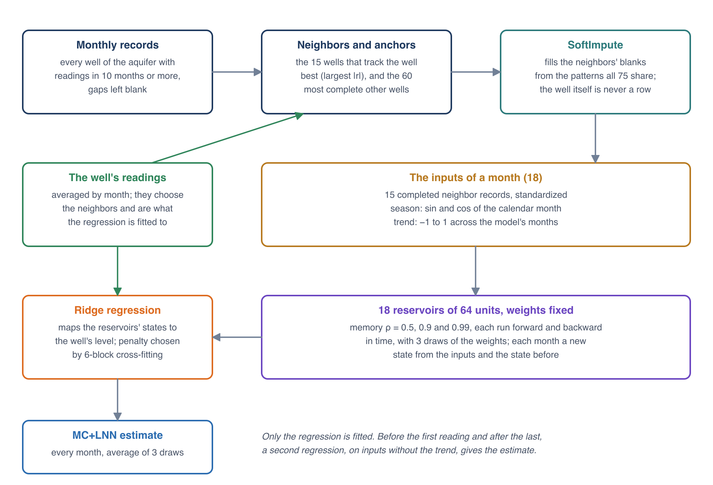

# How MC+LNN Works

Impute Gaps fills each well from the wells around it. For every well it picks the 15 wells whose readings rise and fall most
like its own, completes their records together with the aquifer's most complete wells, and feeds them month by month through
fixed networks of random units (reservoirs) that keep a fading memory of what they have seen. A ridge regression fitted to the
well's own readings turns the reservoirs' states into a water level for every month. Only that regression is fitted, so a well
takes seconds. MC+LNN stands for the two parts: matrix completion (MC) and a liquid neural network (LNN), the kind of reservoir
used here.

The app's MC+LNN is a TypeScript copy of a Python implementation and gives the same values to rounding. The Python version also
reads climate series (soil moisture and drought indices); the app leaves them out, which left the fills as close to hidden readings
as before (see [Gaps in Well Records](gaps.md#how-close-the-filled-values-come)).

## The monthly records

A model has one value per month, from the month of the aquifer's first reading to the month of its last. Each well's readings
within a calendar month are averaged, giving the well a row of monthly levels with blanks where it was not read. Every well of the
aquifer with readings in at least 10 months goes into this monthly matrix, whether or not it is one of the wells to fill, because
any of them can be another well's neighbor.

A well to fill needs at least 12 months with readings for MC+LNN, since its regression is tested on six blocks of them (see
[The readout](#the-readout)). A well with fewer, or with no neighbors, keeps the readings' PCHIP curve and its first and last
readings held (see [The saved series](#the-saved-series)).

## Neighbors

For a well *i*, every other well *j* of the matrix is scored by the correlation of their monthly levels over the months both were
read,

$$
r_{ij} = \frac{\sum_t (x_{it} - \bar x_i)(x_{jt} - \bar x_j)}{\sqrt{\sum_t (x_{it} - \bar x_i)^2 \sum_t (x_{jt} - \bar x_j)^2}}
$$

with the sums and means over those shared months. A well needs at least 8 shared months to be scored. The 15 wells with the
largest |*r*| are the neighbors. The sign does not matter, because the regression can turn a neighbor that falls when the well
rises into a rise. Distance plays no part: a well 20 km away that tracks the well closely ranks above one next door that does
not.

## Completing the neighbors' records

The neighbors have gaps of their own. Before they can describe every month of the well, those gaps are filled by matrix
completion, which estimates a missing entry from the pattern the wells share.

Each neighbor's record has its gaps of up to 24 months filled with PCHIP through its monthly levels; longer gaps and the months
before its first reading and after its last stay empty. The 60 most complete other wells of the aquifer, the anchors, are prepared
the same way and added, because they are often read in months the neighbors missed. Each row is standardized by its own mean and
standard deviation, so that a deep well and a shallow one count alike. The result is a matrix **X** of at most 75 wells by the
model's months, with the well being filled never among its rows.

SoftImpute (Mazumder et al., 2010) fills the empty entries with a low-rank matrix: one in which every well's standardized record
is a mix of a few patterns common to the aquifer. Starting with zeros in the empty entries, it repeats

$$
\mathbf{Z} = \mathbf{U}\,\max(\mathbf{S} - \lambda, 0)\,\mathbf{V}^\mathsf{T},
\qquad x_{jt} \leftarrow z_{jt} \text{ where } x_{jt} \text{ is empty}
$$

where **U S V**T is the singular value decomposition of the current matrix and λ is one fiftieth of the largest singular
value of the first one. Lowering every singular value by λ and dropping those below it keeps the strong common patterns and leaves
out the weak ones. It stops when the empty entries change by less than 0.1% from one pass to the next, or after 100 passes. The
anchors are then set aside, and the 15 completed neighbor records, *c*1(*t*) … *c*15(*t*), go on.

## The inputs of a month

Each month *t* gives the reservoirs an input vector **u**t:

- sin(2π*m*/12) and cos(2π*m*/12), with *m* the calendar month from 1 to 12, so the seasons follow one another around a circle;
- a trend τ that runs in a straight line from −1 in the model's first month to 1 in its last;
- the 15 completed neighbor records, standardized.

That is 18 inputs, fewer where a well has fewer than 15 neighbors. A second set without the trend, 17 inputs, is used for the
months before the well's first reading and after its last (see [Beyond the record](#beyond-the-record)).

## The reservoirs

A reservoir is a network of 64 units whose weights are drawn at random once and never trained. Each month it takes the inputs and
its own state of the month before:

$$
\begin{aligned}
\mathbf{z}_t &= \tanh\left(\mathbf{W}_\text{in}\,\mathbf{u}_t + \mathbf{W}\,\mathbf{h}_{t-1} + \mathbf{b}\right) \\
\mathbf{g}_t &= \sigma\left(\mathbf{A}\,\mathbf{z}_t + \mathbf{c}\right) \\
\mathbf{h}_t &= \mathbf{g}_t \odot \mathbf{h}_{t-1} + (1 - \mathbf{g}_t) \odot \mathbf{z}_t
\end{aligned}
$$

with **h**0 = 0, σ the logistic function and ⊙ the product element by element. **z**t is the units' response
to this month, and the gate **g**t decides, unit by unit, how much of the old state each keeps. Because the gate depends
on the input, so does how long the reservoir remembers, which is what makes it "liquid". The weights are drawn as:

- **W**in, 64 × the number of inputs, uniform on [−0.5, 0.5];
- **W**, 64 × 64, standard normal, scaled so that its largest eigenvalue has size ρ;
- **b**, uniform on [−0.2, 0.2];
- **A**, 64 × 64, normal with standard deviation 1/8;
- **c**, logit(ρ) plus a number uniform on [−0.5, 0.5].

A unit's gate is centered on about ρ, so ρ sets roughly how much of its state a unit keeps from one month to the next. The app runs
three settings, ρ = 0.5, 0.9 and 0.99, for memories of a few months, about a year and several years. Each runs forward through the
months and, with weights of its own, backward from the last month to the first, so that a month in a gap is described by what
follows it as well as by what came before. Three settings, two directions and three draws of the weights make 18 reservoirs.

The weights come from fixed random seeds, so they are the same in every run: the same readings and settings always give the same
model.

## The readout

For each of the three draws, the states of its six reservoirs and the inputs themselves are put side by side, 6 × 64 + 18 = 402
numbers for a month, the features **f**t. A ridge regression maps them to the well's monthly level. It is fitted on the
months the well was read, with each feature standardized over those months and the levels *y*t centered on their mean
*ȳ*:

$$
\hat y_t = \bar y + \tilde{\mathbf{f}}_t^\mathsf{T}\mathbf{w}, \qquad
\mathbf{w} = \left(\tilde{\mathbf{F}}^\mathsf{T}\tilde{\mathbf{F}} + \alpha \mathbf{I}\right)^{-1} \tilde{\mathbf{F}}^\mathsf{T}(\mathbf{y} - \bar y)
$$

where **F̃** stacks the standardized features of the read months. The penalty α is chosen from 1, 10, 100, 1,000 and 10,000 by
cross-fitting: the read months are split, in time order, into six blocks of nearly equal size; each block is predicted by a regression
fitted on the other five; and the α whose predictions miss the readings least, in mean squared error over all six blocks, is kept.
The regression is then fitted on all the read months with that α and gives a value for every month. In the read months, the value
kept is the one predicted when that month's block was left out, so it shows how well the regression does on readings it was not
fitted to.

The well's MC+LNN estimate is the average of the three draws' predictions,

$$
e(t) = \tfrac{1}{3}\left(\hat y^{(1)}_t + \hat y^{(2)}_t + \hat y^{(3)}_t\right)
$$

## Beyond the record

The trend input lets the regression follow a steady rise or fall inside the record. Carried decades past the readings, a fitted
trend keeps going, so the months before a well's first reading and after its last use a second readout, fitted the same way on
inputs without the trend: the season and the neighbors. Past the record the neighbors carry the well, and a neighbor that was
also not read then is carried by the completion.

How far MC+LNN reaches depends on how much the well was read. A well with readings in 60 months or more is filled as far as the
**Fill beyond each record** limit allows. A well with fewer is filled by MC+LNN for 12 months beyond its record, and its first or
last reading is held for the rest of that limit.

## The saved series

Each month of a well's saved series takes one of three values:

- **PCHIP**, the readings' curve (the one the chart draws, see
  [The Time Series Chart](../timeseries/chart.md#how-pchip-is-computed)) on the first of the month, in every month inside the
  record that has a reading or lies in a gap of less than 6 months (183 days) between two readings;
- **MC+LNN**, the estimate *e*(*t*), in the months inside a gap of 6 months or more, and before and after the record as far as
  MC+LNN reaches;
- **the held reading**, the first reading before the record and the last after it, where MC+LNN does not reach.

The series runs from the limit before the first reading to the limit after the last, within the model's months, and the well has no
value outside it. A well MC+LNN cannot fill has PCHIP inside its record and held readings outside it.

MC+LNN fills a long gap right up to the readings on either side, and its estimate is not shifted to meet them, so the series can
step where it hands over to PCHIP. At the 6,857 such places in the Escalante model, the series changes by 0.76 ft at the median and
by more than 3.3 ft at one in ten, against 0.27 ft and 1.7 ft from one month to the next elsewhere. A well read once a year has two
such places a year, on either side of the month with the reading.

The estimate follows the completed neighbor records month by month, so a lone reading of a neighbor can show up in it. In the
1961 to 1971 gap of (C-36-16) 3ddc- 1 in Escalante (see the figure in [Gaps in Well Records](gaps.md#what-impute-gaps-does)), the
estimate dips by about 4 ft in July 1962, the month of the only 1962 reading of a neighbor, (C-35-16)33bdc- 2, whose next reading
came in 1978.

The model file keeps, for each well, the saved series, how each month was filled, and MC+LNN's estimate *e*(*t*) for every month,
so the chart can show the estimate apart (see [Reading the Results](results.md)).

## The fit statistics

Each well's R² and RMSE compare MC+LNN's estimate with the monthly levels over the months the well was read,

$$
R^2 = 1 - \frac{\sum_t \left(y_t - e(t)\right)^2}{\sum_t \left(y_t - \bar y\right)^2}, \qquad
\text{RMSE} = \sqrt{\frac{1}{n} \sum_t \left(y_t - e(t)\right)^2}
$$

in the region's length unit. In those months *e*(*t*) is the cross-fitted value, predicted with that stretch of the record left
out, so the statistics score the regression on readings it was not fitted to. The neighbors were often read in those months too,
though, and in a long gap they may not have been. The hidden-readings check tests the gaps more directly.

## The hidden-readings check

With **Check** ticked in the wizard, each run also tests every well it can on readings it hides:

1. The hidden stretch is five years centered on the well's middle reading (the median of its reading dates).
2. The well is checked when it has at least 5 readings before the stretch and 2 after it, at least 3 readings inside it, and
   MC+LNN can fill it.
3. The months with hidden readings are blanked in the well's record, and MC+LNN fills the well again. The other wells' records are
   unchanged, and the neighbors are chosen again from the readings that remain.
4. Each hidden reading is compared with that MC+LNN estimate in its month, and with the PCHIP curve through the other readings,
   which crosses the stretch.

For the *k* hidden readings *w*i, at times *t*i,

$$
\text{RMSE}_\text{MC+LNN} = \sqrt{\frac{1}{k}\sum_{i=1}^{k}\left(e'(t_i) - w_i\right)^2}, \qquad
\text{RMSE}_\text{PCHIP} = \sqrt{\frac{1}{k}\sum_{i=1}^{k}\left(p'(t_i) - w_i\right)^2}
$$

where *e*′ and *p*′ are made without the hidden readings. Both are saved with the well, and Get Info gives for the aquifer how many
wells were checked, at how many MC+LNN came closer, and the median of each RMSE. In the Sample Data models:

| Aquifer | Wells filled | By MC+LNN | Wells checked | MC+LNN closer | Median RMSE, MC+LNN | Median RMSE, PCHIP |
|---|--:|--:|--:|--:|--:|--:|
| Escalante Valley-Beryl-Enterprise | 213 | 155 | 109 | 87 | 1.47 ft | 2.39 ft |
| East Shore Area | 152 | 135 | 91 | 70 | 2.05 ft | 3.59 ft |
| Central Sevier Valley | 45 | 43 | 21 | 14 | 1.26 ft | 1.78 ft |
| Williamson | 21 | 20 | 15 | 12 | 1.52 ft | 2.29 ft |

The check covers a long gap in the middle of a record. How MC+LNN does before a well's first reading and after its last, against
the reading held, is in the test in [Gaps in Well Records](gaps.md#how-close-the-filled-values-come). The check roughly doubles the
time a run takes, and leaving it unticked saves the model without it.

## References

Mazumder, R., Hastie, T., and Tibshirani, R. (2010). Spectral regularization algorithms for learning large incomplete matrices.
*Journal of Machine Learning Research*, 11, 2287–2322.
