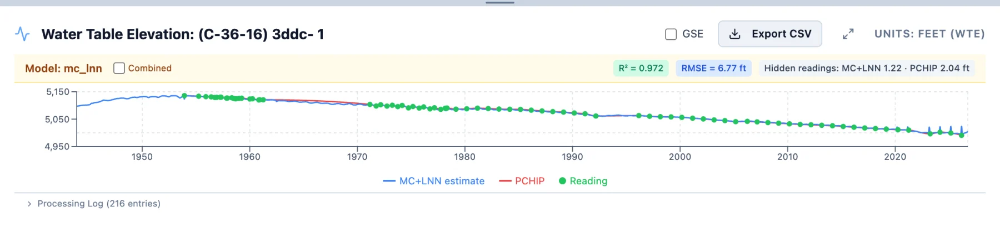
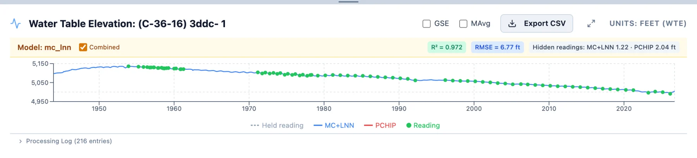

# Reading the Results

## Opening a model

A saved model appears in the tree under its aquifer, beside the aquifer's water table maps. In the Utah sample, Escalante
Valley-Beryl-Enterprise, East Shore Area and Central Sevier Valley each have one named `elm`, built with the default settings, and so
does Williamson in the Oregon sample. Click a model to open it and again to close it; a dot marks the open one. Pointing at it shows
its dates, gap size, how many wells it models and when it was made.

With a model open and one well selected, the chart shows the model's series for that well in place of its readings. A band across the
top names the model, holds the **Combined** checkbox, and gives the well's R² and RMSE (see
[How the Model Works](method.md#the-fit-statistics)) and the result of its hidden-readings check (below). A well the model left out
shows *No model data for this well*, and with two or more wells selected the chart goes back to the readings.

## The parts apart

With **Combined** unchecked, as it is when a model opens, the chart shows the pieces of the model: the PCHIP curve in red over the
well's training months, the ELM in blue over every month of the span, as fitted and before the shift, and the readings as green
dots. A reading inside the span sits on
the nearest first of the month, and readings from before December 1957 keep their dates, so the axis reaches back to them. Where the
blue line runs along the red one, you can see how closely the model follows the record; in the gaps, the blue line alone is the
model's guess.

(C-36-16) 3ddc- 1 in Escalante was read 82 times from 1953 to 2026, with gaps from 1961 to 1971 and from 1992 to 1996. Its model has
an R² of 0.998 and an RMSE of 1.75 ft, and over the training months the blue line keeps close to the red, a few feet either side,
rougher than the curve through the readings.

## The saved series

With **Combined** checked, the chart shows the series the model saved: red where it follows PCHIP and blue where it takes the ELM,
shifted to meet the red at each end (see [How the Model Works](method.md#the-saved-series)). At 3ddc- 1 the blue fills October 1961 to
September 1970 and October 1992 to September 1995, and the months of 2026 after the final reading. Next to the blue line of the
other view, the 1960s stretch is raised by 2.5 ft at its start, growing to 4.9 ft at its end, and the 1990s stretch lowered by
2.8 ft, easing to 0.5 ft.

The chart's controls change while a model is on the chart:

- **MAvg** draws a moving average of the saved series as a dashed orange line, with its window in **months**, with the same Gaussian
  weights as on the readings' chart (see [The Time Series Chart](../timeseries/chart.md#moving-average)). It is offered with **Combined** checked, and
  evens out the ELM's month-to-month roughness.
- **GSE** draws the well's ground surface elevation, in either view.
- **PCHIP**, **Trend Line** and **View/Edit** are hidden until the model is closed.
- **Export CSV** downloads the well's monthly series as `<well>_model_<model>.csv`, with the columns Date, PCHIP, ELM (as fitted)
  and Combined (the saved series, with the shift).

Pointing at the chart shows the month and each value to two decimals. Under the chart, **Processing Log** opens the log of the run that
made the model, with a line for each well and its check.

## The hidden-readings check

The last item in the band compares the model with readings it never saw (see
[How the Model Works](method.md#the-hidden-readings-check)). For 3ddc- 1 it reads *Hidden readings: model 2.31 · PCHIP 2.04 ft*:
the run hid five years of the well's record, the five readings from March 1979 to March 1983, fitted the well again without them,
and filled the stretch both with the model and with the PCHIP curve across it. The numbers are the RMSE of each against the hidden
readings, and pointing at the item gives the dates and how many readings were scored. A well with too few readings around the middle
of its record shows *No hidden-reading check*.

Get Info gives the same comparison for the aquifer: how many wells were checked, at how many the model came closer than PCHIP, and
the median RMSE of each. For Escalante, the model came closer at 28 of the 72 wells checked, with a median RMSE of 3.51 ft against
PCHIP's 2.64 ft.

The check speaks to the gaps inside a record. Where PCHIP came out closer at most wells, the readings' own curve, which maps made with
**Raw Data** use, filled those gaps better than the model did, and what the model adds is a value in the months before a well's first
reading and after its last.

## Managing models

The three dots beside a model open its menu:

- **Edit** renames it, and its file with it.
- **Get Info** shows the model's title, code, aquifer and date; its settings, including the span of months it covers (**Model
  Months**), the hidden units, λ and the number of ELM fits averaged; how many wells it models, with their average R² and RMSE;
  and the hidden-readings check for the aquifer.
- **Delete** removes it, after you confirm.

Sample Data models can be opened and inspected but not renamed or deleted.

## Using a model for water table maps

In Spatial Analysis, an aquifer with a saved model offers a **Data Source** choice, **Raw Data** or **Imputed Data**. With Imputed
Data, each map takes its well values from the chosen model's saved series instead of from the readings: **Direct** takes the series'
value in the map's month, and **Moving Average** a moving average of it over a window you set. Every well in the model has a value in
every month of its span, so the wells on the maps stay the same from one map to the next. The `kriging_elm` map of Central Sevier Valley
in the Utah sample was made this way with a 12-month moving average. Part 5 covers Spatial Analysis in full.

## Reading a model with care

- Start with the hidden-readings check, in Get Info for the aquifer and in the band for each well. It is the only one of the numbers
  shown that tests the model on readings it did not learn from.
- Look at the wells that matter to you with **Combined** unchecked, and check how the blue line behaves next to the readings at each
  end of a gap. The shift lines the saved series up with the readings there, but where the fitted line runs well above or below them,
  its values inside the gap are doubtful too.
- A high R² is easy to reach and says little about the gaps. A well trained on a few months can score above 0.9.
- Values before a well's first reading and after its last are the model extended beyond the record, sometimes by decades. They carry
  the soil moisture and seasonal pattern of the well's measured years, and miss anything else that changed.
- Each run draws new random weights (see [How the Model Works](method.md#each-run-draws-new-weights)), so a second run gives somewhat
  different values in the gaps. Comparing two runs shows how much a gap's values depend on the draw. For a result you will report,
  keep the model you used with it.
