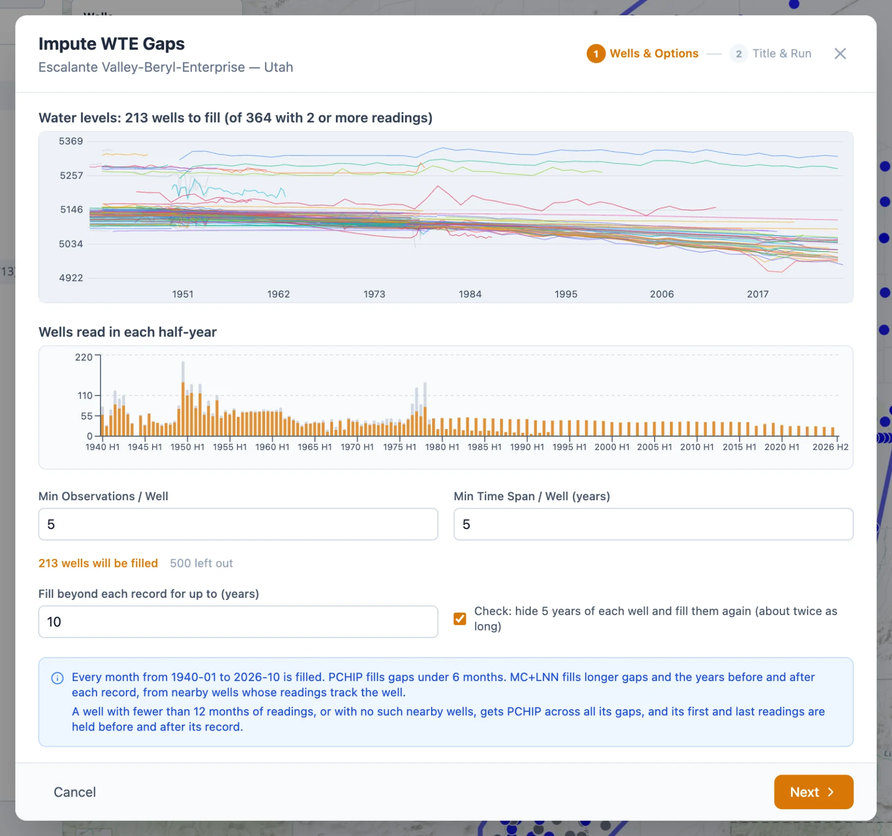

# Running an Imputation

**Impute Gaps** is at the top right once an aquifer is open and water table elevation is the data type. It models the wells of that
one aquifer and saves the result in it, so the region has to be in My Data. On a Sample Data region the button explains that Sample
Data is read-only and offers **Copy to My Data**, which copies the region and opens the copy (see
[Sample Data and My Data](../start/my-data.md#copying-a-sample-region)); open the aquifer in the copy and click **Impute Gaps** again.

The wizard has two steps, **Wells & Options** and **Title & Run**. It reads the soil moisture record from the GEOGLOWS server, so it
needs an internet connection.

## Wells and options

At the top of the first step, **WTE Time Series Preview** draws the PCHIP curve of every well with two or more readings on one set of
axes; the blue band is the span a model can cover, and the dashed green lines are the output dates. **Data Density** under it counts the
wells read at least once in each half year, with bars of five wells or more in orange and the blue band again marking the span a model
can cover.

### The options

- **Output Start Date** and **Output End Date** set the months that are saved. They start as the whole span a model can cover,
  December 1957 to the latest month of the soil moisture record, and the arrows beside each move it to January 1 of the year before
  or after, within that span. The model is trained on the whole span whatever the dates; they only trim the result.
- **Min Samples / Well**, 5 to start with, is the least a well needs: that many readings, and that many months of record from
  December 1957 on, not counting the inside of long gaps. A well needs three such months in any case.
- **Gap Size (days)**, 730 to start with: a gap between two readings longer than this is filled by the model. Shorter gaps keep the
  PCHIP curve.
- **Pad Size (days)**, 180 to start with: how far the PCHIP curve still reaches into a long gap from the reading at each end. The model
  fills the rest of the gap.

The line under the options counts the wells that qualify and, for each reason, the wells left out. On Escalante it reads 159 wells
qualify, 424 with fewer than 5 readings, and 130 with fewer than 5 months of record from 1957-12-01; those 130 were read only before
1958, or too briefly after it. The note at the bottom gives the span the model covers.

### Choosing the options

A shorter **Gap Size** hands more of each record to the model, including gaps that the PCHIP curve would cross reasonably well; a
longer one asks the curve to bridge gaps in which a drought or a change in pumping can hide (see [The Time Series
Chart](../timeseries/chart.md#what-the-curve-can-tell-you)). **Pad Size** keeps the months next to a reading on the curve, which passes
through the reading; a larger pad leaves the model less of each gap. Raising **Min Samples / Well** drops wells whose few readings give
the model little to learn from. A well with five readings from the early 1960s still gets values from 1957 to the present, and almost
all of them are the model's.

## Title and run

The second step asks for a **Title**: letters, numbers, spaces, hyphens and underscores. Under it is the file the model will be saved
in, such as `escalante_valley_beryl_enterprise/model_wte_elm.json`, with a warning if the aquifer already has a model by that name.
**Options Summary** repeats the settings and the model, an ELM with 500 hidden units and λ = 100, which are fixed.

**Run Imputation** starts the run, and a progress bar and a log follow it: the soil moisture months, how many wells qualified, each
well dropped and why, and a line for each well modeled with its R², RMSE and number of training months. The work runs in the
background, so the page stays responsive, and Escalante's 159 wells took about a minute. **Cancel** stops the run and goes back to the
first step without saving anything.

When the run ends, the wizard reports how many wells were modeled, the number of monthly values saved, the dates and the aquifer, with
the log under **Processing Log**. **View Results** opens the model on the chart (see [Reading the Results](results.md)).
