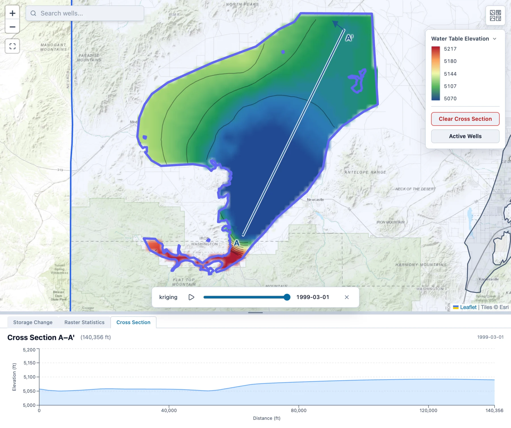
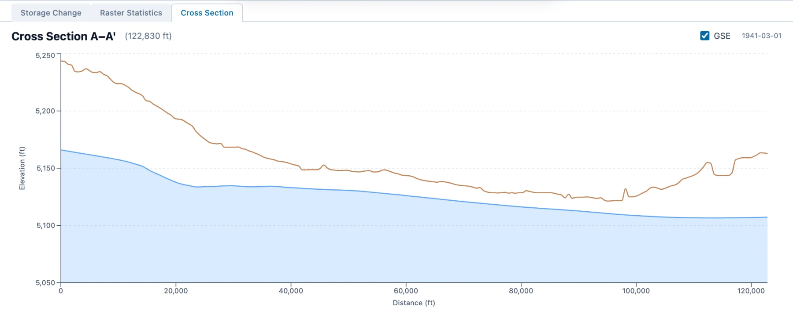

# Cross Sections

A cross section is a profile of the maps along a straight line: the water table's elevation from one end of the line to the other, on
the date shown. As the date changes, the profile changes with it, so playing the maps shows the water table rising or falling along
the line.

## Drawing a section

With a set of maps open, click **Cross Section** on the card at the top right of the map. The pointer becomes a crosshair:

1. Click where the line starts. A dashed line follows the pointer from there.
2. Click where it ends.

**Esc** before the second click cancels. The line is drawn with its ends labeled A and A′, and an arrow at each end that points the
way you look at the profile: with A on your left and A′ on your right. The panel below the map opens on the **Cross Section** tab,
titled *Cross Section A–A′* with the line's length.

The button then reads **Clear Cross Section**, which removes the line and the tab. Closing the maps, or opening another set, clears it
too. To draw a different line, clear the first.

## The profile

The chart gives the elevation along the line against the distance from A, in the region's unit. It is sampled at 200 points evenly
spaced along the line, each the bilinear interpolation of the four cell centers around it. Where the line runs outside the aquifer's
outline, the profile has a gap. Pointing at the chart gives the date, the distance and the elevation, and the date shown is also at the
top right of the tab.

**GSE**, beside the date, adds the ground surface along the line in brown, and pointing at the chart then also gives the ground's
elevation and the depth to water. The ground comes from the same source as the wells' elevations: USGS 3DEP elevation tiles of about
15 m in the United States, and the Copernicus DEM, about 90 m, elsewhere (see
[Wells](../data/wells.md#ground-surface-elevation)). It is read once for each line, which takes a moment and needs an internet
connection. A model of the ground carries roads, canals and buildings as small bumps.

The elevation axis spans the lowest to the highest value along the line on any date of the set, and the ground when it is shown, and
stays fixed as the date changes. Drag the slider or play the maps, and the profile drops where the water table fell and rises where it
recovered.

The section in the figures crosses the Escalante Valley-Beryl-Enterprise aquifer for 23.3 miles (122,830 ft), from its west side to its
northeast, through the area where the water table fell most. In March 1941 the water table fell steadily along it, from 5,166 ft at A
to 5,107 ft at A′, and over the valley floor, from 50,000 to 100,000 ft, it lay 10 to 21 ft below the ground:

By March 1999 the water table had fallen 50 to 64 ft over the first 63,000 ft and less farther east, 11 ft at A′. It now dropped from
5,107 ft at A to 5,069 ft at 49,000 ft and rose 28 ft from there to A′, so east of the low it sloped back toward the area of the
largest fall (the figure at the top of the page). Over the valley floor it lay 33 to 79 ft below the ground. Playing the maps shows
the dip forming: from March 1978 on, its low sits more than 5 ft below A′.

Between the wells the water table line carries the interpolation's shape (see [Interpolation Methods](interpolation.md)), and the
section does not show the aquifer's base. Wells near the line show where the profile rests on readings: turn on **Active Wells** to see
which wells have a value on the date shown (see [Viewing the Maps](maps.md#what-the-map-shows)).
