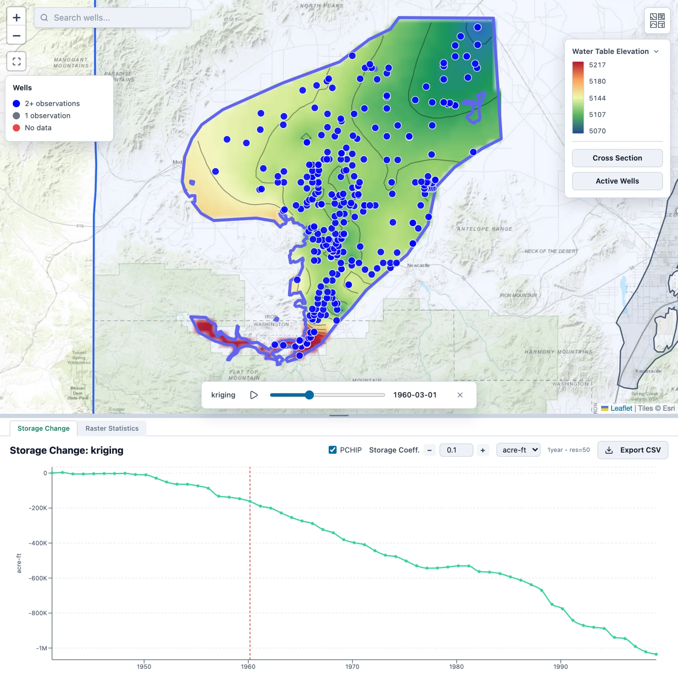
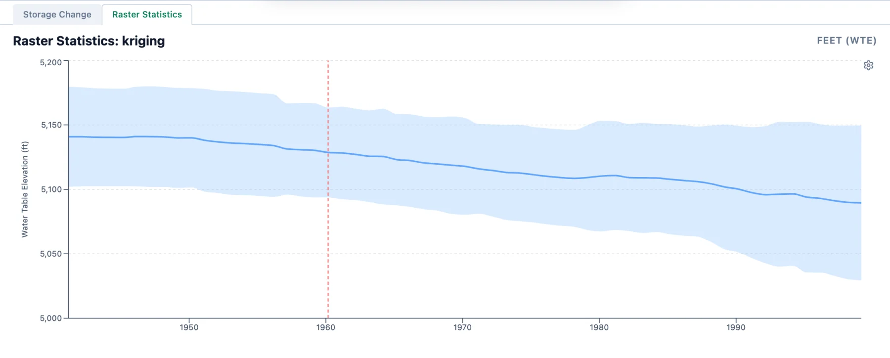

# Viewing the Maps

## Opening a set of maps

A run of Spatial Analysis is saved as one set of maps, listed in the tree under its aquifer beside any gap-filling models, or under the
region itself in a single-unit region. Its name is the data type's code and the title, such as `wte_kriging`. Pointing at it shows
its first and last date, the interval, the resolution, the data type and when it was made. Click it to open the maps and again to
close them; a dot marks the open set. Opening an aquifer again reopens the set that was last open in it.

The Sample Data has a set in each of eleven aquifers, all made with the defaults (exponential kriging without a nugget, the busiest
month, the default years, readings held up to 10 years):

- from the measurements, named `kriging`: Cache Valley, Cedar Valley, Escalante Valley-Beryl-Enterprise, Juab Valley, Northern Utah
  Valley-east, Pahvant Valley and Parowan Valley in Utah, and Prescott AMA in Arizona;
- from the gap-filling model, named `kriging_mc_lnn`: Central Sevier Valley and East Shore Area in Utah, and Williamson in Oregon.

## What the map shows

The open map colors each cell of the aquifer by its value on the date shown, under the aquifer's outline and the wells. Thin dark lines
are contours, eight levels evenly spaced across the color scale. Pointing at the map shows the value of the cell under the pointer.

The color scale stays the same for every date of the set, so a color means the same value from one map to the next. It runs from the
2nd to the 98th percentile of all the cells of all the maps, and the few values beyond those ends take the end colors. For the
Escalante maps that is 5,070 to 5,217 ft. The card at the top right gives the scale with five values. Click the data type's name
above it to choose another color ramp: BGYR (blue, green, yellow, red; the default), Viridis, Plasma, Turbo, Inferno or Blues. The
contours keep the same levels on every date too, so a contour moving across the aquifer from one map to the next shows the water table
rising or falling there.

The card also holds **Cross Section**, which draws a profile of the maps along a line (see [Cross Sections](cross-sections.md)), and
**Active Wells**. With Active Wells on, the wells with a value on the date shown are green and the rest dark gray, so you can see
which wells each map rests on. Maps made before November 2026 work the list out again from the readings, and for maps made from a model
it then leaves out the years the model added beyond each record.

## Moving through the dates

The bar at the bottom of the map gives the set's title, a play button, a slider and the date shown. Drag the slider to a date, or
click play to step through the maps, two a second, from the date shown to the last; it stops there and returns to the first. The
button at the right end of the bar closes the maps.

While a set of maps is open, the well, storage change and statistics charts in the panel below mark the date shown with a red dashed
line, which moves as the date changes, and the cross section follows the date.

## The charts

Opening a set of water level maps opens the panel under the map on **Storage Change**, the change in the volume of water stored in the
aquifer since the first map (see [Storage Change](storage.md)). A set of water quality maps opens on **Raster Statistics**. The panel
has a tab for each chart that applies: **Water Level** (or the data type's name) when wells are selected, **Storage Change** for
water levels, **Raster Statistics**, and **Cross Section** once a line is drawn.

### Raster statistics

**Raster Statistics** charts the values of the wells on each map: their mean as a line and, to start with, a band one standard deviation
either side of it. The gear at the top right adds the median, the band from the 25th to the 75th percentile, and the band from the
lowest to the highest value, or hides the standard deviation. Pointing at the chart gives the date, the number of wells on that map,
and each value shown.

The statistics come from the wells' values on each date, the same values the map was interpolated from, and the number of wells
changes as wells join and leave the maps. On the Escalante maps the mean falls from 5,140.8 ft in March 1941, over 173 wells, to
5,089.5 ft in March 1999, over 49, and part of that change comes from which wells were read: the wells still read in the 1990s are
not the wells read in the 1940s. The storage change curve, which compares each cell with itself, separates the two better.

## Managing maps

The three dots beside a set of maps open its menu:

- **Edit** renames it, and its file with it.
- **Get Info** shows its settings in four parts. General: the title, the code, the data type, the aquifer and when it was made.
  Temporal: the first and last date, the interval, the data source (Measurements, or Imputed Data with the model's code), the method,
  and for Measurements the well settings and the hold. Spatial: the method, the resolution, the wells at one place (the places, the
  distance, the wells left out and the rule), and the kriging or IDW settings. Post-Processing: any truncation or log transform.
- **Delete** removes it, after you confirm in the tree.

Sample Data maps can be opened and their Get Info read, but not renamed or deleted. Copy the region to My Data to change them, or to
make maps of your own beside them.
