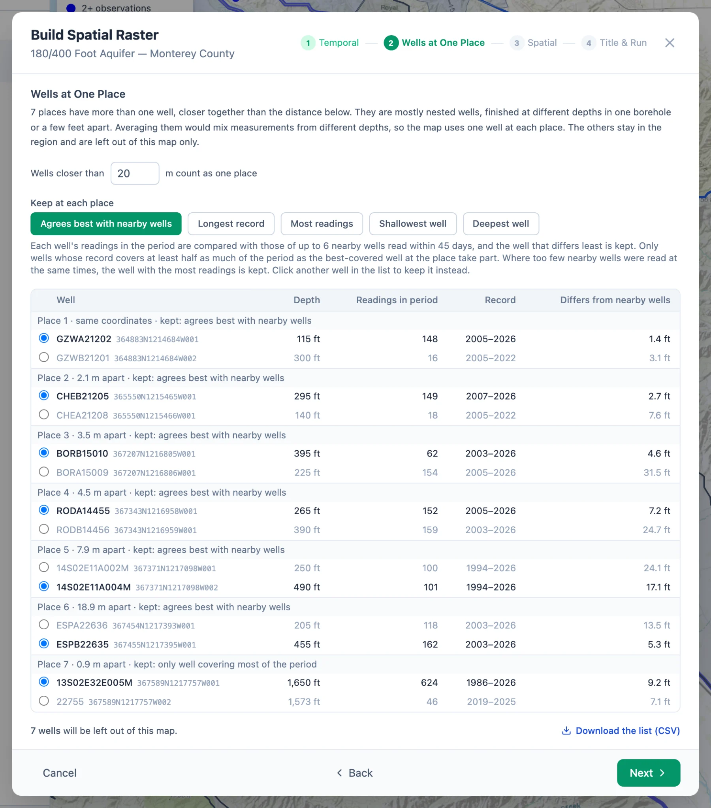

# Wells at One Place

Nested wells are wells finished at different depths in one borehole or a few feet apart, and each measures the water at its own depth.
The app keeps every well, so nested wells can be plotted side by side (see
[Exploring a Region](../start/exploring.md#selecting-wells)). A water table map can use only one of them: two water levels from
different depths averaged into one point give a value that belongs to neither, and two wells at one spot with different values leave
the interpolation nothing sensible to draw between them.

After the Temporal step, Spatial Analysis looks for places where two or more of the wells that go on the maps stand less than 20 m
apart. Where it finds any, a **Wells at One Place** step follows and keeps one well at each place; where it finds none, the wizard
goes straight to the Spatial step. With Imputed Data the wells that go on the maps are the model's, so the step looks among those.
Escalante Valley-Beryl-Enterprise in the Utah sample has four places among its 213 wells, each with two wells.

{ width="900" }

## Choosing the well

**Keep at each place** sets the rule:

- **Agrees best with nearby wells**, the default. Each of a well's readings in the map's period is compared with an estimate from up to
  six wells within 8 km, not at a place themselves, that were read within 45 days of it, the nearer ones weighted more. The well whose
  readings differ least, by the median, is kept. Only wells whose record covers at least half as much of the period as the best-covered
  well at the place take part, so a close match over a few years can't leave the place empty for the rest of the maps. A reading is
  compared when at least three nearby wells were read near its date, and a well needs five compared readings; where a well at the place
  has fewer, the one with the most readings is kept.
- **Longest record**, the well whose record, from its first reading to its last, covers more of the period.
- **Most readings** in the period.
- **Shallowest well** or **Deepest well**, by the [well depth](../data/wells.md#well-depth). Where a well at the place has no depth, the
  one with the most readings is kept.

Where the rule can't decide between wells, the one with the most readings in the period is kept.

The list gives each place, how far apart its wells are and how the kept well was chosen, and for each well its depth, readings in the
period, record and median difference from nearby wells. Pointing at a difference gives the number of readings compared. A click on
another well keeps it instead, and a click on the rule's own choice goes back to it; changing the rule clears the wells picked by hand.
The line under the list counts the wells left out of the maps. They stay in the region and on the map of wells.

**Wells closer than** sets the distance, 20 m to start with. The step stays in the wizard when you change it, so a distance that finds
no places can be changed back.

**Download the list (CSV)** saves every well at those places with the reason it was kept or left out. After the run the wizard reports
the places and the wells left out, and the maps' Get Info records the rule, the places and how many were picked by hand (see
[Viewing the Maps](maps.md#managing-maps)).

## Mapping each depth

To map wells at different depths separately, make each depth an aquifer of its own (see
[Regions and Aquifers](../data/regions-aquifers.md#aquifers-at-different-depths)). The step only groups wells of the same aquifer.
