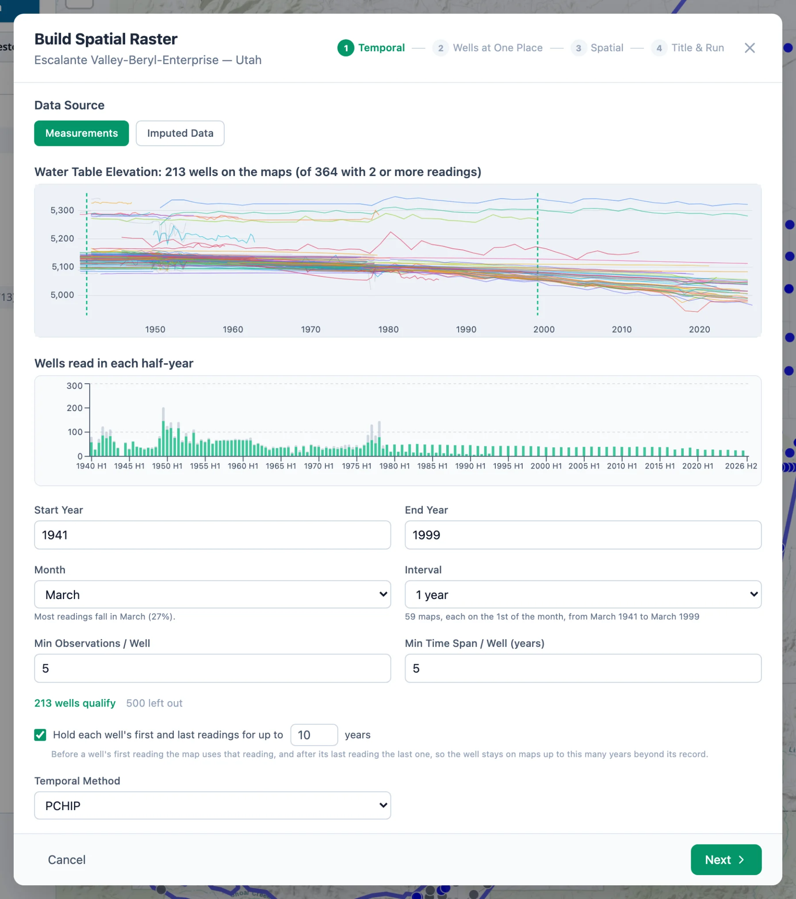

# Running a Spatial Analysis

**Spatial Analysis** makes a series of maps of one aquifer, one map for each date in a range you choose. For each date it takes a
value at each well, from the readings or from a gap-filling model, and interpolates between the wells across the aquifer's outline.
The maps are saved together in the aquifer, and from them come the storage change curve and cross sections (see
[Storage Change](storage.md) and [Cross Sections](cross-sections.md)).

The button is at the top right once an aquifer is open, and it maps the data type selected in the panel: water table elevation, or a
water quality parameter. The maps are saved in the aquifer, so the region has to be in My Data. On a Sample Data region the button
offers **Copy to My Data**, which copies the region and opens the copy (see
[Sample Data and My Data](../start/my-data.md#copying-a-sample-region)); open the aquifer in the copy and click **Spatial Analysis**
again. The Sample Data comes with a map of each of eleven aquifers, which you can open without copying (see
[Viewing the Maps](maps.md)).

The wizard, **Build Spatial Raster**, has up to four steps: **Temporal**, **Wells at One Place**, **Spatial** and **Title & Run**. The
second appears only when two or more of the wells that go on the maps are less than 20 m apart (see [Wells at One Place](places.md)).

## Temporal

### Data source

For water levels in an aquifer with a saved gap-filling model, the step opens with **Data Source**: **Measurements** or **Imputed
Data**. Measurements, the default, takes each well's value from its readings. Imputed Data takes it from a model's series, which has a
value in every month for every well in the model (see [Reading the Results](../imputation/results.md#using-a-model-for-water-table-maps));
with more than one model, a list beside the buttons picks one. Without a model the step has no Data Source, and the maps use the
measurements.

### The two charts

The first chart draws the PCHIP curve of every well with two or more readings. The wells that go on the maps are in color and the rest
in gray, and the title counts both. Two dashed green lines mark the first and last map date, and with Imputed Data a blue band shows
the months the model covers. **Wells read in each half-year** under it counts the wells with at least one reading in each half of each
year: green for the wells on the maps, gray for the others. On Escalante Valley-Beryl-Enterprise the title reads 213 wells on the maps
of 364 with two or more readings. The bars are tallest in the 1950s, and from the late 1980s the bars of the second half-years shrink
to a few wells, as the wells still read were measured once a year, in March.

### Dates

- **Start Year** and **End Year** set the first and last map.
- **Month** sets the month of every map. Each map falls on the 1st of that month.
- **Interval** is **1 year**, **6 months** or **3 months**. A 6- or 3-month interval starts from the month, so March gives March and
  September, or March, June, September and December.

The line under Interval counts the maps and gives their first and last date: on Escalante, *59 maps, each on the 1st of the month,
from March 1941 to March 1999*.

#### The month

A map's value at a well comes from the well's PCHIP curve at the map's date, and the curve is only a smooth join between readings (see
[The Time Series Chart](../timeseries/chart.md#what-the-curve-can-tell-you)). From 1980 on, every Escalante well read in a year was
read in March, and from about 1985 most were read only then. A map on March 1 falls next to each well's reading of that year. A map on
September 1 takes each well halfway between two March readings, where the curve knows nothing of the summer's pumping, and it shows a
level between two springs rather than the late-summer low. Where wells are read in different seasons, a map on any one date mixes
values read near that date with values taken from the curve between readings.

The Month box starts at the month with the most readings among the wells that go on the maps, and the note under it gives that
month's share of their readings: *Most readings fall in March (27%)* on Escalante. Choose another month and the note adds its share.
In the Utah sample the busiest month is March in every aquifer with a map. Where wells are read in two seasons, a 6-month interval
from the busier one maps both.

#### The years

Start Year and End Year start as the first and last years in which at least 1 in 5 of the wells on the maps, and at least 10, have a
reading before that year's map date and another after it. Before the first of those years and after the last, most of the maps'
values would come from the few wells read then, or from readings held from other years (below). On Escalante, 43 of the 213 wells
are needed. In March 1941 58 of them were inside their records, in 1960 114, and in 1999 43; from 2000 on fewer than 43 were, 35 in
2020, so the years run from 1941 to 1999. You can type other years. Maps after 1999 rest on the wells read then and on the readings
of others held up to 10 years.

With Imputed Data the years are found the same way from the readings, and the boxes accept only years whose map date falls inside the
model's months.

### Which wells

- **Min Observations / Well** and **Min Time Span / Well (years)**, 5 and 5 to start with, choose the wells for the maps: those with
  at least that many readings, spread over at least that many years. The line under them counts the wells that qualify and those
  left out: on Escalante, 213 and 500. A well with fewer readings, or readings close together, gives a curve that says little about
  the years between them. These are the same two settings Impute Gaps uses to choose the wells it fills (see
  [Running an Imputation](../imputation/running.md#the-options)).
- **Hold each well's first and last readings for up to (years)**, checked for water levels with 10 years to start with, keeps each
  well on the maps beyond its record. Before its first reading the map uses that reading, and after its last reading the last one, up
  to that many years. Unchecked, a well is on the maps only from its first reading to its last.

With Imputed Data these settings go away: the maps use every well in the model, with the values its series holds, and the model's own
limit beyond each record takes the place of the hold.

#### Why hold the readings

Without the hold, a run of maps over several decades draws each year from a different set of wells, as wells join and leave, and where
a well has left the map fills its place from the wells around it. Two tests hid the first or the last 3, 5 or 10 years of each record
at 4,596 wells in 50 aquifers of eight regions, and compared two maps at the hidden readings: one with the well's nearest reading held,
and one without the well. Holding the reading came closer at 65 to 79% of the stretches after the record and at 63 to 78% of those
before it. Over the 10-year stretches after the record it stayed ahead every year, closer at 84% of the hidden readings in the first
year and at 68% in years 7 to 10, so 10 years is the default. The tests covered water levels only, and the hold starts unchecked for
water quality.

### Value at each date

**Temporal Method** sets how each well's value at a map date is read from its record:

- **PCHIP**, the default for Measurements: the PCHIP curve through the readings at the map's date (see
  [The Time Series Chart](../timeseries/chart.md#the-curve-between-measurements)).
- **Moving Average**, for Measurements: the PCHIP curve through a moving average of the readings, with **MA Window (months)**, 12 to
  start with. Each reading is replaced by a weighted average of the readings around it, with Gaussian weights whose standard deviation
  is a quarter of the window, as the chart's moving average does (see
  [The Time Series Chart](../timeseries/chart.md#moving-average)). It evens out seasonal swings and single odd readings, so a map shows
  the level the well was trending toward. With the hold, the value held is the moving average at the first or last reading.
- **Direct**, the default for Imputed Data: the model's value in the map's month.
- **Moving Average**, for Imputed Data: a moving average of the model's monthly series, with the same weights and window.

## Wells at One Place

When wells that go on the maps stand less than 20 m apart, mostly nested wells finished at different depths, the next step keeps one
well at each such place. [Wells at One Place](places.md) covers it. Escalante has four such places among its 213 wells.

## Spatial

- **Spatial Method** is **Kriging**, the default, or **IDW (Inverse Distance)**.
- **Resolution (columns)**, 50 to start with, sets the map grid: that many columns across the aquifer's outline from west to east,
  with square cells and as many rows as the outline's height takes. Escalante's maps have 50 columns and 55 rows of cells about 900 m
  on a side, 1,381 of them inside the outline. A finer grid shows more detail between close wells and takes longer to compute.
- **Kriging Options**: **Variogram Model** (**Exponential**, the default, **Spherical** or **Gaussian**), **Enable nugget** (off), and
  **Range**: **Auto (1/3 diagonal)**, **Custom (meters)** or **Percentage** of the diagonal.
- **IDW Options**: **Exponent** (2), **Nodal Function** (**Classic**, **Gradient Plane** or **Quadratic**), and **Neighbors**: **All
  Wells** or **Nearest N** (12).

[Interpolation Methods](interpolation.md) gives both methods in full, what each option does, and why exponential kriging without a
nugget is the default.

**General Options** apply to either method:

- **Truncate Low** and **Truncate High** clip every map to a lowest and a highest value. Truncate High starts at the highest reading,
  rounded up.
- **Log Interpolation** interpolates the logarithm of the values and maps the result back. It suits concentrations that span several
  orders of magnitude, and it is unavailable when any value is zero or below.

## Title and run

The last step asks for a **Title**: letters, numbers, spaces, hyphens and underscores. It starts as `kriging`, or `idw`, `idw_gp` or
`idw_quad` for IDW with each nodal function. Under it is the file the maps will be saved in, such as
`escalante_valley_beryl_enterprise/raster_wte_kriging.json`, with *Name already exists* if the aquifer already has maps of that data
type by that title. **Options Summary** repeats the settings.

**Run Analysis** starts the run, and a progress bar follows it through the wells and the maps. The run works in the background, so
the page stays responsive, and **Cancel** stops it without saving anything. Maps at the start or end of the range with no well value
at all are dropped.

When the run ends, the wizard gives the number of maps, the first and last date and the aquifer, and, when the step ran, how many
places had more than one well and how many wells it left out. **View Results** opens the maps (see [Viewing the Maps](maps.md)).
