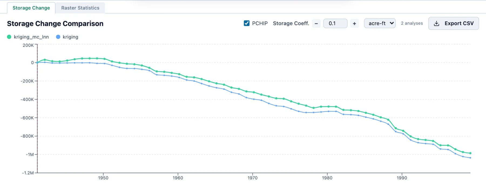

# Storage Change

A set of water level maps gives the water table across the aquifer on each date, and the change from one map to the next, times the
aquifer's storage coefficient, gives the volume of water the aquifer gained or lost. **Storage Change** charts that volume, added up
from the first map, so the curve starts at zero and each point is the change in storage since the first date. The figure in
[Viewing the Maps](maps.md#opening-a-set-of-maps) shows it under the Escalante Valley-Beryl-Enterprise maps.

## How it is computed

For each pair of consecutive maps, the change in storage is summed over the cells:

$$
\Delta V_k = S \sum_{c} \left( h_{c,k} - h_{c,k-1} \right) A_c
$$

with *h*c,k the value of cell *c* on map *k*, *S* the storage coefficient and *A*c the cell's area. A cell with
no value on either map is skipped. The curve is the running total, *V*0 = 0 and *V*k = *V*k−1 +
Δ*V*k. A cell spans the same longitude and latitude everywhere on the grid, and its area shrinks with the cosine of its
latitude:

$$
A_c = R^2\, \Delta\lambda\, \Delta\varphi\, \cos\varphi_c
$$

with *R* = 6,371 km, Δ*λ* and Δ*φ* the cell's width and height in radians, and *φ*c the latitude of its center. The
Escalante Valley-Beryl-Enterprise grid has 1,381 cells inside the outline, each about 0.81 km², 1,118 km² (276,000 acres) in all.

## The controls

- **Storage Coeff.**, 0.1 to start with, is *S*. The − and + buttons step it by 0.05, and the box takes any value from 0.01 to 1. For
  an unconfined aquifer it is the specific yield: the volume of water drained from a unit area of the aquifer as the water table falls
  by one unit. At 0.1, a 1 ft fall across one acre releases 0.1 acre-ft. The curve is proportional to *S*, so doubling it doubles
  every value.
- The unit list gives the volume in **acre-ft** (the default) or **ft³** in a region measured in feet, and in **MCM** (million cubic
  meters, the default), **m³** or **km³** in a region measured in meters.
- **PCHIP**, checked to start with, draws a smooth curve through the maps' dates; unchecked, straight lines join them.
- **Export CSV** downloads the curve as `storage_change_<code>.csv`, with the date and the volume of each set of maps on the chart.

The note beside the controls gives the set's interval and resolution. The curve has a point for each map; pointing at the chart gives
the date and the volume.

On the Escalante maps, with *S* = 0.1, the aquifer lost about 1.04 million acre-ft from March 1941 to March 1999, an average fall of
the water table of 37.5 ft over its 276,000 acres. The loss was slow in the 1940s, about 3,000 acre-ft from 1941 to 1946. It looks
fastest from 1986 to 1991, about 230,000 acre-ft in five years, but a third of that comes in one year, when 27 wells left the maps
(below).

## Comparing sets of maps

With a set of maps open, hold Shift and click another set in the tree to add its curve to the chart, and Shift-click it again to take
it off. The chart's title becomes *Storage Change Comparison*, a legend names each set by its title, and Export CSV writes a column for
each. The map shows only the set opened first.

Comparing the maps an aquifer gets from its measurements with those from its gap-filling model shows how much the filled values change
the curve.

The figure compares two sets of Escalante maps: `kriging`, from the measurements, as in the Sample Data, and `kriging_mc_lnn`, made in a
My Data copy from the aquifer's gap-filling model with Direct and the other settings at their defaults. From 1941 to 1999 the maps from
the model lose 985,000 acre-ft, 5% less than those from the measurements, and they gain 36,000 acre-ft by 1946, where the others barely
change. Both take their largest step from 1988 to 1989: the model, too, extends each well only up to 10 years past its last reading, so
29 wells leave its maps that year (below).

## Reading the curve

- **The maps cover the whole outline.** Every cell has a value on every map, near the wells or far from them. Where there are no wells
  nearby, the map follows a weighted mean of all the wells, so those cells rise and fall with the aquifer's wells at large.
- **Wells joining and leaving move the surface.** When a well joins the maps or leaves them, the surface around it changes though the
  water has not, and the curve steps. While a well's last reading is held, the map keeps the well at that level as the wells around
  it fall, and when the hold ends the fall shows up in one step. On the Escalante maps the largest step, a loss of 80,000 acre-ft
  from March 1988 to March 1989, against a median of 14,000 acre-ft a year, comes as 27 wells last read in 1978 leave the maps. At the
  wells themselves the hold still comes closer to the water level than dropping each well at its last reading (see
  [Running a Spatial Analysis](running.md#why-hold-the-readings)). Active Wells shows which wells each map rests on (see
  [Viewing the Maps](maps.md#what-the-map-shows)), and a set of maps from a gap-filling model, compared with the set from the
  measurements, shows what the filled values change.
- **The date sets the season.** With one map a year in March, the curve measures storage from spring to spring, after the winter's
  recovery. Maps on other months, or every 3 or 6 months, show the seasonal swing as well, if enough wells were read in each season.
- **The storage coefficient is a single number.** One value of *S* stands for the whole aquifer and every depth the water table passes
  through. Where it is known only roughly, read the curve for its shape and the size of the change against other estimates of *S*.
