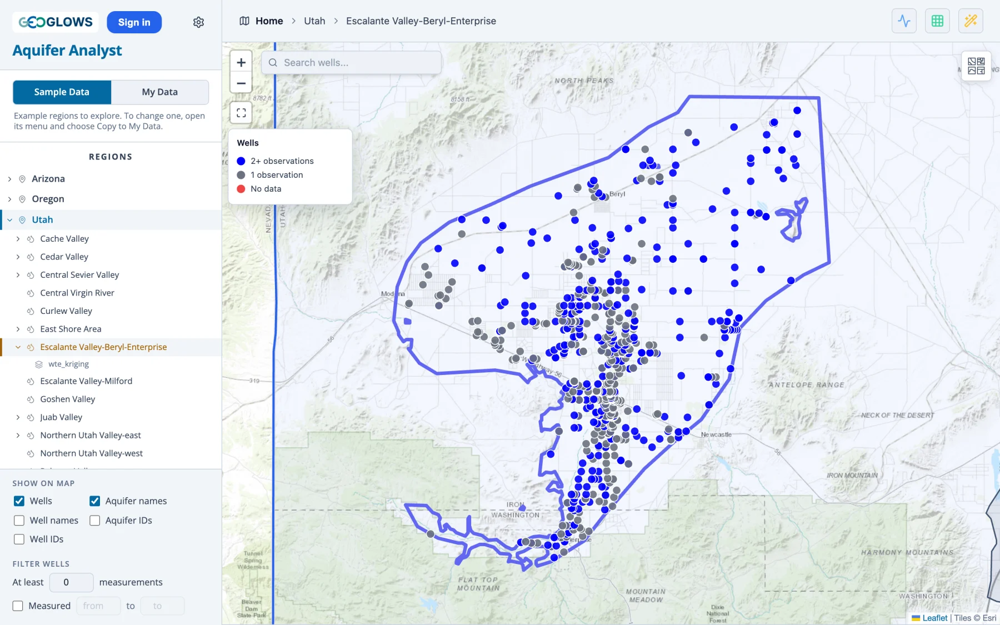
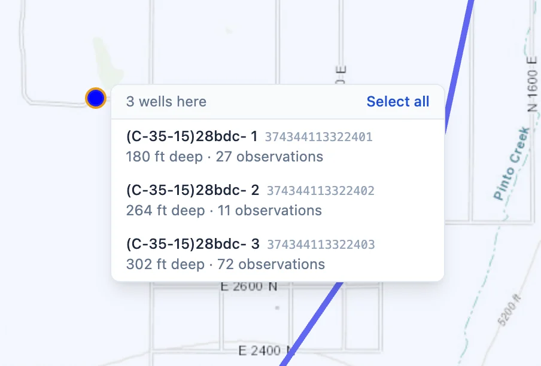
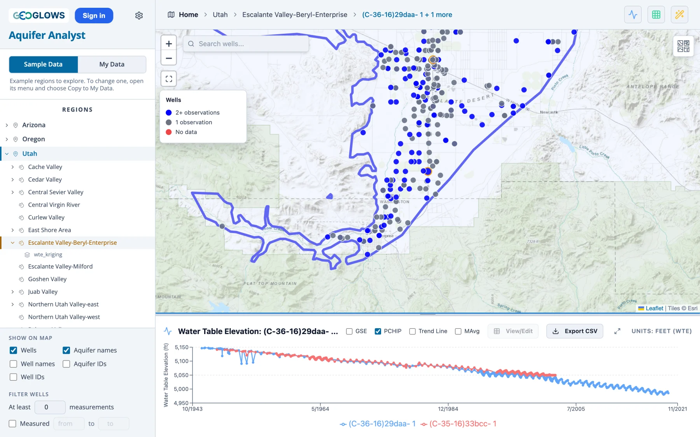
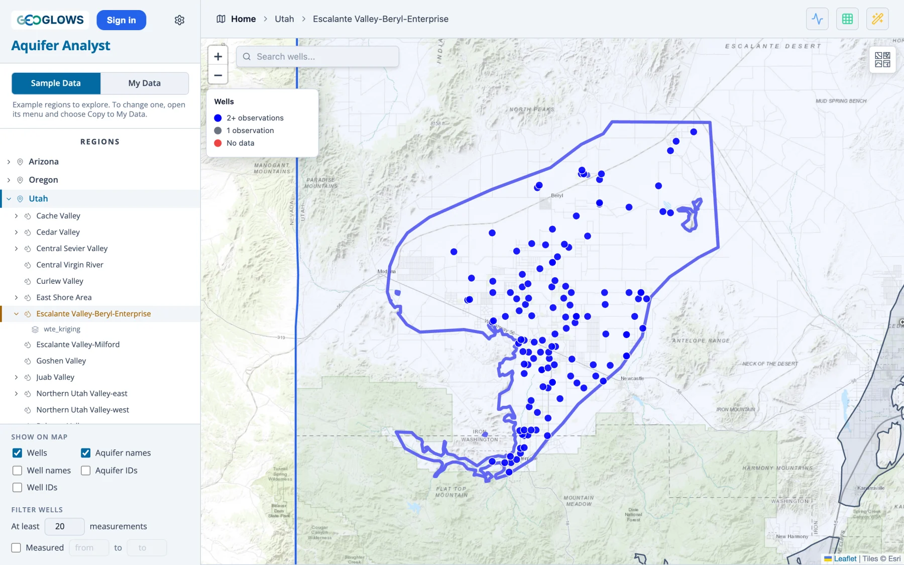
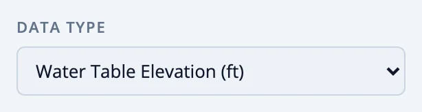

# Exploring a Region

## Opening a region and an aquifer

Click a region in the tree, or its outline on the map, to open it. The map zooms to the region and draws its aquifers, and the tree
lists them under it. Click an aquifer to show its wells.

In a region treated as a single unit, the region is its own aquifer, so its wells appear as soon as it opens and the tree lists its
saved maps and models directly under it.

## Well markers

Each well is a dot colored by how many measurements of the current data type it has:

- **blue**, two or more, enough to draw a record
- **gray**, one
- **red**, none of this data type, though the well may have others

After **Analyze Trends**, the colors show water level trends instead, and the legend changes to match (see Part 3).

Point at a well to see its name, ID, ground surface elevation, depth where it is known, and number of measurements.

## Selecting wells

Click a well to plot its measurements in the chart panel. To find a well by name or ID, type in **Search wells** at the top left of the
map.

Nested wells, finished at different depths in one borehole or a few feet apart, share a spot on the map, and their markers lie on top
of each other. The popup of such a well says how many more wells are there. A click on the spot opens a list of them, shallowest first,
with each well's depth and number of measurements: pick one, or **Select all** to plot them together.

{ width="452" }

To compare wells, select more than one:

- **Shift-click** a well to add it to the selection, or to remove it.
- Hold **Shift** and **drag a box** to select every well inside it.

The selected wells get a gold ring on the map, and the chart draws each one in its own color, with a legend underneath. The bar above
the map names the first well and counts the others. Click an empty spot in the aquifer to clear the selection.

## Filtering wells

The **Filter wells** settings at the bottom of the panel hide wells you are not interested in:

- **At least *N* measurements** hides wells with fewer measurements of the current data type. Setting it to 10 or 20 leaves the wells
  with a useful record.
- **Measured *from* to *to*** shows only wells with at least one measurement between those two years, which separates wells that are
  still measured from wells abandoned long ago.

The filters change which wells are drawn, found by the search and caught by a box selection. The app remembers them between visits, so
set **At least** back to 0 to see every well again.

## Labels

**Show on map** labels each aquifer with its name or ID and each well with its name or ID. Well labels crowd quickly, so they are most
useful zoomed in or with a filter on. The label size is in [Settings](my-data.md#settings).

## Data types

{ align=left width="300" style="margin: 0 18px 12px 0" }
When a region holds more than one kind of measurement, a **Data type** list appears in the lower part of the control panel, under the
region tree and above **Show on map**. It names each type with its unit, and stays hidden for a region that holds water levels only.

Picking a type changes everything at once: the marker colors count that type, the chart plots it, and the analyses use it. Filling gaps
works on water table elevation only. The Oregon sample region has water levels and six water quality parameters to try this on.
