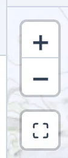
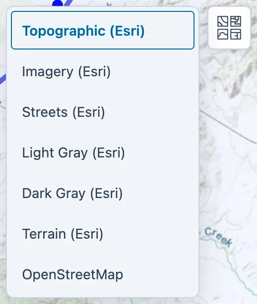
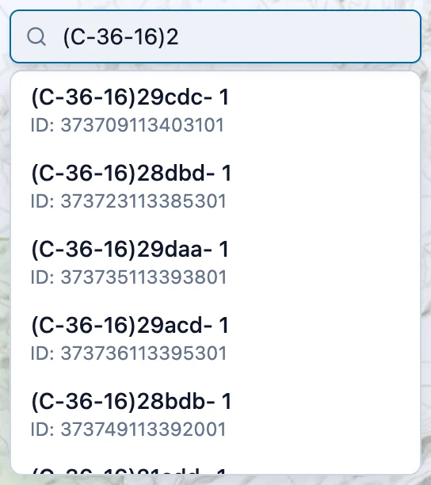
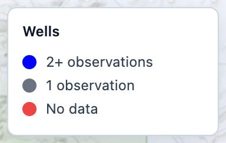
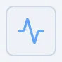

# The App Interface

## Opening the app

Open [apps.geoglows.org/previews/aquiferx](https://apps.geoglows.org/previews/aquiferx){:target="_blank"} in a current version of
Chrome, Edge, Firefox or Safari. Nothing needs to be installed. **Sign in** connects your GEOGLOWS account, which is shared by the apps on
apps.geoglows.org; nothing in Aquifer Analyst requires it.

The window has a **control panel** on the left and the **map** on the right. Selecting a well opens a **chart panel** under the map. Drag
the bar between the map and the chart to give either one more room.

## Control panel

{ align=right width="230" }

From top to bottom:

- **GEOGLOWS logo.** Opens apps.geoglows.org, where the other GEOGLOWS apps are listed.
- **Sign in.** Your GEOGLOWS account, as above.
- **Settings** (the gear). Light or dark colors, the size of map labels, how much space My Data takes in the browser, and deleting all of
  My Data. See [Sample Data and My Data](my-data.md#settings).
- **Sample Data / My Data.** Which set of regions the tree and the map show. Sample Data holds three ready-made regions that cannot be
  changed; My Data holds the regions you add. In My Data, three buttons sit under the switch: **Add Data**, **Back up** and **Restore**,
  with a line saying when you last backed up. See [Sample Data and My Data](my-data.md).
- **Regions.** The tree of regions. Click a region to open it and list its aquifers, and an aquifer to show its wells. Under an aquifer
  are the water table maps and gap-filling models saved for it. Every row has a menu, the three dots that appear when you point at it,
  with the actions for that item.
- **Data type.** Shown only when the open region holds more than one kind of measurement, such as water levels and nitrate. It picks
  which one the map, the chart and the analyses use.
- **Show on map.** Turns the wells on and off, and labels each aquifer or well with its name or ID. The label size is in Settings.
- **Filter wells.** Hides wells with fewer than a given number of measurements, or wells never measured between two years. See
  [Exploring a Region](exploring.md#filtering-wells).

## Map

The bar along the top of the map shows where you are: **Home**, then the open region, aquifer and well. Click any step to go back to it.

{ width="542" }

The controls on the map:

{ align=left width="46" style="margin: 0 18px 12px 0" }
**Zoom** with the **+** and **−** buttons, the mouse wheel, or a pinch on a trackpad. Drag the map to pan.

{ align=left width="259" style="margin: 0 18px 12px 0" }
**Basemap**, the button at the top right, opens the list of background maps: Esri's topographic map, which is the default,
Esri imagery, streets, light gray, dark gray and terrain, and OpenStreetMap.

{ align=left width="272" style="margin: 0 18px 12px 0" }
**Search wells**, the box at the top left once an aquifer is open, lists the wells whose name or ID matches what you type. Use
the arrow keys and **Enter**, or click a match, to select the well and zoom to it.

{ align=left width="192" style="margin: 0 18px 12px 0" }
**The legend** explains the colors of the well markers. The colors change when trends are shown (see Part 3).

**Clicking** on the map opens what you click: a region's outline opens the region, an aquifer shows its wells, and a well is plotted in
the chart panel. Clicking an empty spot inside the open aquifer clears the selected wells, and clicking a part of the region outside every
aquifer goes back to the region.

## Analysis buttons

Three buttons at the top right start the analyses. Each appears once there is something for it to work on.

{ align=left width="44" style="margin: 0 18px 12px 0" }
**Analyze Trends**, once a region is open, colors wells and aquifers by how fast their water levels are changing. See Part 3.

{ align=left width="44" style="margin: 0 18px 12px 0" }
**Spatial Analysis**, once an aquifer is open, interpolates maps of the water table. See Part 5.

{ align=left width="44" style="margin: 0 18px 12px 0" }
**Impute Gaps**, once an aquifer is open and water table elevation is the data type, fills the gaps in well records. See Part 4.

## Chart panel

The chart panel plots the measurements of the selected wells. Along its top:

- **GSE** adds a line for each well's ground surface elevation.
- **PCHIP** draws a smooth curve through the measurements. Part 3 explains the method.
- **Trend Line** adds a straight-line trend through each well's record.
- **MAvg** adds a moving average, and a **months** box appears beside it for the averaging window, in steps of 3 months.
- **View/Edit** opens a table of the selected well's measurements, where you can correct or delete them.
- **Export CSV** downloads what the chart shows.
- The arrows open the chart in a larger window.

The right end says which data type is plotted and in what unit.

The panel can hold more than one chart. When it does, tabs above the chart switch between them:

- **Water Level**, or the name of the data type, plots the selected wells, as above.
- **Storage Change** plots the change in groundwater storage when a water table map is open.
- **Raster Statistics** plots, for each date of an open map, the spread of the well values it was built from: median, quartiles and range.
- **Cross Section** plots a profile through the map once you draw one.

Part 3 covers the well chart in detail, and Part 5 the charts that come with a map.
