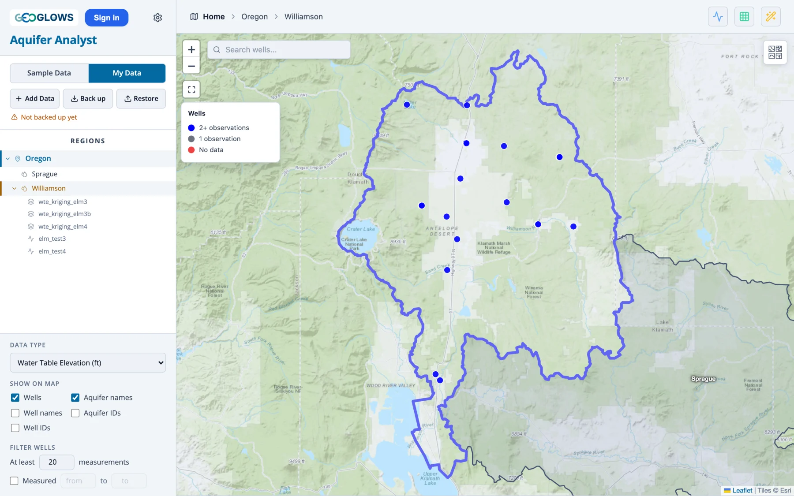
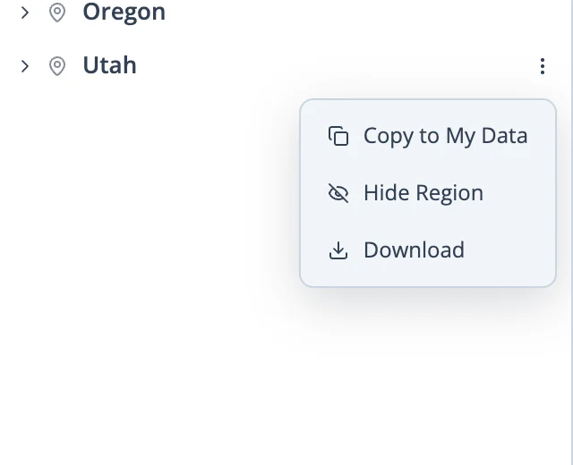
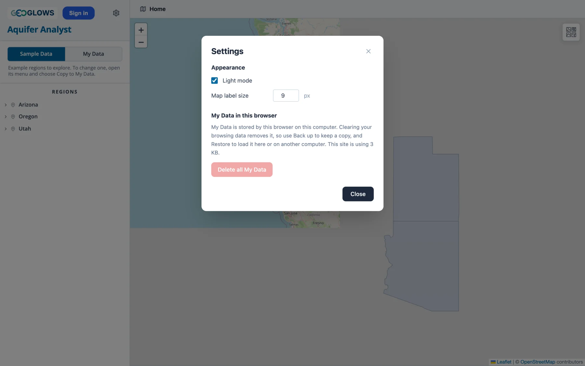

# Sample Data and My Data

The switch at the top of the control panel chooses between two sets of regions. **Sample Data** holds ready-made regions to explore,
and **My Data** holds the regions you add.

## Sample Data

Three regions come with the app, each downloaded the first time you open it:

- **Utah** and **Arizona** hold water levels for many aquifers, some with records going back to the 1940s or earlier.
- **Oregon** is small, with two aquifers, and holds water quality samples as well as water levels, so it is the one to open to see how
  the app handles water quality.

Some aquifers already have saved water table maps and gap-filling models, which appear under the aquifer in the tree.

Sample Data cannot be changed. Anything that would change a region, such as editing measurements, filling gaps or saving a water table
map, offers to copy the region to My Data first. The copy is yours to change, and the sample stays as it was.

## My Data

My Data holds the regions you create, copy or restore. It is stored by your browser on your computer, which has some consequences:

- It is there the next time you open the app in the same browser.
- Another browser, or another computer, does not see it.
- Clearing your browser's data for the site removes it.
- Your files stay on your computer. The app has no server that receives them. The USGS, Water Quality Portal and elevation lookups send
  only the area or the well locations they need to search.

Back up whenever you have added or changed something you would not want to lose (see [below](#backing-up-and-restoring)).

When My Data is empty, the panel offers three ways to start: **Add a region** opens the Add Data window (see Part 2), **Copy a sample
region** switches to Sample Data so you can copy one, and **Restore** loads a backup.

## Copying a sample region

{ align=right width="300" }

Point at a region in the tree and click the three dots beside it to open its menu. For a Sample Data region the menu has:

- **Copy to My Data.** Copies the region, with its aquifers, wells, measurements and saved analyses, into My Data and opens the copy.
- **Hide Region.** Takes the region's outline off the map, which helps when regions overlap. **Show Region** puts it back.
- **Download.** Saves the region as a zip file in the same layout as a backup.

A My Data region's menu also has **Edit**, for its name, unit and whether it is a single unit (see Part 2), and **Delete**.

## Backing up and restoring

**Back up** downloads all of My Data as one zip file, named with the date, such as `aquifer-analyst-my-data-2026-11-06.zip`. The line
under the buttons says when you last backed up and how many changes you have made since, and turns to a warning when you have changes
that are not in a backup.

**Restore** loads a backup zip into My Data. Before anything changes, a window lists the regions in the file and what will happen to
each one:

- **new**: the region is added.
- **replaces existing**: a region with the same ID is already in My Data, and the one in the backup replaces it.
- **added as** *a new ID*: the backup holds a region whose ID belongs to a Sample Data region, so it is added under a new ID.

Restore adds to My Data and never removes a region the backup does not contain. To move your work to another computer, back up on one
and restore on the other.

A backup is an ordinary zip file with one folder per region. Each folder holds plain files that other software can read:

- `region.json`: the region's name, unit and settings
- `region.geojson` and `aquifers.geojson`: the outlines
- `wells.csv`: the wells
- `data_wte.csv`, and a `data_*.csv` for each water quality parameter: the measurements
- one folder per aquifer for its saved water table maps and models

## Settings

{ align=right width="420" }

The gear at the top of the panel opens **Settings**:

- **Light mode.** Light colors, the default, or dark ones when it is off.
- **Map label size.** The size of the aquifer and well labels turned on under **Show on map**.
- **My Data in this browser.** How much space the app is using in the browser.
- **Delete all My Data.** Removes every region in My Data from this browser after you confirm. Sample Data is not affected, and the
  deletion cannot be undone, so back up first if you might want any of it again.
