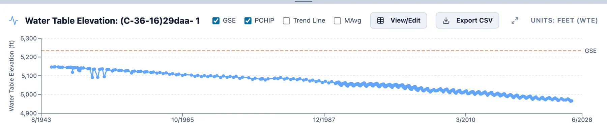
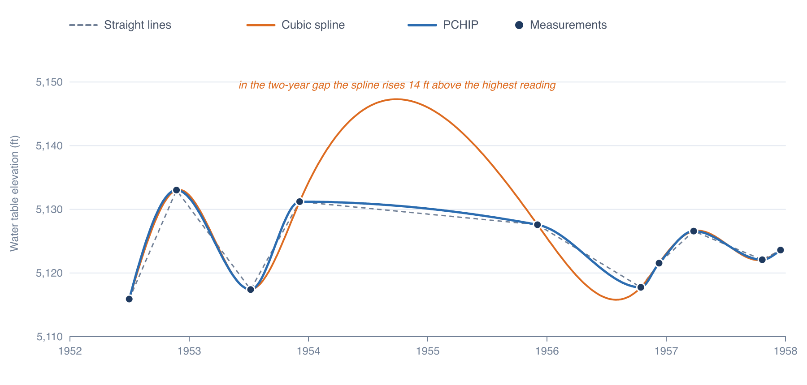
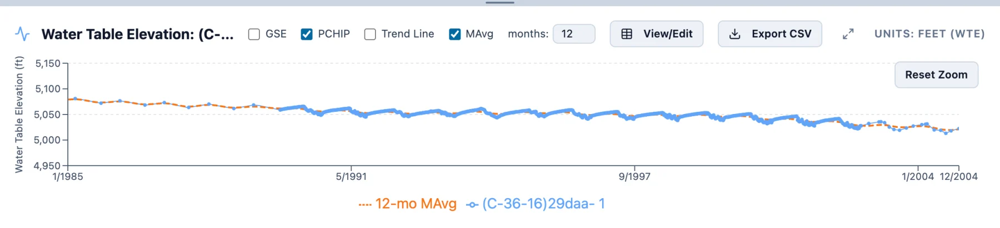

# The Time Series Chart

Clicking a well plots its measurements of the current data type in the chart panel (see
[Exploring a Region](../start/exploring.md#selecting-wells)). Each measurement is a dot, and a curve joins the dots. This page covers the
curve, the lines the chart can add to it, and the ways to look closer. Correcting measurements on the chart and exporting what it shows
are in [Editing and Exporting](../data/editing.md).

## The curve between measurements

With **PCHIP** checked, as it is by default, the curve is a PCHIP curve (piecewise cubic Hermite interpolating polynomial) through the
measurements. Unchecked, straight lines join them. A well with two measurements gets a straight line either way, and a well with one
gets a dot.

The usual smooth curve, a cubic spline, keeps its curvature continuous from one interval to the next, and to do that it bends past the
measurements, the more so the farther apart they are. PCHIP gives up that second smoothness to stay with the measurements: between two
neighboring measurements it never rises above the higher one or drops below the lower one, and where the readings turn, at a peak or a
trough, it is level.

Ten readings of (C-35-16)29ccd- 1 in the Utah sample show the difference. Between 1952 and 1957 the well was read lower in summer than
in late fall, with no reading at all from December 1953 to December 1955. In that gap a cubic spline rises 14 ft above the highest
reading, while PCHIP stays between the readings on either side, close to the straight line.

### How PCHIP is computed

Take the measurements in date order, (*t*i, *y*i) for *i* = 1, …, *n*, with the interval *h*i =
*t*i+1 − *t*i and the slope *δ*i = (*y*i+1 − *y*i) / *h*i between
each pair. On each interval the curve is the cubic that passes through both measurements with slopes *d*i and
*d*i+1 at them:

$$
y(t) = (2s^3 - 3s^2 + 1)\, y_i + (s^3 - 2s^2 + s)\, h_i d_i + (-2s^3 + 3s^2)\, y_{i+1} + (s^3 - s^2)\, h_i d_{i+1},
\qquad s = \frac{t - t_i}{h_i}
$$

The slopes at the measurements set its shape. Where the readings turn, where *δ*i−1 and *δ*i differ in sign or
either is zero, *d*i = 0. Elsewhere *d*i is a weighted harmonic mean of the slopes on either side:

$$
d_i = \frac{w_1 + w_2}{w_1 / \delta_{i-1} + w_2 / \delta_i}, \qquad w_1 = 2h_i + h_{i-1}, \quad w_2 = h_i + 2h_{i-1}
$$

A harmonic mean leans toward the smaller of the two slopes, which keeps the curve from overshooting beside a steep step. At the first
measurement the slope comes from the first two intervals,

$$
d_1 = \frac{(2h_1 + h_2)\, \delta_1 - h_1 \delta_2}{h_1 + h_2}
$$

set to zero if its sign differs from that of *δ*1, and to 3*δ*1 if *δ*1 and *δ*2 differ in sign
and |*d*1| is larger than 3|*δ*1|. The last measurement is treated the same way from the last two intervals. These
are the rules of Fritsch and Carlson (1980) and Fritsch and Butland (1984), as SciPy's `PchipInterpolator` applies them, and the app's
curve matches SciPy's.

### What the curve can tell you

Where measurements are close together, the curve is a fair guess at the water level between them. Across a gap of years it is only a
smooth join, and a drought, a pumping season or a recovery inside the gap leaves no trace on it. A well read twice a
year has a curve that swings between its summer and winter levels, so a value read off the curve depends on the date as much as on the
year. Spatial Analysis reads each well's curve at the dates of its maps (Part 5), and gap filling replaces long gaps with a model of the
well (see [Gaps in Well Records](../imputation/gaps.md)).

With more than 25 wells selected, the chart draws straight lines whatever the checkbox says, to stay quick.

## Several wells

Each selected well gets its own color, eight colors in turn, and a legend under the chart names them. Pointing at the chart shows the
date and the value of each well's curve there, to two decimals. The title above the chart names up to three wells and counts any more.

## Ground surface elevation

For water table elevation, **GSE** draws each well's ground surface elevation as a dashed brown line, labeled GSE, or GSE and the well's
name when several wells are selected. The distance from that line down to the curve is the depth to water: at (C-36-16)29daa- 1, whose
ground is at 5,233 ft, it grew from 87 ft in 1945 to 268 ft in 2026. The y axis stretches to take in the line. A well with no ground
surface elevation gets no line.

## Moving average

**MAvg** draws a smoothed copy of each well's record as a dashed orange line, labeled with its window, such as *12-mo MAvg*, and thins
the well's own curve. The **months** box beside it sets the window *W*, in steps of 3 months from 3.

Despite the name, it is a weighted average rather than a plain one. The smoothed value at each measurement is an average of the
measurements around it with Gaussian weights (Nadaraya–Watson kernel regression):

$$
\hat{y}_j = \frac{\sum_i w_{ij}\, y_i}{\sum_i w_{ij}}, \qquad w_{ij} = \exp\!\left(-\frac{(t_i - t_j)^2}{2\sigma^2}\right), \qquad
\sigma = \frac{W}{4}
$$

About 95% of the weight falls inside a window *W* wide centered on the measurement, and measurements more than *W* away are left out. A
PCHIP curve through the smoothed values, drawn month by month, makes the line. A 12-month window averages out a yearly swing and leaves
the change from year to year. From 1989 to 2002, (C-36-16)29daa- 1 was read about 70 times a year, and its water level swung 10 to 19 ft
within each year; the 12-month average runs through the middle of those swings.

## Trend line

**Trend Line** draws a dashed straight line through each well's measurements, fitted by least squares. For water table elevation the
line takes the color of its trend class (see [Trends](trends.md)); for other data types it takes the well's color. Without Analyze
Trends the line is fitted to all of the well's measurements and runs from the first to the last.
With Analyze Trends on, it is fitted to the measurements inside the trend window and runs from the window's start to today. A well whose
measurements span less than two years gets no line. Analyze Trends checks **Trend Line** when you turn it on and clears it when you turn it off.

## Looking closer

- **Zoom:** drag across the chart to zoom to those dates, and **Reset Zoom** at its top right goes back. The y axis keeps its range.
  Choosing other wells resets the zoom.
- **A larger window:** the arrows at the right of the chart's controls open the chart in a window over most of the screen. Drag
  its title bar to move it and its edges to resize it, and press Escape or click X to close it. It draws the same wells with the same
  settings.
- **One measurement:** click a dot to mark it with a gold ring, and right-click it for the menu that corrects or deletes it (see
  [Editing and Exporting](../data/editing.md#on-the-chart)).

## Other marks on the chart

- A gray band marks the years of the **Measured from … to** well filter while it is on (see
  [Exploring a Region](../start/exploring.md#filtering-wells)).
- With a water table map open, a red dashed line marks the date of the map on screen (Part 5).
- With a gap-filling model open and one well selected, the chart shows the model's series for that well instead (see
  [Reading the Results](../imputation/results.md)).

## References

Fritsch, F. N., and Butland, J. (1984). A method for constructing local monotone piecewise cubic interpolants. *SIAM Journal on
Scientific and Statistical Computing*, 5(2), 300–304.

Fritsch, F. N., and Carlson, R. E. (1980). Monotone piecewise cubic interpolation. *SIAM Journal on Numerical Analysis*, 17(2), 238–246.
