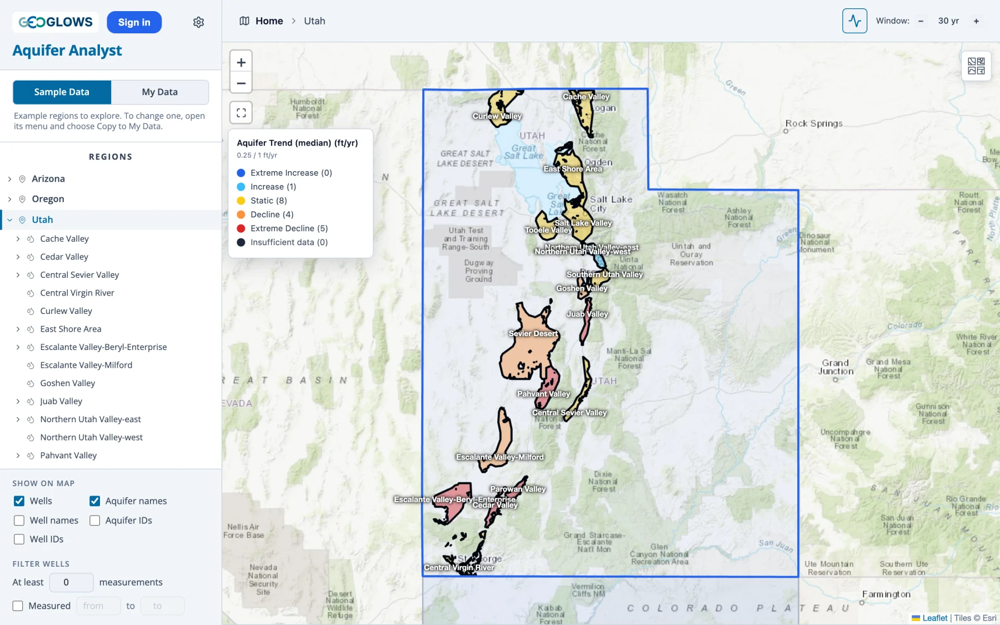
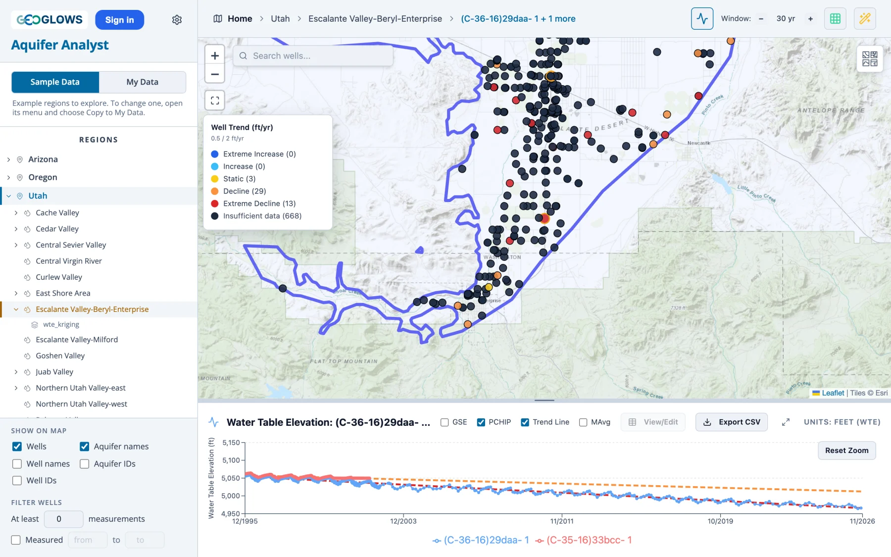

# Trends

**Analyze Trends**, at the top right once a region is open, colors each well by how fast its water level has been changing, and each
aquifer by the median of its wells' rates. Clicking it again turns the colors off. They stay on when you open another region, which gets
colors of its own, and going Home turns them off. It works on water table elevation: the classes below are rates of a water level, and
with another data type chosen the button is off.

## The trend of a well

A well's trend is the slope *m* of a straight line fitted by least squares to its measurements inside the trend window:

$$
m = \frac{n \sum t_i y_i - \sum t_i \sum y_i}{n \sum t_i^2 - \left(\sum t_i\right)^2}
$$

where *y*i are the *n* water table elevations in the window and *t*i their dates in years, so *m* is in feet or
meters per year, the region's unit. A well needs measurements in the window at least two years apart for a trend; otherwise it is
**Insufficient data**. Two readings a few weeks apart would give rates of hundreds of feet a year.

Each measurement counts the same in the fit. A well read seventy times a year for a decade and twice a year since has a line that leans
on the decade of frequent readings, and a well read only in summer in its early years and only in winter later shows a rise that is
partly the season. Look at the chart before reading much into one well's rate.

## The trend window

While trends are on, **Window** beside the button sets how many years back from today the fit reaches, 30 to start with. **−** and **+**
change it by 5 years, from 5 years up to the age of the region's oldest measurement, rounded up to a multiple of 5, and a region with a
shorter record cuts the window back to that age. Measurements before the window take no part.

A long window gives the rate over decades and evens out wet and dry spells. A short one shows what the wells are doing now, but a
well's rate over a few years can be a drought or a wet spell. Comparing two windows tells you whether a decline is steady or recent.
Wells not read during the window turn to **Insufficient data** as it shortens. The window always ends today, so a region whose readings stop
years ago has little or nothing in its short windows.

## The classes

Each rate falls in one of five classes. The limits are in the region's unit, and an aquifer's are half a well's, since the median rate of
a whole aquifer moving 1 ft a year is a larger change than one well doing so.

| Class | Color | Well (ft/yr) | Well (m/yr) | Aquifer (ft/yr) | Aquifer (m/yr) |
|-------|-------|--------------|-------------|-----------------|----------------|
| Extreme Decline | red | below −2 | below −0.6 | below −1 | below −0.3 |
| Decline | orange | −2 to −0.5 | −0.6 to −0.15 | −1 to −0.25 | −0.3 to −0.075 |
| Static | yellow | −0.5 to +0.5 | −0.15 to +0.15 | −0.25 to +0.25 | −0.075 to +0.075 |
| Increase | light blue | +0.5 to +2 | +0.15 to +0.6 | +0.25 to +1 | +0.075 to +0.3 |
| Extreme Increase | blue | above +2 | above +0.6 | above +1 | above +0.3 |
| Insufficient data | near-black | | | | |

A rate exactly on a limit goes to the class nearer zero: −0.5 ft/yr at a well is Static, and −2 ft/yr is Decline.

## Wells and aquifers on the map

With an aquifer open, its wells take the colors of their classes. With the region open and no aquifer chosen, the aquifers do: an
aquifer's rate is the median of the rates of its wells that have one, so a few wells in a deep pumping cone don't decide it. An aquifer
whose wells have no rate in the window is **Insufficient data**, and one with a single rated well takes that well's class.

A legend at the left of the map names what is colored, **Well Trend** or **Aquifer Trend (median)**, with the unit, the limits of the
classes, and how many of the open aquifer's wells, or of the region's aquifers, fall in each.

## On the chart

Turning trends on also checks **Trend Line** in the chart panel. Each selected well then shows its fitted line, dashed and colored by its
class, from the start of the window to today (see [The Time Series Chart](chart.md#trend-line)). A line that runs above a well's latest
readings shows a decline that has sped up, and one below them a decline that has slowed. The line runs on to today even when the
readings stop earlier, so it says nothing about the years after a well's last reading.

## An example

In Escalante Valley-Beryl-Enterprise in the Utah sample, with the window at 30 years in November 2026, the aquifer's median rate is
−1.65 ft/yr, an Extreme Decline. Of its two example wells, (C-36-16)29daa- 1 falls 2.88 ft a year over 618 readings, Extreme Decline,
and (C-35-16)33bcc- 1 falls 1.47 ft a year over 390 readings, Decline, though its readings stop in 2002. Only 45 of the aquifer's 713
wells have a trend; the rest have no readings two years apart in the last 30 years and show as Insufficient data. At 10 years,
(C-36-16)29daa- 1 falls 2.48 ft a year, and (C-35-16)33bcc- 1 has no trend.

## Reading the result

A region of red and orange wells points at a decline worth looking into, but whether its cause is pumping, a run of dry years or less
recharge is a question the colors can't answer; nor can they say whether blue wells show recovery, managed
recharge or the rebound after a dry spell. A straight line also hides the shape of a record: a well that fell for twenty years and then
recovered can come out Static. The chart of each well, and the maps and storage curve of Part 5, carry the detail behind the colors.
