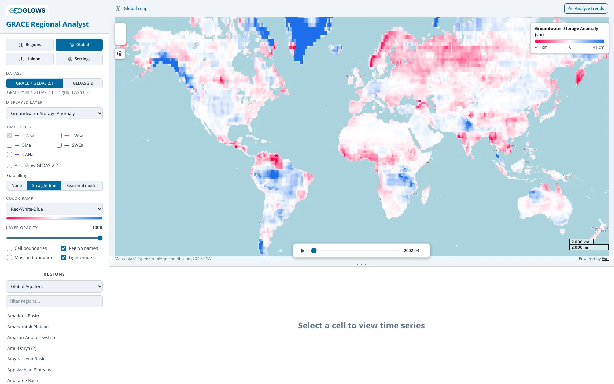
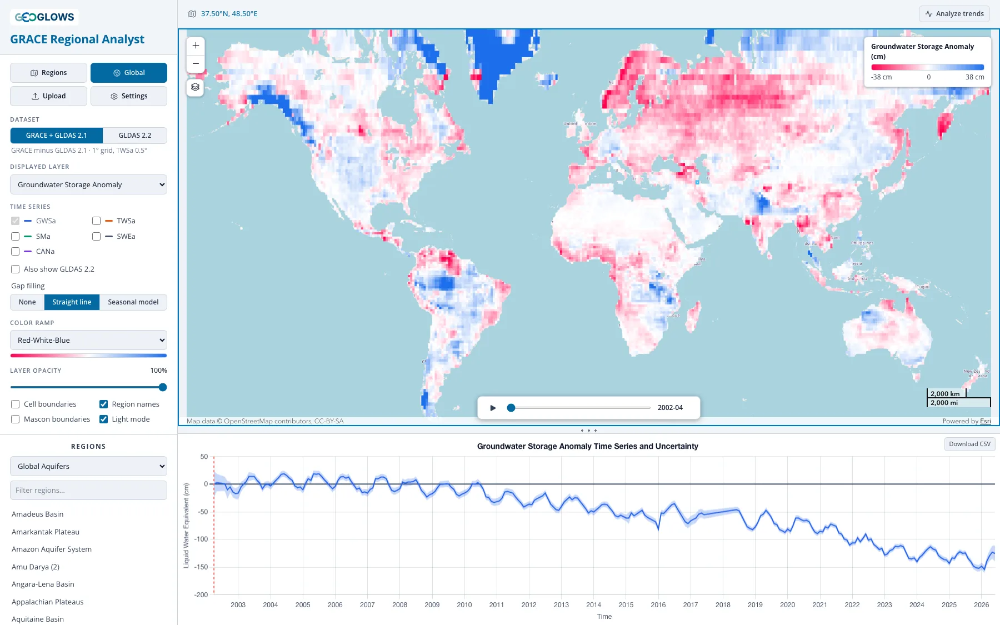

# Global View

## The global view

Click **Global** to see the displayed layer for every land cell in the world. The first time you open it, the app downloads the whole record for
that layer, which can take a little while; after that it is cached in your browser.

The global map is on a 1° grid for both datasets, even though GLDAS 2.2 is natively 0.25°. A whole-world 0.25° layer is a 971 MB array in the
browser for a single variable, which no amount of patience makes workable. The finer grid is read only inside a region, where there is a
boundary to cut it down to; see [Regional View](regional-view.md#which-cells-are-averaged).

Press play on the time control to animate the record month by month. The global view plays faster than the regional view, about four months a
second, and loops back to the start. The animation makes the big patterns easy to spot: the steady decline across northern India, the Middle
East and the North China Plain, the rising storage across the Sahel since about 2010, and the wet and dry years that sweep across the Amazon
and southern Africa.

Change the **Displayed layer** to compare components. On the GRACE dataset, TWSa still carries the footprint of the 3° mascons even with the
gain factors applied (see
[How GRACE Measures Water Storage](../mission/measuring-water-storage.md#the-mascon-solution-used-by-the-app)); SWEa is near zero everywhere
except at high latitudes and in mountains; SMa shows the seasonal wetting and drying of soils.

Change the **Dataset** to compare the two routes to groundwater over the whole world. The patterns agree in the places the signal is large —
northern India, the North China Plain, the Middle East — and that agreement means something, because the two were arrived at independently. The
2.2 map starts in February 2003 rather than April 2002 and has a value in every month, so its animation runs without the pauses GRACE's missing
months leave in the other.

## Time series for a single cell

Click any land cell to plot its time series. The breadcrumb changes to the cell's coordinates, and the chart shows the cell's values, with the
±1σ uncertainty band on the GRACE dataset; GLDAS 2.2 has no band (see [Regional View](regional-view.md#uncertainty)). The chart works as it does for a region (see [Regional View](regional-view.md#the-time-series-chart)), and the CSV download for a cell is
named after its coordinates.

A single cell is quick to look at, but remember that GRACE resolves about 3°, so the cell's TWSa rests on the same measurement as its
neighbors in the same mascon. The gain factors give those neighbors different numbers, and that difference comes from a land surface model
rather than from GRACE (see [Resolution, Leakage and Small Regions](../mission/resolution-and-leakage.md)). The same caution applies to a 2.2
cell: its grid is finer, but the GRACE correction behind its groundwater is not. For a basin or aquifer, use the
[regional view](regional-view.md), which averages over all the cells in the region.

## Trend map

With trends turned on, the global view colors each cell by its trend in place of the monthly anomaly, and the animation is hidden. The legend
counts the cells in each class. Trends work on either dataset; the cell counts differ, because the two have different land masks and start in
different years.

See [Trend Analysis](trends.md) for how the trend is computed and how to choose the window.
