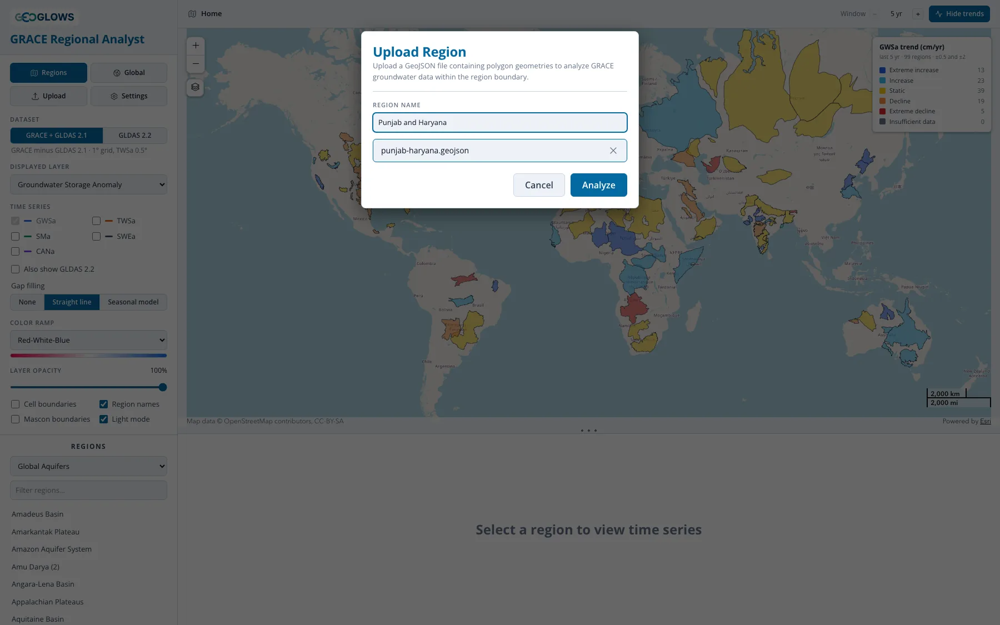
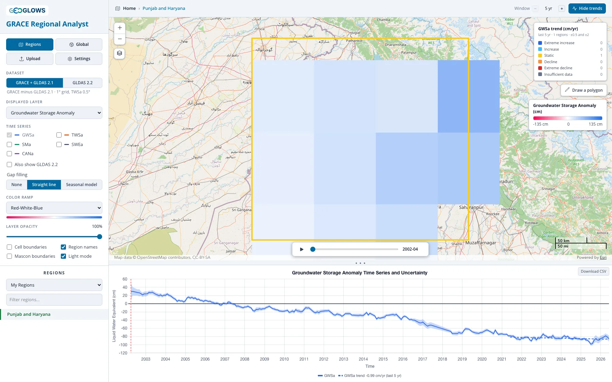
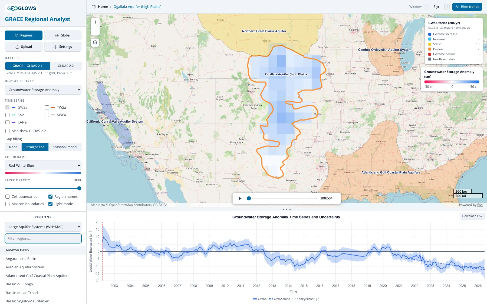
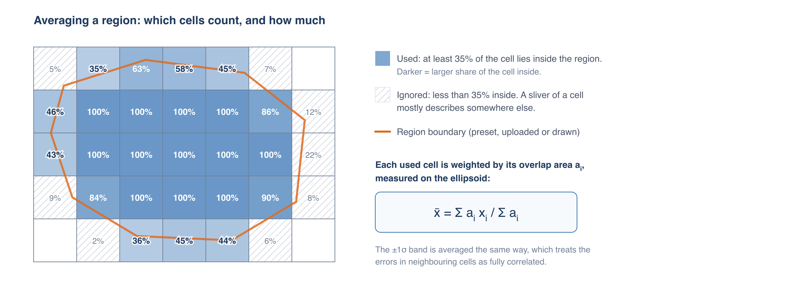
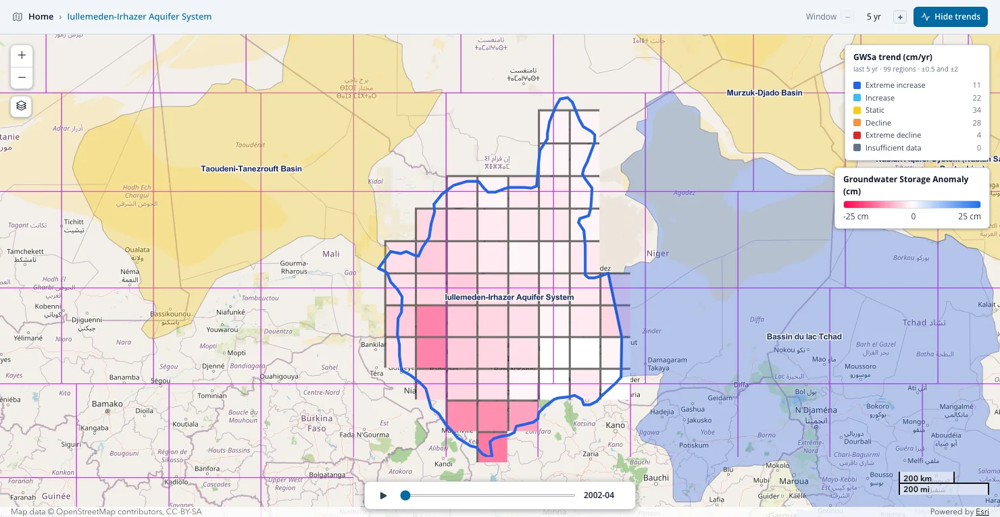
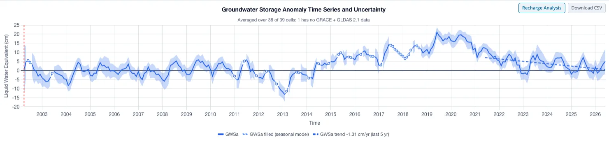
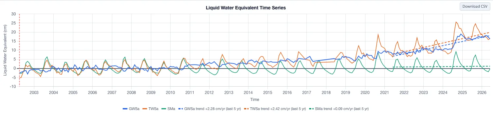

# Regional View

## The landing page

The app opens in the regional view, showing the outlines of every region in the active region set. The default set is Global Aquifers. Each
outline is colored by the trend in groundwater storage over the last five years, and the legend in the upper right counts the regions in each
trend class (see [Trend and Difference Analysis](trends.md)). **Color by** in the header changes what the outlines are colored by, and
**Hide** shows plain outlines instead.

From here you can:

- pan and zoom the map; region names appear once you zoom in far enough (turn them off with **Region names**)
- switch to another region set, or filter the list of names, in the **Regions** section of the control panel
- change the **Displayed layer** or the **Window** to reclassify every region at once, for example to see which aquifers have lost
  total water storage over the last 20 years
- change **Color by** to classify every region by how far the two datasets disagree there, in trend, in month-to-month agreement or in the
  size of the seasonal cycle (see [Exploring the Differences in the App](../compare/exploring.md))
- open a region for analysis, as described below

The breadcrumb in the header reads **Home** on this page. After you open a region, click **Home** or the **Regions** button to come back.

## Choosing a region

There are three ways to open a region for analysis:

1. Click its outline on the map, or its name in the list in the control panel.
2. Upload a boundary from a GeoJSON file.
3. Draw a polygon on the map.

### Preset region sets

Pick a set from the drop-down under **Regions**. Type in **Filter regions…** to narrow the list.

| Region set | Regions | Source |
|---|---|---|
| Global Aquifers | 99 | Compiled by the GEOGLOWS team from several sources, with gaps filled from the WHYMAP and IGRAC sets below |
| Large Aquifer Systems (WHYMAP) | 37 | Large Aquifer Systems of the World, WHYMAP (BGR/UNESCO) |
| Transboundary Aquifers (IGRAC) | 155 | Transboundary Aquifers of the World 2025, UNESCO-IHP / IGRAC (CC BY-SA 3.0 IGO) |
| Principal Aquifers, USA (USGS) | 31 | Principal Aquifers of the United States, U.S. Geological Survey |
| Major River Basins (GRDC) | 456 | Major River Basins of the World, Global Runoff Data Centre (non-commercial use only) |
| My Regions | yours | Regions you have uploaded |

The attribution for the active set is shown under the list. Cite it if you publish results based on that set.

### Uploading a region

Click **Upload**, choose or drag in a GeoJSON file (`.geojson` or `.json`, up to 50 MB), give the region a name, and click **Analyze**.

{ width="510" }

The file must contain Polygon or MultiPolygon features in WGS 84 longitude and latitude, which is the GeoJSON standard. If it has more than one
feature, they are merged into a single region. Holes in polygons are ignored.

!!! tip "Converting a shapefile"
    The app reads GeoJSON only. To convert a shapefile, open it in QGIS, right-click the layer, choose **Export → Save Features As…**, set the
    format to GeoJSON and the CRS to EPSG:4326. [mapshaper.org](https://mapshaper.org){:target="_blank"} does the same in a browser: import
    the `.shp`, `.dbf` and `.prj` files together and export as GeoJSON. Simplifying a very detailed boundary first makes the file smaller
    without changing the result, since the grid cells are 1° across.

The region is analyzed as soon as it is uploaded, the same way a published one is, and the breadcrumb takes the name you gave it. The example
above is a plain rectangle over Punjab and Haryana, where the groundwater decline is steep enough to be obvious at a glance.

Uploaded regions are saved in **My Regions**, where you can open them again or delete them with the × next to the name. They are stored in your
browser only: they are not shared with anyone, and they won't appear on another computer or in another browser.

### Drawing a region

Select **My Regions** in the region set drop-down, then click **Draw a polygon** on the map. Click to place each corner and double-click to
finish. The app analyzes the polygon straight away. Drawn polygons are not saved; upload a file if you want to keep a region.

## Reading the results

When you open a region, the map zooms to it and shows the anomaly cells for the displayed layer inside its boundary, and the chart shows the
region's average time series (see [The time series chart](#the-time-series-chart)).

The Ogallala, above, shows what a regional result looks like. The cells sit above the 2004–2009 average across the northern half of the aquifer
and close to it in the south, so the colours are not uniform even within one region. The average series runs roughly level through the 2010s and
then falls from about 2020, which is what produces the −1.70 cm/yr in the trend legend: that figure is the slope over the last five years, not
over the record. Changing the **Window** stepper changes it (see [Trend and Difference Analysis](trends.md#the-analysis-window)).

### Which cells are averaged

The regional average uses every grid cell that has at least 35% of its area inside the region, and weights each one by the area of overlap.
Cells mostly outside the region are left out; cells on the edge count in proportion to how much of them is inside.

Which grid that is depends on the dataset. On **GRACE + GLDAS 2.1**, TWSa is averaged on its 0.5° grid and the other layers on their 1° grid,
each with its own overlap weights. On **GLDAS 2.2** every layer is averaged on the model's native 0.25° grid, so a region gets sixteen times as
many cells and the 35% rule excludes far less of it. That is the main practical reason to reach for 2.2 on a small basin.

A region smaller than about 35% of one cell may have no cells that qualify; use a larger region, switch to GLDAS 2.2 for its finer grid, or
click the cell in the [global view](global-view.md) instead.

### Showing the grid

Turn on **Cell boundaries** and **Mascon boundaries** to see how the region relates to the grid and to GRACE's true resolution:

Here the region spans parts of several mascons (purple), so its average draws on several independent GRACE values. A region inside a single mascon
is subject to the [leakage](../mission/resolution-and-leakage.md) described in Part 1.

Mascons belong to the GRACE solution, so **Mascon boundaries** is hidden under GLDAS 2.2. The caution behind it has not gone away: 2.2
assimilates GRACE, so the correction that puts pumping into its groundwater arrives at GRACE's resolution however fine the model grid is.

## The time series chart

The chart below the map plots the region's average for each month in cm of liquid water equivalent, with zero (the 2004–2009 mean) drawn as a
solid line. Drag the divider between the map and the chart to give the chart more room.

Hover over the chart to read the values for a month. The red dashed line marks the month shown on the map, and it moves as you step or play
the time control.

### Uncertainty

On **GRACE + GLDAS 2.1**, a shaded band shows ±1σ when one component is plotted. The band is averaged over the cells the same way as the
values, which treats the errors in neighboring cells as fully correlated. That is the cautious choice: errors that partly cancel between cells
would give a narrower band. The band is hidden when several components are plotted, to keep the chart readable.

**GLDAS 2.2 has no band.** It is a single model run, so there is no ensemble to take a spread from, and NASA publishes no per-month uncertainty
for it. The absence of a band means no estimate was available, never that the values are more certain than the ones that have one — in general
the opposite, since a model run carries all the error sources listed in
[The GLDAS Land Surface Models](../gldas/land-surface-models.md#accuracy-and-mixing-versions) with nothing reporting them.

### Comparing components

The chart always plots the **Displayed layer**. Check other components under **Time series** in the control panel to add them on the same
axes:

| Component | On GRACE + GLDAS 2.1 | On GLDAS 2.2 | What it shows |
|---|---|---|---|
| TWSa | measured by GRACE | the model's own total | all the water in the column: groundwater, soil moisture, snow, canopy and surface water |
| GWSa | TWSa minus the three GLDAS layers | a model state, corrected by GRACE | groundwater, with surface water included |
| SMa | mean of three GLDAS 2.1 models | Catchment profile, less groundwater | soil moisture |
| SWEa | mean of three GLDAS 2.1 models | Catchment | snow water equivalent |
| CANa | mean of three GLDAS 2.1 models | Catchment | water held on vegetation canopies |

The same five names mean the same physical quantities in both datasets, which is what makes them comparable, but they are arrived at
differently and will not agree exactly. [Deriving Groundwater Storage](../gldas/deriving-groundwater.md) explains how the layers fit together
in each.

Ticking **Also show GLDAS 2.2** (or **Also show GRACE + GLDAS 2.1**, depending on which dataset is selected) adds the other dataset's version
of whatever is already plotted, in a second set of colors. Where the two groundwater series agree, the result rests on a measurement and a model
built independently of each other, which is stronger evidence than either on its own. Where they diverge, look at the components to see which
term the disagreement is in; the case studies work through examples.

Comparing components shows what drives the groundwater signal. In the example above, soil moisture (green) has a strong seasonal cycle but no
long-term trend, while total water storage (orange) and groundwater (blue) rise together from about 2010, so the rise in total storage is
groundwater.

### Gap filling

GRACE has no data for 35 months of the record, so on the GRACE dataset TWSa and GWSa have gaps; its GLDAS layers, and every layer of GLDAS 2.2,
have a value every month. The **Gap filling** control sets how the chart draws the gaps, and is hidden entirely under GLDAS 2.2:

- **None** breaks the line at every gap.
- **Straight line** joins the months on either side of each gap.
- **Seasonal model** estimates the missing months from a trend and seasonal cycle fitted to the region's own record, and draws them as a
  dashed line with open markers, as in the chart above.

The setting changes the chart only. [Gaps and Gap Filling](../mission/gap-filling.md) compares the three options and then gives the full method.

### Trend lines

While a trend is showing (**Analyze** in the header), each plotted component gets its fitted trend as a dashed line over the window, and the
legend gives its slope, for example "GWSa trend −0.29 cm/yr (last 5 yr)". Under one of the comparison measures the chart instead reports that
region's number under the title, with both datasets drawn. See [Trend and Difference Analysis](trends.md).

### Recharge Analysis

The water table fluctuation method needs a value every month, so a **Recharge Analysis** button appears above the chart once the series has
one: with **Seasonal model** selected on the GRACE dataset, and always on GLDAS 2.2, whose record has no gaps to fill. It opens a page that
estimates annual groundwater recharge from the GWSa series. The analysis always uses GWSa, whichever layer is displayed. Part 4 describes it,
starting with [The WTF Method](../recharge/wtf-method.md).

Being able to run it on 2.2 is not the same as the answer being right. Barbosa et al. (2025) ran both in the Volta Basin and found 2.2 gave
recharge 1.7 to 3.5 times the well-based estimate, depending on the WTF method, and did not recommend it for recharge at all, though they
recommended it for monitoring trends (see [Volta Basin](../case-studies/volta.md)). Read a 2.2 recharge number against a 2.1 one before using
it.

### Downloading the data

**Download CSV** saves the monthly values of all five components for the region, whichever components are plotted and whichever gap-filling
option is selected, along with the ±1σ bounds and gap-filled series where the dataset has them. With the comparison ticked, the other dataset's
columns come too. [Downloading Data](downloading-data.md) lists the
columns and shows how to convert the values to volumes.
