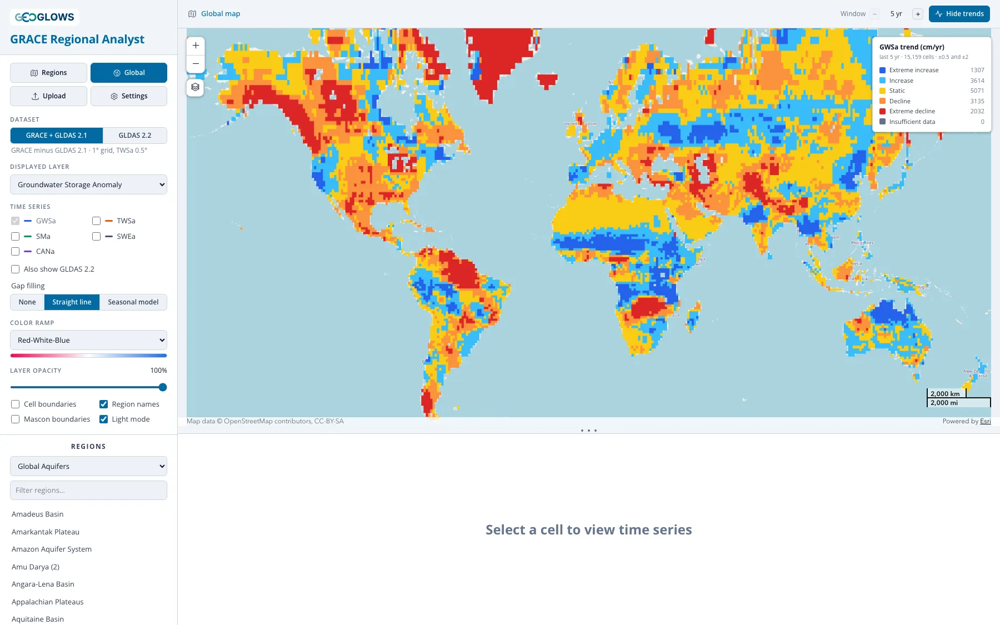

# Trend Analysis

## Trend classification

**Analyze trends** colors each region outline (in the regional view) or each grid cell (in the global view) by the rate at which the displayed
layer has been rising or falling. Trends are on when the app opens; click **Hide trends** to turn them off.

In the regional view, above, each aquifer or basin gets one trend from the average of its cells (see
[Regional View](regional-view.md#the-landing-page)). That is the better guide for a particular aquifer.

The global view, above, classifies every land cell — 15,159 of them on the GRACE dataset's 1° grid and 17,346 on GLDAS 2.2's, which carries a
slightly larger land mask — so it shows where storage is changing regardless of aquifer boundaries: rising across the Sahel and East Africa,
falling across much of the Middle East, northern India and Brazil.

The trend is the slope of a straight line fitted by least squares to the monthly values in the trend window, in cm per year. Months with no
GRACE data are skipped rather than filled, which affects the GRACE dataset only; GLDAS 2.2 has a value in every month. A region or cell needs at
least 24 months with data in the window to be classified; otherwise it is shown as **Insufficient data**.

Trends are computed on whichever dataset is selected, so the classification changes when you switch. Two differences matter when comparing the
two maps. GLDAS 2.2 starts in February 2003 against GRACE's April 2002, so the **All** window covers ten fewer months. And a 2.2 trend is a
trend in a model state that GRACE corrects monthly, which inherits GRACE's resolution however fine the model grid looks.

| Class | Trend (cm/yr) |
|---|---|
| Extreme decline | less than −2 |
| Decline | −2 to −0.5 |
| Static | −0.5 to +0.5 |
| Increase | +0.5 to +2 |
| Extreme increase | more than +2 |

The legend counts the regions or cells in each class. For reference, a trend of −2 cm/yr sustained over 100,000 km² is a loss of 2 km³ of water
a year.

### Gain factors and trend magnitudes

This section is about the GRACE dataset. GLDAS 2.2 is unaffected: no gain factor is applied to it, and the GRACE solution assimilated into it is
CSR's rather than JPL's.

The TWSa the app serves has JPL's gain factors applied (see
[Deriving Groundwater Storage](../gldas/deriving-groundwater.md#gain-factors)), and those factors flow straight into the trends, because a
constant multiplier on a time series multiplies its slope. JPL attaches a caution to this use: the factors are dominated by the annual cycle,
and the GRACE-FO Level-3 Handbook says they "can potentially introduce biases in frequency bands outside the annual component, in particular for
longer term trends," for which factors derived per averaging kernel would be needed. No such factors are published for this product, so the app
applies the standard ones throughout and reports one value of GWSa everywhere rather than one number for the map and a different one for the
trend.

In practice this moves most trends very little. Over the app's default five-year window the median cell's groundwater trend shifts by
0.12 cm/yr and the median trend magnitude goes from 0.95 to 0.93 cm/yr; over the whole record the median shift is 0.05 cm/yr. About 15% of cells
cross a class boundary over five years and 10% over the whole record — nearly all of them cells already sitting close to the ±0.5 or ±2 cm/yr
lines, where a small change in slope moves the label. The exceptions are glaciated cells, in Svalbard, Novaya Zemlya and the Patagonian
icefields, where a large factor is applied to an enormous ice signal and the trend can move by tens of cm per year. Those cells were never
groundwater. Treat a class as a summary rather than a measurement, and read the trend magnitude and the time series together.

## The trend window

The **Window** stepper in the header sets how far back the fit reaches from the most recent month: 5, 10, 15 or 20 years, or **All** for the
whole record since 2002. The classification and the legend update when you change it.

Storage in most regions swings between wet and dry years, so a short window can capture one swing rather than the long-term direction. In California's Central Valley, groundwater storage declined from 2002 through the drought of 2021–2022, then recovered
partly after the very wet winter of 2022–2023. The 5-year trend is an increase; the 20-year trend is a decline. Both are correct for their
windows. Look at the time series before drawing conclusions from a trend class, and compare more than one window.

## Trend line on the chart

When a region or cell is selected and trends are on, the chart adds the fitted line as a dashed line over the trend window, and the legend
reports the slope, for example "GWSa trend +2.25 cm/yr (last 5 yr)". Each plotted component gets its own trend line.

## How the region classification is computed

To classify every region in a set at once, the app averages the cells whose centers fall inside each region, weighted by the cosine of
latitude. This is faster than the overlap-weighted average used for the chart of a selected region (see
[Regional View](regional-view.md#which-cells-are-averaged)), and the two can differ slightly for small or narrow regions. The trend in
the chart legend is the one computed from the chart's series. A region too small to contain any cell center is classified using the cell at its
center.
