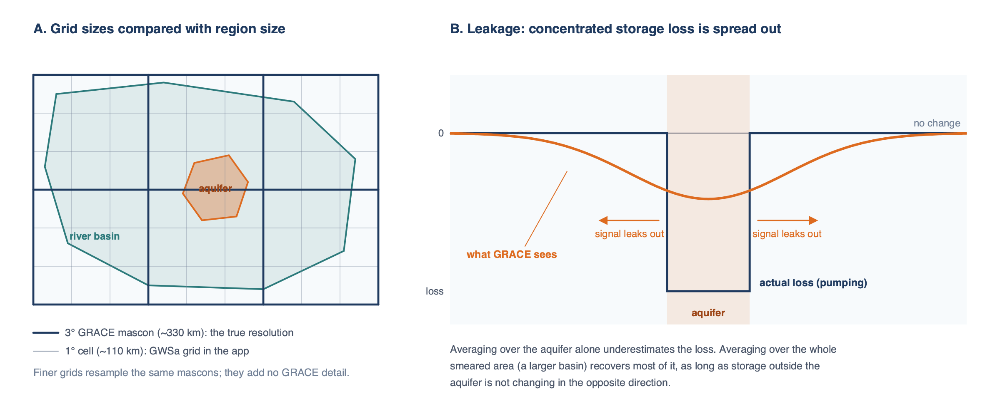
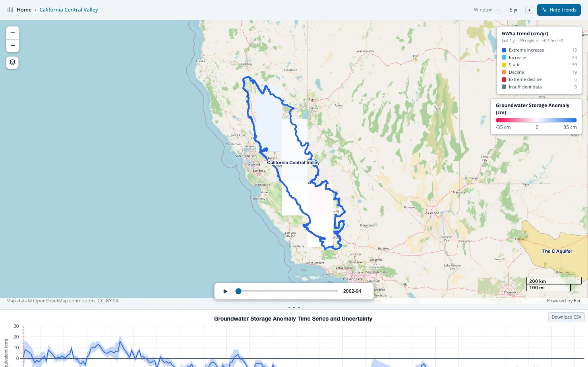

# Resolución, Fuga de Señal y Regiones Pequeñas

## Qué puede resolver GRACE { #what-grace-can-resolve }

GRACE detecta la masa a través de la gravedad, y la gravedad se dispersa con la distancia. Desde una órbita a cientos de kilómetros de altura, dos
masas separadas por menos de unos pocos cientos de kilómetros se confunden en una sola. La solución mascon de JPL refleja ese límite: resuelve un
valor por cada casquete de 3°, de unos 330 km de ancho, y las mallas de 0.5° y 1° son esa solución muestreada sobre una malla más fina. La
aplicación sí aplica los factores de ganancia de JPL, que dan a la malla de 0.5° cierta estructura dentro de cada mascon (ver
[Cálculo del Almacenamiento de Agua Subterránea](deriving-groundwater.md#gain-factors)), pero la medición que hay debajo sigue siendo un valor
por cada casquete de 3°.



El panel A compara las mallas con dos regiones. La cuenca hidrográfica abarca varios mascons, así que su promedio se basa en varias mediciones
independientes. El acuífero es más pequeño que un mascon. Su valor refleja sobre todo lo que hizo el mascon en el que se encuentra, incluidos los
cambios de almacenamiento fuera del acuífero.

Como regla práctica, los resultados de GRACE son confiables para regiones de unos 200,000 km² o más (aproximadamente 4° × 4° cerca del ecuador),
utilizables con cuidado hasta el tamaño de un mascon (unos 100,000 km²) y cada vez más inciertos por debajo de eso. Dos fuentes de variación
separan a las celdas vecinas dentro de un mismo mascon: los términos de GLDAS, que se miden en sus propias mallas de 0.25° y 1°, y los factores
de ganancia, que redistribuyen la amplitud del mascon entre sus celdas. Ninguna de las dos añade una segunda medición de GRACE. El número de
observaciones independientes bajo una región es el número de mascons que cubre, sea cual sea la malla que dibuje la aplicación.

## Fuga de señal { #leakage }

Como GRACE difumina la masa a lo largo de unos pocos cientos de kilómetros, un cambio de almacenamiento concentrado en un área pequeña aparece en
los datos como un cambio menor repartido sobre un área mayor (panel B). La señal **se fuga** de la región donde ocurrió hacia sus vecinas. También
ocurre lo contrario: los cambios de almacenamiento justo fuera de una región se filtran hacia adentro.

La fuga de señal importa más cuando el cambio de almacenamiento dentro de la región difiere del cambio a su alrededor. El peor caso es un valle
irrigado con bombeo intenso de agua subterránea y rodeado de montañas: el descenso se concentra en el valle y GRACE lo reparte también sobre las
montañas. Un promedio solo sobre el valle subestima entonces la pérdida real, a veces varias veces. Donde el almacenamiento cambia de forma
similar dentro y fuera de la región, como en una gran cuenca sedimentaria con un clima uniforme, las fugas hacia adentro y hacia afuera se
compensan aproximadamente y el promedio regional se acerca a la realidad.

El filtro de línea de costa de JPL limita la fuga entre tierra y océano, y los factores de ganancia restituyen parte de la amplitud que el
procesamiento de GRACE elimina dentro de un mascon. Ninguno de los dos corrige la fuga entre áreas terrestres vecinas, que es lo que más importa
para un acuífero con bombeo intenso junto a una región que se comporta de otro modo. Y los factores de ganancia son menos confiables precisamente
en ese caso: provienen de un modelo que no simula el bombeo.

## Trabajar con regiones pequeñas { #working-with-small-regions }

Si tu región de interés es más pequeña que un mascon, o es un centro de bombeo rodeado de áreas con un comportamiento distinto, estos enfoques
ayudan:

**Analiza la unidad hidrológica mayor.** Haz el análisis sobre la cuenca hidrográfica o el sistema acuífero que contiene tu área, usando uno de los
conjuntos de regiones predefinidos o un límite subido. Si casi todo el cambio de almacenamiento ocurre dentro del área más pequeña (por ejemplo,
si el bombeo se concentra en el acuífero), el volumen de cambio de la unidad mayor aproxima el volumen del área más pequeña:

```text
ΔV ≈ GWSa_basin × Area_basin
```

Esto funciona porque un volumen sumado sobre un área suficientemente grande recupera la mayor parte de la señal fugada, mientras que un promedio
sobre un área pequeña no.

**Calibra con pozos.** Donde los pozos de monitoreo dan una estimación independiente del cambio de almacenamiento durante parte del registro de
GRACE, la razón entre las estimaciones basadas en pozos y las basadas en GRACE da un factor de escala empírico que corrige la fuga de señal en esa
región. El factor es específico de la región y del periodo usado para obtenerlo. Stevens et al. (2025) lo hicieron para el Valle Central de
California ([caso de estudio](../case-studies/central-valley.md)).

**Interpreta una sola celda con cautela.** En la vista global puedes hacer clic en una sola celda para ver su serie temporal. Es rápido y útil
para explorar, pero dos acuíferos vecinos dentro del mismo mascon se apoyan en la misma medición de 3°. Los factores de ganancia les darán números
distintos; esa diferencia viene de un modelo de superficie terrestre, no de GRACE.



## Otras limitaciones { #other-limitations }

- **Almacenamiento, no niveles.** La GWSa es un cambio en la masa de agua. Convertirla en un cambio en la elevación del nivel freático requiere un
  rendimiento específico del acuífero, que varía mucho y a menudo se conoce mal.
- **Sin detalle vertical.** GRACE no puede distinguir acuíferos someros de profundos, ni confinados de libres.
- **Error de los modelos.** Los errores en los términos de humedad del suelo, nieve y dosel de GLDAS pasan directamente a la GWSa. Esto es más
  grave en regiones nevadas y húmedas, donde esos términos son grandes.
- **Agua superficial.** Los cambios en embalses, lagos y llanuras de inundación se cuentan como agua subterránea (ver
  [Cálculo del Almacenamiento de Agua Subterránea](deriving-groundwater.md)).

Aun con estos límites, GRACE ofrece una visión consistente e independiente del cambio de almacenamiento en sistemas acuíferos completos, que a
menudo es la única disponible. Úsalo para tendencias regionales y compáralo con datos locales siempre que puedas.

## Referencias { #references }

- Stevens, M. D., et al. (2025). Groundwater storage loss in the Central Valley analysis using a novel method based on in situ data compared
  to GRACE-derived data. *Environmental Modelling & Software*, 186, 106368.
  [doi:10.1016/j.envsoft.2025.106368](https://doi.org/10.1016/j.envsoft.2025.106368){:target="_blank"}

- Landerer, F. W., and Swenson, S. C. (2012). Accuracy of scaled GRACE terrestrial water storage estimates. *Water Resources Research*, 48,
  W04531. [doi:10.1029/2011WR011453](https://doi.org/10.1029/2011WR011453){:target="_blank"}
  La derivación de los factores de ganancia que aplica la aplicación, y la autoridad a la que remite el GRACE-FO Level-3 Handbook sobre su uso y
  sus límites.

- Rodell, M., and Famiglietti, J. S. (1999). Detectability of variations in continental water storage from satellite observations of the time
  dependent gravity field. *Water Resources Research*, 35, 2705–2723.
  [doi:10.1029/1999WR900141](https://doi.org/10.1029/1999WR900141){:target="_blank"}
- Longuevergne, L., Scanlon, B. R., and Wilson, C. R. (2010). GRACE hydrological estimates for small basins: Evaluating processing approaches on
  the High Plains Aquifer, USA. *Water Resources Research*, 46, W11517.
  [doi:10.1029/2009WR008564](https://doi.org/10.1029/2009WR008564){:target="_blank"}
