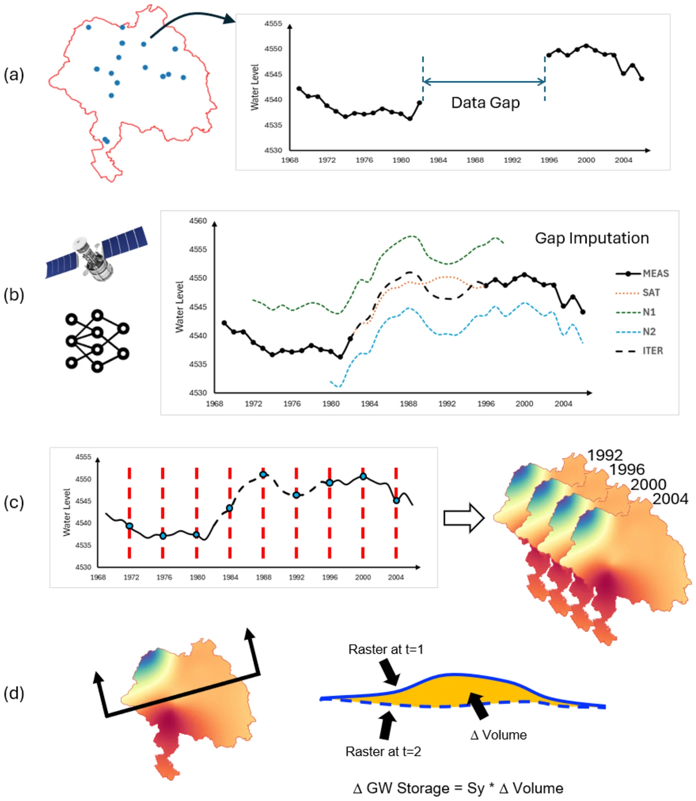
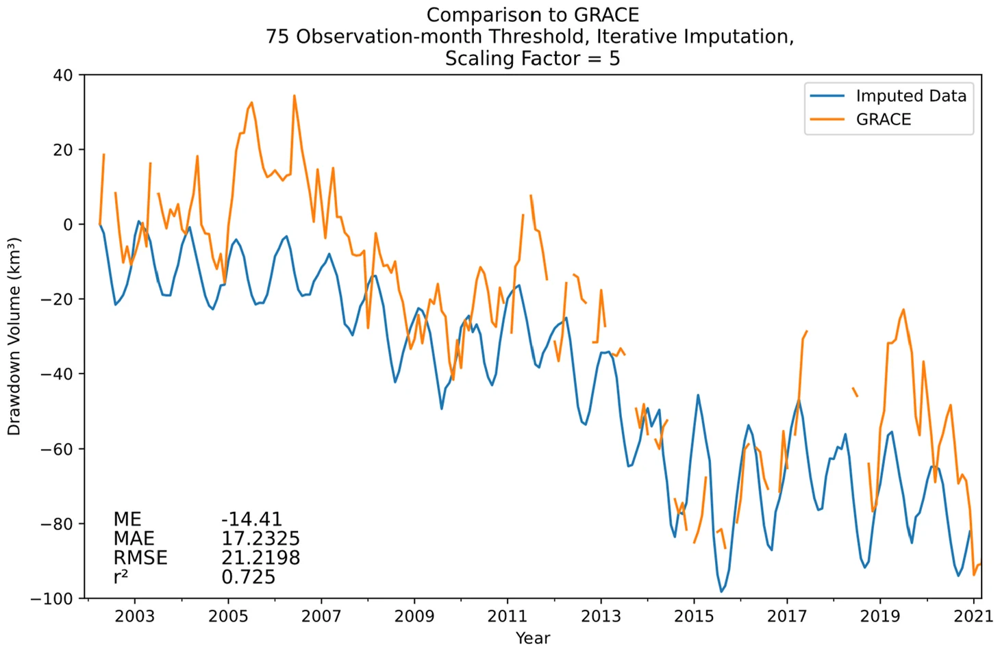

# California's Central Valley: correcting GRACE with well data

!!! cite "Paper"
    Stevens, M. D., Ramirez, S. G., Martin, E.-M. H., Jones, N. L., Williams, G. P., Adams, K. H., Ames, D. P., and Pulla, S. T. (2025).
    **Groundwater storage loss in the Central Valley analysis using a novel method based on in situ data compared to GRACE-derived data.**
    *Environmental Modelling & Software*, 186, 106368.
    [doi:10.1016/j.envsoft.2025.106368](https://doi.org/10.1016/j.envsoft.2025.106368){:target="_blank"}

## Setting

!!! tip "Which region to pick in the app"
    **Central Valley aquifer system**, in the **Principal Aquifers, USA (USGS)** set — 52,500 km², the closest of the app's outlines to the
    ~52,000 km² the study worked over. The **Global Aquifers** set also offers **California Central Valley**, but that outline is 71,000 km², a
    third larger, and it averages GRACE over ground the study did not include.

California's Central Valley is about 700 km long and 80 km wide, about 52,000 km², and one of the most heavily pumped aquifer systems in the
world. It is narrower than a single 3° GRACE mascon (about 333 × 264 km at that latitude), and the pumping decline is concentrated in the valley
while the surrounding mountains behave differently. That makes it a textbook case of [leakage](../mission/resolution-and-leakage.md#leakage):
averaged over the valley, GRACE understates the storage loss.

## An independent estimate from wells

The study built a storage record from well data for 1960–2020:

*Groundwater storage analysis using in situ data. (a) wells with data gaps are identified, (b) data gaps are imputed using a multi-step machine
learning algorithm featuring Earth observations, (c) temporal and then spatial interpolation is used to generate time-varying water level
rasters, (d) water levels rasters are combined with storage coefficients to estimate groundwater storage change at each time interval.
Reprinted from Stevens et al. (2025), Fig. 3, © 2025 Elsevier, reused under the authors' rights.*

1. Wells from USGS and California Department of Water Resources databases were screened by record length; the study compared thresholds of
   150, 75 and 50 months with observations (181, 572 and 921 wells).
2. Gaps in each well's record were filled in three stages: PCHIP interpolation across gaps shorter than 120 days, then an extreme learning
   machine trained per well on the Palmer Drought Severity Index and GLDAS (Noah at 0.25°, version 2.0 before 2000 and 2.1 after), then an
   iterative refinement that retrained on the three most closely correlated wells. The imputation follows a series of papers from the same
   group developing this model (Evans et al., 2020; Ramirez et al., 2022b, 2023).
3. The filled records were kriged into monthly water level surfaces on a 0.1° grid, clipped to the valley.
4. Changes in water level were converted to changes in storage with the specific yield map of the USGS Central Valley Hydrologic Model (CVHM).

Using the 75-month threshold, the well-based storage curve matched CVHM closely (r² = 0.87, RMSE 9.04 km³).

## Calibrating GRACE

The GRACE GWSa for the valley, converted to volume, tracked the well-based curve in timing but was much smaller. Its GRACE input was the JPL
mascons resampled to 0.5° with NASA's gain factors already applied (RL06.1 v03, where the app now serves RL06.3 v04), so the leakage factor
below is on top of that scaling rather than in place of it — see
[Gain factors](../gldas/deriving-groundwater.md#gain-factors) for what those factors do and do not fix.

Over 2002–2021 the two series correlate at r² = 0.725, and that figure holds whatever scale factor is used, because a constant multiplier
leaves a correlation alone. The errors set it instead. A sensitivity test from 3.5 to 6 put the lowest RMSE at 5.5 with the series
aligned on the GRACE start date, and at 4.5 with the wells lagged six months; the authors settled on 5 (± 1.0) as the value that serves under
either alignment. At 5 the mean error is −14.4 km³ and the RMSE 21.2 km³.

*Comparison of Iterative Well Imputation to GRACE using 75 observation-month threshold dataset. Reprinted from Stevens et al. (2025), Fig. 11,
© 2025 Elsevier, reused under the authors' rights.*

With the factor applied, the GRACE storage losses agree with most published estimates for the same periods:

| Published study | Period | Published loss | GRACE × 5 in this study |
|---|---|---|---|
| Famiglietti et al. (2011) | Oct 2003 – Mar 2010 | 20.3 km³ | 26.7 km³ |
| Scanlon et al. (2012) | Oct 2006 – Mar 2010 | 31 km³ | 31.1 km³ |
| Xiao et al. (2017) | Apr 2002 – Sep 2016 | 64.6 km³ | 70.7 km³ |
| Ojha et al. (2018) | Dec 2006 – Jan 2010 | 21.3 km³ | 53.2 km³ |

The ± 1.0 shows its effect here: a factor of 4 puts the Famiglietti period at 21.4 km³ against their 20.3 km³, closer than the 26.7 km³ a factor
of 5 gives. Ojha et al. (2018) stays more than double, and the authors flag it without accounting for it. The GRACE figure for Xiao et al. runs
through August 2016, because September was not yet available.

## Conclusions

- Gap-filled well records can produce a storage history that agrees with a calibrated regional groundwater model.
- That history gives a direct way to calibrate a leakage scale factor for GRACE, about 5 for the Central Valley.
- Once calibrated, GRACE can track storage change in the valley going forward, and the same approach could be used in data-poor regions with
  some well records.

**For app users:** for a small or narrow aquifer, the GRACE average from the app captures the timing and direction of storage change but can
understate its size several times over. A scale factor calibrated against wells corrects that, for that aquifer only.
