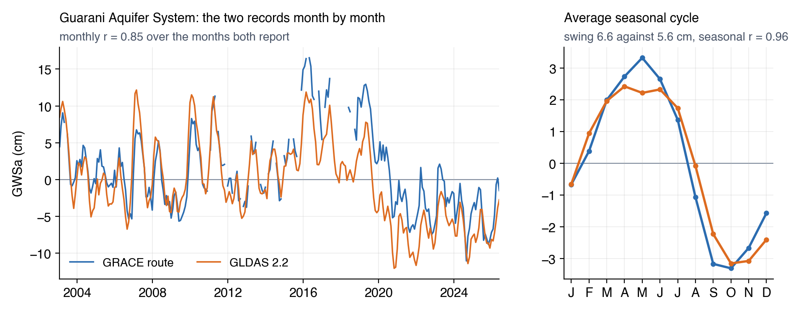
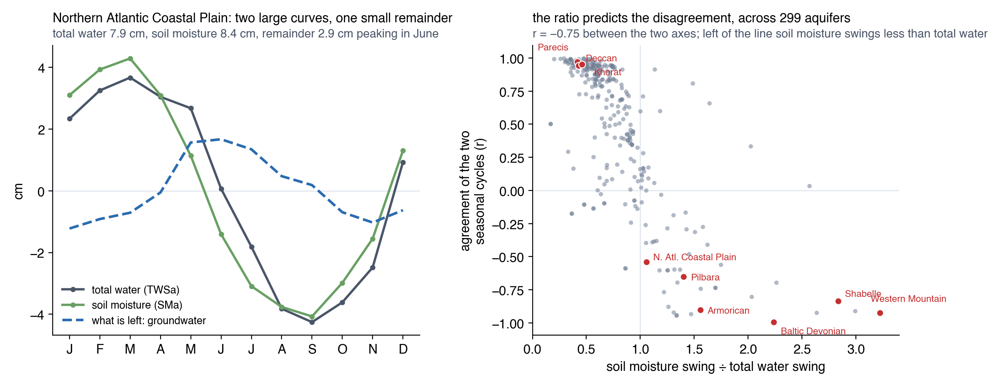
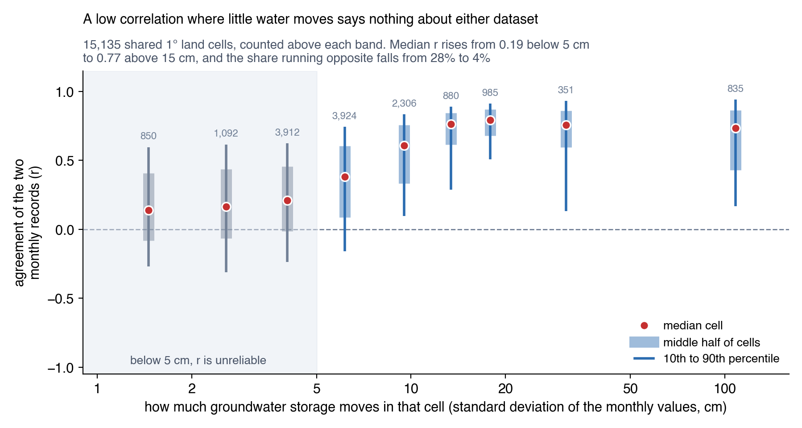
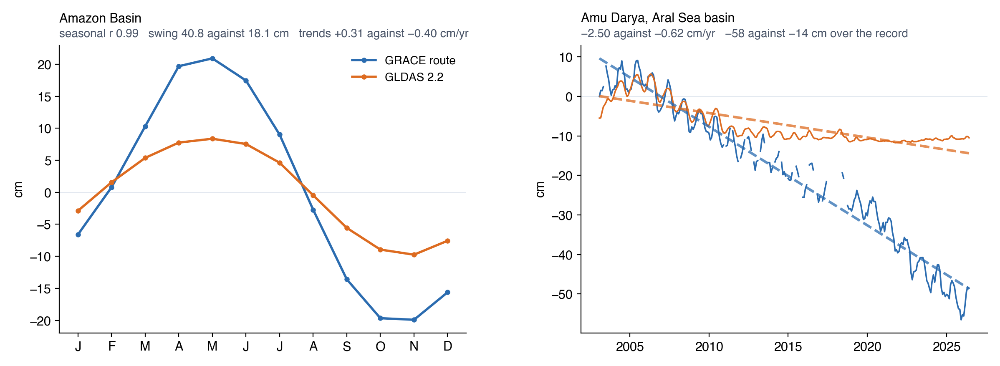
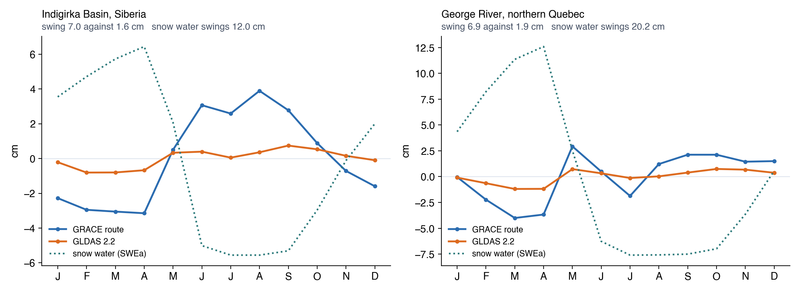

# À quoi ressemblent les écarts

[Pourquoi les deux jeux de données diffèrent](why-they-differ.md) expose les deux causes. Cette page montre ce qu’elles produisent, dans des
aquifères nommés sur cinq continents, les deux jeux de données étant tracés sur les mêmes axes à chaque fois.

Chaque série ici est la moyenne pondérée par la surface sur la région, ce que trace la vue régionale de l’application, sur les 281 mois que les
deux jeux de données fournissent. Un **cycle saisonnier** est la forme moyenne d’une année une fois la tendance à long terme retirée, et une
**amplitude** est la hauteur entre son mois le plus bas et le plus haut. La première moitié de la page traite de désaccords réels sur l’eau
souterraine. La seconde, de lieux où l’un des deux ne rapporte pas du tout de l’eau souterraine.

## Là où les deux concordent { #where-the-two-agree }

Quatre aquifères, quatre continents, rien en litige :

| Aquifère | r mensuel | r saisonnier | Amplitude, GRACE | Amplitude, 2.2 |
|:---|:---:|:---:|:---:|:---:|
| Bassin de Parecis, Brésil | 0,94 | 0,97 | 35,3 cm | 37,7 cm |
| Taurus-Zagros, Irak et Iran | 0,92 | 0,96 | 13,7 cm | 10,7 cm |
| Plateau du Deccan, Inde | 0,91 | 0,94 | 26,5 cm | 22,5 cm |
| Plateau de Khorat, Thaïlande et Laos | 0,89 | 0,95 | 27,7 cm | 31,1 cm |

Rien de ce qu’un gestionnaire de l’eau conclurait dans ces quatre cas ne change avec le choix du jeu de données. Ils couvrent un bassin tropical
humide, un front montagneux semi-aride, un plateau de mousson et une plaine de mousson, et tous quatre baissent ou montent dans les deux
enregistrements à la fois — le Deccan gagne dans les deux (+0,64 et +0,37 cm/an), le Taurus-Zagros perd dans les deux (−0,73 et −0,43).

Ce qu’ils ont en commun est le rapport qui traverse le reste de cette page : dans chacun, le cycle d’humidité du sol des modèles vaut environ 0,4
du cycle d’eau totale. La soustraction retire moins de la moitié de ce que GRACE a mesuré et laisse un signal souterrain doté d’une forme propre.

## Là où la tendance diffère { #where-the-trend-differs }

Les deux jeux de données peuvent voir les mêmes années humides et sèches et se placer malgré tout sur des droites qui s’écartent régulièrement :

| Aquifère | GRACE | GLDAS 2.2 | 2.2 / GRACE |
|:---|:---:|:---:|:---:|
| Central Valley, Californie | −1,37 | −0,24 | 0,18 |
| Saq-Ram (Disi), Jordanie et Arabie saoudite | −1,08 | −0,11 | 0,10 |
| Plaine côtière de Veracruz, Mexique | −1,21 | −0,06 | 0,05 |
| Bassin du Tarim, Chine | −0,55 | −0,06 | 0,11 |
| Gange-Brahmapoutre | −1,53 | −0,44 | 0,29 |
| Indus | −1,45 | −0,21 | 0,14 |
| Plaine de Chine du Nord | −0,67 | −0,25 | 0,38 |
| Ogallala (Hautes Plaines) | −0,45 | −0,22 | 0,49 |

Tendances en cm/an, pondérées par la surface, de février 2003 à juin 2026. Sur les 37 bassins WHYMAP, la tendance de 2.2 vaut une médiane de 0,26
de celle de GRACE là où le stockage baisse et 0,33 là où il monte, l’aplatissement jouant donc dans les deux sens.

La Central Valley est le cas le plus net parce que des puits peuvent trancher. Sur l’enregistrement, la voie GRACE perd 32 cm et 2.2 en perd 6 :
un bassin en épuisement sérieux face à un autre qui baisse doucement. L’étude de la Central Valley a trouvé que l’enregistrement GRACE suivait
dans le temps une histoire de stockage fondée sur des puits tout en étant plusieurs fois trop faible, et a calibré un facteur d’échelle d’environ
5 pour l’ajuster (voir [Central Valley](../case-studies/central-valley.md)). Face aux puits, 2.2 est le plus éloigné des trois.

La cause tient à la construction de 2.2. Le modèle Catchment ne comporte aucun pompage : personne n’irrigue dans le monde du modèle, de sorte que
le modèle seul n’épuisera jamais un aquifère. L’épuisement n’atteint l’eau souterraine de 2.2 que par la correction mensuelle que GRACE applique
au modèle, et cette correction se répartit entre les réservoirs de surface, de zone racinaire et profond plutôt que de tomber sur la seule eau
souterraine. Entre deux corrections, le modèle dérive vers son propre bilan hydrique.

Disi fait la même démonstration sans districts d’irrigation. C’est un aquifère fossile sous le désert jordanien et saoudien, pompé pour des villes
et pour des exploitations qui ne rechargent presque rien. GRACE le fait baisser de 25 cm sur l’enregistrement et 2.2 de 3 cm.

## Là où l’amplitude diffère { #where-the-swing-differs }

Le calendrier peut concorder presque parfaitement alors que la taille du cycle saisonnier, elle, ne concorde pas :

Dans le bassin sénégalo-mauritanien, les deux jeux de données montent avec les pluies d’été, culminent à un mois d’écart au plus, et leurs cycles
corrèlent à 0,94 — mais 2.2 oscille 3,2 fois plus. Le panneau de droite montre d’où vient la plus faible amplitude de la voie GRACE. L’eau totale
monte et descend de 15,8 cm sur l’année et l’humidité du sol des modèles de 11,7 cm, de sorte que soustraire l’une de l’autre laisse un reste de
5,8 cm. La vallée du Nu, à la frontière Chine-Myanmar, fait de même : des cycles corrélés à 0,94 et des amplitudes de 11,8 cm contre 31,5 cm.

Le modèle Catchment au sein de 2.2 découpe la même colonne autrement et conserve une part bien plus grande du cycle dans son réservoir souterrain.
Sur les 37 bassins WHYMAP, l’amplitude de 2.2 vaut une médiane de 1,23 fois celle de GRACE ; sur les 31 aquifères principaux de l’USGS, 1,52.

Aucune des deux amplitudes ne peut être confrontée à un puits dans ces bassins, de sorte que la lecture honnête est que les deux jeux de données
sont en désaccord sur le partage d’une saison humide entre le sol et l’aquifère qui le sous-tend.

## Là où les cycles sont opposés { #where-the-cycles-run-opposite }

Dans certaines régions, les deux ne diffèrent pas seulement par la taille. Ils culminent à des saisons différentes :

| Aquifère | GRACE culmine | 2.2 culmine | r saisonnier | Humidité du sol ÷ eau totale |
|:---|:---|:---|:---:|:---:|
| Dévonien balte, Lettonie et Estonie | août | mars | −0,99 | 2,24 |
| Montagne occidentale, Israël et Palestine | août | mars | −0,93 | 3,22 |
| Massif armoricain, France | août | février | −0,90 | 1,56 |
| Shabelle, Éthiopie et Somalie | septembre | décembre | −0,84 | 2,83 |
| Craton de Pilbara, Australie | septembre | avril | −0,65 | 1,40 |
| Plaine côtière atlantique nord, États-Unis | juin | février | −0,54 | 1,06 |

La dernière colonne est le diagnostic, et c’est la même quantité qui faisait concorder les aquifères concordants. Là où le cycle d’humidité du sol
des modèles est petit à côté du cycle mesuré d’eau totale, la soustraction laisse un signal souterrain doté d’une forme propre. Là où l’humidité
du sol oscille autant que l’eau totale ou davantage, les deux s’annulent presque :

Le panneau de gauche est le mécanisme en une seule image. Dans la plaine côtière atlantique nord, l’eau totale oscille de 7,9 cm sur l’année,
l’humidité du sol des modèles de 8,4 cm, et les deux courbes se superposent presque. Soustraire l’une de l’autre laisse le reste en pointillés :
petit, et décalé pour culminer quand le sol est le plus sec, c’est-à-dire au cœur de l’été. Le cycle souterrain que rapporte la voie GRACE est la
petite différence entre deux grands nombres voisins, de sorte que toute erreur sur l’un ou l’autre retombe entièrement dessus.

Le panneau de droite est le motif sur 299 aquifères des jeux de régions de l’application. L’humidité du sol divisée par l’eau totale prédit la
concordance des deux cycles saisonniers, à une corrélation de −0,75. En dessous d’un rapport de 0,7 la concordance saisonnière médiane vaut 0,93 ;
au-dessus de 1,0 elle vaut −0,39. Sur les 59 aquifères dont les cycles sont opposés, 42 ont une humidité du sol qui oscille plus fort que l’eau
totale.

Les nappes peu profondes sont la raison probable de rapports aussi élevés. Une partie de ce que les modèles GLDAS 2.1 comptent comme humidité du
sol est de l’eau qu’un hydrologue appellerait souterraine, de sorte que la soustraction retire deux fois le signal souterrain. Getirana, Kumar et
Rodell (2025) formulent la version générale de cet argument : les compartiments d’un modèle ne sont pas les réservoirs physiquement distincts que
la soustraction suppose.

## Là où une corrélation faible ne signifie rien { #where-a-low-correlation-means-nothing }

Tout désaccord n’est pas un problème de jeu de données. Deux petits signaux qui ne parviennent pas à s’aligner produisent une corrélation faible,
qu’il y ait ou non quelque chose qui cloche :

Chaque bande de la figure est la distribution de la corrélation sur les mailles qu’elle contient : le point est la médiane, la barre épaisse la
moitié centrale, la barre fine les 10e à 90e centiles. Que les médianes montent est la moitié du propos, que les barres se resserrent en est
l’autre. En dessous de 5 cm, la moitié centrale des mailles traverse zéro et 28 % d’entre elles ont les deux enregistrements en opposition ;
au-dessus de 15 cm, la moitié centrale se tient entre 0,6 et 0,85 et 4 % seulement sont en opposition.

| Ampleur des mouvements de l’eau souterraine GRACE | Corrélation médiane | Écart médian entre les deux | Cellules |
|:---|:---:|:---:|:---:|
| moins de 5 cm | 0,19 | 4,58 cm | 5854 |
| 5–15 cm | 0,51 | 8,32 cm | 7110 |
| plus de 15 cm | 0,77 | 27,32 cm | 2171 |

La montée s’aplatit au-delà d’environ 15 cm, où les deux jeux de données se stabilisent autour de 0,77 quelle que soit la quantité d’eau
supplémentaire en mouvement. Les aquifères que l’on analyserait se situent dans cette partie plate. Il faut
lire une corrélation en regard de la quantité d’eau en jeu, jamais seule.

## Des écarts qui ne sont pas de l’eau souterraine { #differences-that-are-not-groundwater }

Dans les cas ci-dessous, l’un des deux enregistrements rapporte quelque chose de réel qui n’est pas de l’eau souterraine. L’application dessine
ces cellules comme toutes les autres.

### Calottes glaciaires et glaciers { #ice-sheets-and-glaciers }

GRACE mesure les calottes glaciaires et les glaciers qui perdent de la masse, année après année. Aucun modèle GLDAS ne porte les uns ni les
autres, aucun ne rapporte donc cette perte comme de la neige, et la soustraction n’a nulle part où la mettre sinon dans l’eau souterraine.

Une cellule de 1° dans l’est du Groenland, à 66,5°N 36,5°O, rapporte une eau souterraine en baisse de **22 mètres** sur l’enregistrement — une
droite interrompue seulement par la lacune de la mission, dans un lieu sans aquifère et sans eau souterraine à perdre. Cette droite est la calotte
groenlandaise. La neige de cette même cellule se tient 303 cm au-dessus de sa ligne de base, car la neige du modèle s’accumule sans limite là où
il devrait y avoir de la glace. Le bassin du Pascua, qui draine le champ de glace Sud de Patagonie, fait de même à 3 mètres.

2.2 contourne l’arithmétique sans échapper au problème : son modèle Catchment n’a pas de glace non plus, et la correction GRACE qu’il reçoit se
répartit entre tous les réservoirs du modèle, de sorte qu’il rapporte un chiffre bien plus petit pour la même raison qui l’amène à aplatir les
tendances ailleurs. Aucune des deux séries ne signifie quoi que ce soit comme eau souterraine ici. Deux bassins fluviaux des jeux de
l’application, Alsek et Santa Cruz, portent une GWSa très grande pour ce motif.

**Comment le reconnaître.** Basculez la couche affichée sur la neige (SWEa). Là où elle atteint des centaines de centimètres, ou si la région
repose sur une calotte glaciaire à n’importe quelle latitude, la couche d’eau souterraine rapporte de la glace.

### L’eau de surface que les modèles ne portent pas { #surface-water-the-models-do-not-carry }

Aucun modèle GLDAS ne représente les fleuves, les lacs, les plaines d’inondation ni les réservoirs. Sur la voie GRACE, cette eau n’a nulle part où
aller dans la soustraction et atterrit donc dans l’eau souterraine.

En Amazonie le calendrier n’est pas en litige — les deux cycles corrèlent à 0,99, culminant tous deux en mai avec la crue. La taille, si : la voie
GRACE oscille de 40,8 cm contre 18,1 cm, et l’eau en trop est le fleuve lui-même, montant et descendant sur la plaine d’inondation. Les tendances
pointent alors en sens opposés, +0,31 contre −0,40 cm/an, de sorte qu’un lecteur demandant si l’eau souterraine amazonienne augmente ou diminue
obtient une réponse différente de chaque jeu de données. Le Congo se comporte de même.

L’Amou-Daria montre le même mécanisme sous forme de tendance plutôt que de cycle. La voie GRACE fait baisser le stockage de 58 cm sur
l’enregistrement contre 14 cm pour 2.2, et l’essentiel tient à la mer d’Aral et aux canaux d’irrigation qui en détournent l’eau — de l’eau de
surface qui quitte le bassin, comptée comme souterraine.

**Comment le reconnaître.** Un cycle souterrain GRACE bien plus grand que celui de 2.2, dans un bassin doté d’un grand fleuve, d’un grand lac ou
d’un grand réservoir, est généralement de l’eau de surface.

### Neige et sol gelé aux hautes latitudes { #snow-and-frozen-ground-at-high-latitude }

| Bande | Écart typique | Neige moyenne | Cellules |
|:---|:---:|:---:|:---:|
| 60°S–30°S | 5,92 cm | 0,33 cm | 540 |
| 30°S–0° | 8,48 cm | 0,01 cm | 2428 |
| 0°–30°N | 7,41 cm | 0,02 cm | 3094 |
| 30°N–60°N | 6,49 cm | 2,12 cm | 5397 |
| 60°N–90°N | 7,75 cm | 18,91 cm | 3700 |

La bande la plus septentrionale est celle qui porte la neige. Dans le bassin de l’Indigirka en Sibérie, l’eau souterraine GRACE oscille de 7,0 cm
sur l’année contre 1,6 pour 2.2, et dans le bassin de la rivière George au nord du Québec, 6,9 contre 1,9. La courbe en pointillés de chaque
panneau est le cycle de neige, et l’eau souterraine GRACE en est presque l’image miroir : là où le modèle retient trop ou trop peu de neige,
l’erreur passe directement dans la soustraction. L’eau bloquée dans un sol gelé saisonnier s’y ajoute, puisqu’aucun modèle GLDAS ne la conserve
comme réservoir propre.

**Comment le reconnaître.** Tracez la neige (SWEa) à côté de l’eau souterraine. Un cycle souterrain qui est le cycle de neige à l’envers est le
terme de neige, pas un aquifère.

### Nappes peu profondes { #shallow-water-tables }

Là où la nappe est proche de la surface, une partie de ce que les modèles comptent comme humidité du sol est de l’eau souterraine, et la
soustraire retire deux fois le signal souterrain. C’est le mécanisme derrière les cycles opposés ci-dessus, et le rapport présenté dans cette
section est la façon de le repérer.
