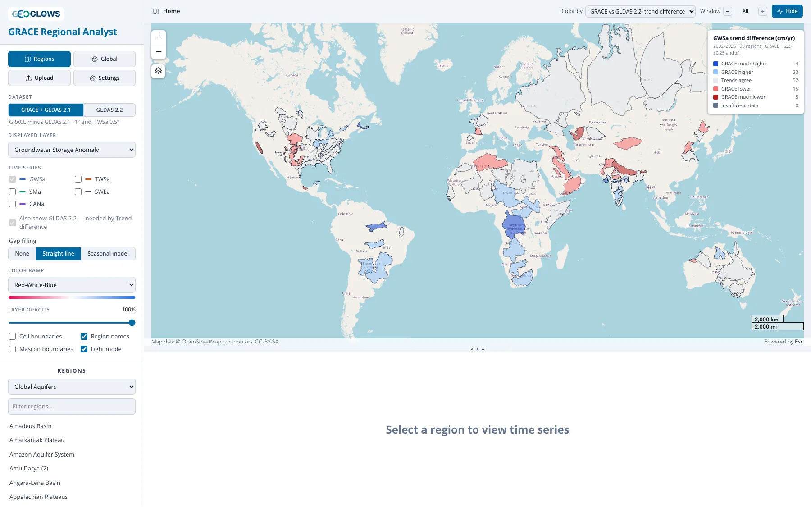
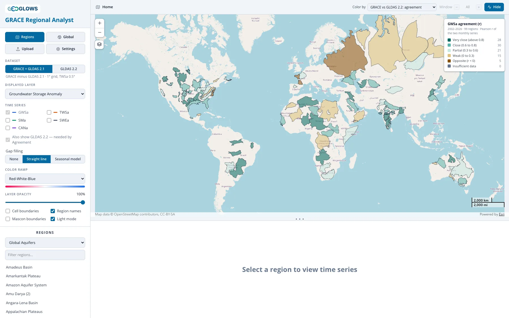
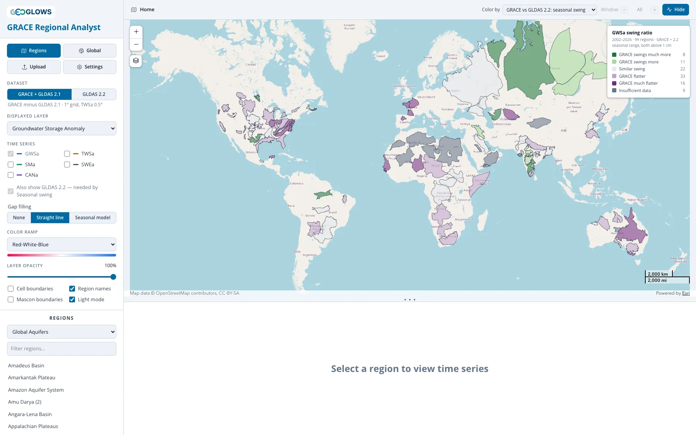
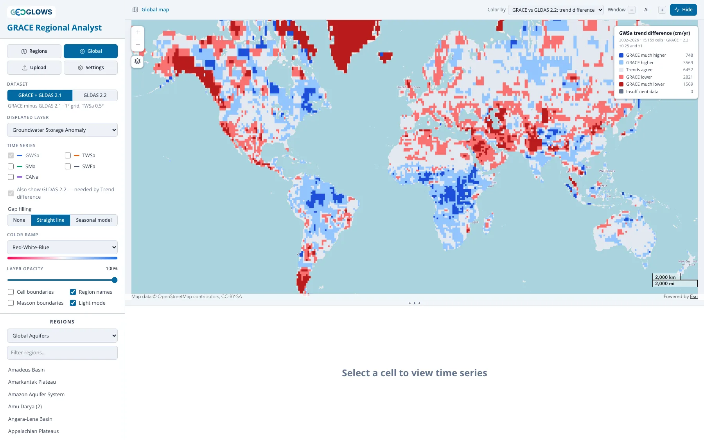
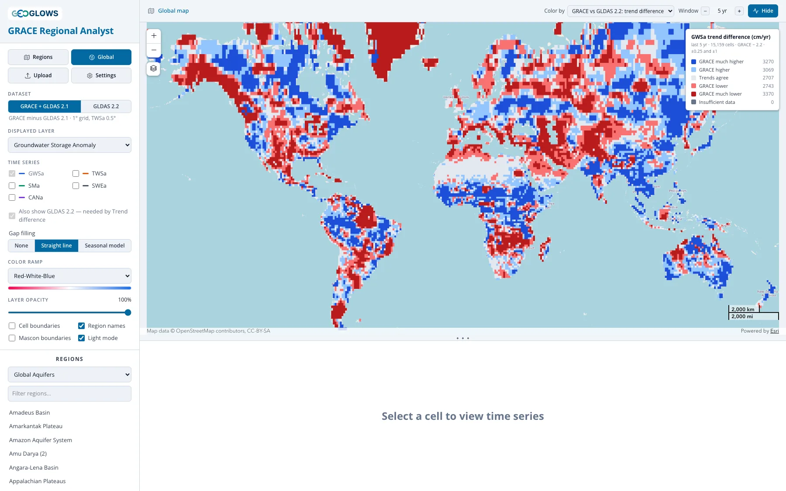
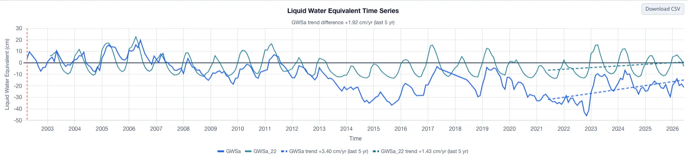

# Explorer les écarts dans l’application

[À quoi ressemblent les écarts](examples.md) parcourt des aquifères nommés un par un. L’application fait le même calcul pour toutes les régions
d’un ensemble à la fois, et pour chaque maille terrestre, en colorant la carte avec une comparaison entre les deux jeux de données plutôt
qu’avec la valeur de l’un ou de l’autre.

## Comment l’activer { #turning-it-on }

Une comparaison a besoin des deux jeux de données ; l’application ne la propose donc que lorsque la **Displayed layer** est
**Groundwater Storage Anomaly (GWSa)**, la seule grandeur que les deux jeux produisent en propre. Avec GWSa affichée, le menu déroulant
**Color by** de l’en-tête contient quatre choix : la tendance de GWSa, qui travaille sur un jeu de données à la fois, et trois comparaisons.

| Color by | La question à laquelle elle répond |
|:---|:---|
| GRACE vs GLDAS 2.2: trend difference | les deux divergent-ils sur la vitesse à laquelle le stockage change |
| GRACE vs GLDAS 2.2: agreement | les deux voient-ils les mêmes mois humides et les mêmes mois secs |
| GRACE vs GLDAS 2.2: seasonal swing | les deux s’accordent-ils sur l’ampleur du cycle annuel |

Chacune est un axe de désaccord, et une carte de l’un dit peu de chose des deux autres. Sur les 322 contours d’aquifères et de bassins que
couvrent les données publiées, les deux tendances de la région médiane diffèrent de 0,27 cm/an sur l’ensemble de l’enregistrement, ses deux
séries mensuelles sont corrélées à 0,69, et son cycle saisonnier GRACE oscille 0,73 fois autant que celui de 2.2.

Choisir une comparaison active **Also show GLDAS 2.2** dans le panneau de contrôle et l’y maintient, de sorte que le graphique porte les deux
séries pour ce que vous sélectionnerez ensuite, et règle la **Window** sur l’enregistrement entier : comparer deux enregistrements est une
question sur les enregistrements, et les classes ci-dessous ont été tracées pour leur totalité. Déplacer le sélecteur fonctionne toujours, et
votre choix l’emporte ensuite. La vue régionale colore les contours des régions, la vue globale colore les mailles, et la mesure
reste sélectionnée quand vous passez de l’une à l’autre. [Analyse des tendances et des écarts](../app/trends.md) en donne la mécanique : les
limites des classes, l’enregistrement minimal qu’il faut à une région, et la façon dont ses mailles sont moyennées.

## La carte des écarts de tendance { #the-trend-difference-map }

Chaque région ou maille est colorée par la tendance GRACE moins la tendance 2.2 sur la fenêtre de l’en-tête, en cm/an. GRACE est toujours
l’opérande de gauche, quel que soit le jeu de données sélectionné dans le panneau, si bien que le signe de l’écart ne dépend jamais d’un autre
réglage.

| Classe | Écart (cm/an) |
|:---|:---:|
| GRACE much lower (GRACE bien plus bas) | inférieur à −1 |
| GRACE lower (GRACE plus bas) | −1 à −0,25 |
| Trends agree (les tendances concordent) | −0,25 à +0,25 |
| GRACE higher (GRACE plus haut) | +0,25 à +1 |
| GRACE much higher (GRACE bien plus haut) | supérieur à +1 |

Le rouge marque les aquifères où la voie GRACE fait baisser le stockage plus vite, c’est-à-dire l’aplatissement qu’expose
[Jusqu’où cela est validé](validation.md#22-flattens-trends) : le modèle Catchment derrière 2.2 ne comporte aucun pompage, et l’épuisement
n’atteint son réservoir d’eau souterraine que par la correction mensuelle de GRACE, répartie entre tous les réservoirs du modèle. Le bleu marque
la direction inverse, où GRACE fait monter le stockage plus vite. Sur les 37 bassins WHYMAP, la tendance 2.2 vaut une médiane de 0,26 de celle de
GRACE là où le stockage baisse et de 0,33 là où il monte : les deux couleurs sont donc le même effet.

Ces limites viennent de l’enregistrement entier. Sur les 322 contours notés, l’écart médian vaut 0,27 cm/an et le 95e centile 1,12 : ±0,25 et ±1
sont donc réglés pour signaler comme extrême environ un dixième des régions. Raccourcir la fenêtre agrandit les deux tendances et leur écart avec
elles — sur les contours de Global Aquifers l’écart typique fait plus que doubler, de 0,26 cm/an à 0,59 — et les mêmes limites en signalent alors
un tiers :

| Fenêtre | GRACE much lower | GRACE lower | Trends agree | GRACE higher | GRACE much higher |
|:---|:---:|:---:|:---:|:---:|:---:|
| enregistrement entier (par défaut) | 5 | 15 | 52 | 23 | 4 |
| 20 dernières années | 7 | 14 | 50 | 24 | 4 |
| 15 dernières années | 6 | 21 | 42 | 24 | 6 |
| 10 dernières années | 8 | 19 | 37 | 20 | 15 |
| 5 dernières années | 14 | 18 | 28 | 21 | 18 |

Les deux lectures sont correctes pour leur fenêtre, et une fenêtre plus courte est la bonne question si vous voulez savoir si les deux jeux de
données ont commencé à diverger récemment. Lisez-y les extrêmes avec plus de scepticisme : une région qui change de classe quand vous raccourcissez
la fenêtre vous dit que les deux divergent sur une oscillation récente, ce qui est un problème moindre que diverger sur la direction à long terme.

## La carte de concordance { #the-agreement-map }

La concordance est la corrélation de Pearson des deux séries mensuelles, sur les mois que les deux jeux rapportent. Les mois qui manquent à GRACE
sont écartés des deux côtés plutôt que comblés, si bien que le nombre ne dépend pas du réglage de comblement des lacunes. L’enregistrement entier
est toujours utilisé ; le sélecteur **Window** s’estompe, parce qu’une corrélation sur cinq ans pose une autre question qu’une corrélation sur
vingt ans et que la réponse courte est la plus bruitée des deux.

| Classe | Corrélation | Aquifères de l’ensemble Global Aquifers |
|:---|:---:|:---:|
| Very close (très étroite) | supérieure à 0,8 | 28 |
| Close (étroite) | 0,6 à 0,8 | 30 |
| Partial (partielle) | 0,3 à 0,6 | 21 |
| Weak (faible) | 0 à 0,3 | 15 |
| Opposite (opposée) | inférieure à 0 | 5 |

Lisez cette carte à côté de la carte d’anomalies, et non seule. Une corrélation faible là où peu d’eau bouge ne dit rien sur l’un ou l’autre jeu
de données : en dessous d’environ 5 cm de variation de l’eau souterraine GRACE, les deux sont corrélés à une médiane de 0,19, et au-dessus
d’environ 15 cm ils se stabilisent autour de 0,77 quelle que soit la quantité d’eau en jeu (voir
[Là où une corrélation faible ne signifie rien](examples.md#where-a-low-correlation-means-nothing)). La classe brune, où les deux vont en sens
inverse, est celle à prendre au sérieux, et elle a un mécanisme connu : là où le cycle d’humidité du sol des modèles oscille autant que le cycle
mesuré d’eau totale, la soustraction derrière la voie GRACE annule l’essentiel du signal d’eau souterraine et ce qui reste peut culminer à la
mauvaise saison (voir [Là où les cycles sont en opposition](examples.md#where-the-cycles-run-opposite)).

Les classes faible et opposée se concentrent aux hautes latitudes sur cette carte — les bassins sibériens, les aquifères baltes —, ce qui relève
du terme de neige et non d’un aquifère : aucun modèle GLDAS ne garde le sol saisonnièrement gelé comme un réservoir propre, de sorte qu’une
erreur sur la neige des modèles passe directement dans l’eau souterraine de la voie GRACE (voir
[Neige et sol gelé aux hautes latitudes](examples.md#snow-and-frozen-ground-at-high-latitude)).

## La carte d’amplitude saisonnière { #the-seasonal-swing-map }

L’amplitude est la hauteur de l’année moyenne entre son mois le plus bas et le plus haut, une fois la tendance à long terme retirée, et cette
carte colore chaque région par l’amplitude GRACE divisée par celle de 2.2. C’est la grandeur que tracent les figures des pages de comparaison :
la couleur d’une région ici et ses chiffres là-bas concordent.

| Classe | Rapport | Aquifères de l’ensemble Global Aquifers |
|:---|:---:|:---:|
| GRACE much flatter (GRACE bien plus plat) | inférieur à 0,5 | 16 |
| GRACE flatter (GRACE plus plat) | 0,5 à 0,8 | 33 |
| Similar swing (amplitude semblable) | 0,8 à 1,25 | 22 |
| GRACE swings more (GRACE oscille plus) | 1,25 à 2 | 11 |
| GRACE swings much more (GRACE oscille bien plus) | supérieur à 2 | 8 |

Le rapport de deux petits nombres est instable, aussi les deux amplitudes doivent-elles dépasser 1 cm pour qu’une région soit notée ; neuf des 99
aquifères restent en dessous et ressortent en **Insufficient data**, presque tous au Sahara, dans la péninsule Arabique et en Asie centrale, où
le cycle annuel est trop faible pour qu’un rapport ait un sens. Sur les 90 notés, 49 ont le cycle GRACE plus plat que celui de 2.2 et 19
l’ont plus grand — le schéma que montrent les cas d’amplitude, l’oscillation de la voie GRACE étant rognée par l’humidité du sol qu’elle
soustrait. Les aquifères où GRACE oscille bien plus sont surtout ceux où elle porte autre chose que de l’eau souterraine : une rivière, une
plaine d’inondation, un réservoir ou un manteau neigeux que les modèles ne portent pas (voir
[Des écarts qui ne sont pas de l’eau souterraine](examples.md#differences-that-are-not-groundwater)).

## Une maille n’est pas une région { #a-cell-is-not-a-region }

La vue globale répond aux trois mêmes questions par maille de 1°, et les réponses en ressortent bien moins établies que les réponses régionales :

| Part de l’ensemble dans cette situation | Global Aquifers, 99 contours | mailles de 1° |
|:---|:---:|:---:|
| écart de tendance au-delà de ±1 cm/an, enregistrement entier | 9 % | 15 % |
| écart de tendance au-delà de ±1 cm/an, 5 dernières années | 32 % | 44 % |
| corrélation inférieure à 0 | 5 % | 18 % |
| amplitude saisonnière GRACE supérieure à 1,25 fois celle de 2.2 | 21 % | 45 % |

Une maille terrestre sur six a les deux enregistrements en opposition, là où cinq des 99 aquifères le sont, et près de la moitié des mailles ont
le cycle GRACE qui oscille plus que celui de 2.2, là où le tableau régional est l’inverse.

Au réglage par défaut, la carte a de la géographie : rouge foncé là où la voie GRACE porte de la glace, au Groenland, dans l’Arctique canadien
et en Patagonie ; rouge sur le nord de l’Inde, le Moyen-Orient et la Sibérie centrale ; bleu sur l’Amazone, le Congo, le Sahel et le Zambèze.
Ramenez-la à cinq ans et l’essentiel de cela disparaît :

Du moucheté sur la plus grande partie des terres émergées, du rouge et du bleu qui alternent sur quelques centaines de kilomètres, et le seul
grand bloc de **Trends agree** étendu sur le Sahara et la péninsule Arabique, où ni l’un ni l’autre des enregistrements ne bouge beaucoup en cinq
ans. Deux pentes ajustées chacune sur 60 mois puis soustraites laissent un nombre dont l’erreur dépasse l’écart qu’il rapporte. Une moyenne de
surface en supprime l’essentiel : voilà pourquoi la carte régionale mérite d’être lue à cinq ans et celle-ci non.

Une maille isolée porte le bruit d’un mois à l’autre qu’une moyenne de surface supprime, et du côté GRACE elle porte en plus le facteur de gain
appliqué à un mascon de 3°, si bien que la valeur d’une maille repose sur la même mesure que celle de ses voisines (voir
[Résolution, fuite du signal et petites régions](../mission/resolution-and-leakage.md)). Lisez les cartes de comparaison globales pour voir où
sont les grands motifs, et la vue régionale pour tout ce que vous comptez dire d’un aquifère donné.

## Lire une région face à son graphique { #reading-a-region-against-its-chart }

Cliquer sur une région, ou sur une maille dans la vue globale, trace les deux jeux de données et place sous le titre du graphique le nombre qui
se trouve derrière la couleur de cette région. La Central Valley ci-dessus affiche « GWSa trend difference −1.09 cm/yr (2002–2026) », avec les
deux droites ajustées de la légende à −1,35 et −0,22 cm/an : un bassin en épuisement sérieux sur un enregistrement contre un autre qui descend
doucement sur le second, le cas que traite [Là où la tendance diffère](examples.md#where-the-trend-differs).

Ramenez cette même région à cinq ans et les trois nombres changent de signe. GRACE affiche +3,40 cm/an, 2.2 affiche +1,43 et l’écart vaut
+1,92 : les deux enregistrements montrent la vallée qui se remet de la sécheresse de 2021–2022, et GRACE l’y montre plus de deux fois plus vite.
Aucune des deux lectures n’est fausse. Elles répondent à des questions différentes, et la valeur par défaut répond à celle pour laquelle la
comparaison existe.

Sous l’une ou l’autre des mesures de tendance, chaque série reçoit en plus sa droite ajustée, en pointillé. La concordance et le rapport
d’amplitude n’ont pas de droite à tracer : le graphique rapporte la mesure sous son titre et laisse les séries nues.

Le nombre sous le titre est celui de la carte, et il peut donc différer légèrement des deux pentes de la légende. Colorer toutes les régions d’un
ensemble à la fois moyenne les mailles dont le centre tombe à l’intérieur de chaque contour, tandis que le graphique de la région ouverte utilise
une moyenne pondérée par le recouvrement de chaque maille que le contour touche (voir
[Vue régionale](../app/regional-view.md#which-cells-are-averaged)).

## Ce qu’un grand écart signifie et ne signifie pas { #what-a-large-difference-does-and-does-not-mean }

Une région colorée à l’un des deux extrêmes est une région à examiner. Ce n’est pas une barre d’erreur, et aucun des deux jeux de données n’est
la vérité dont l’autre s’écarterait. Avant de traiter un grand écart comme un résultat, faites les vérifications de
[Lequel utiliser](which-one-to-use.md#before-treating-a-large-difference-as-a-result) : tracez l’eau de neige, comparez les deux totaux, comparez
l’humidité du sol à l’eau totale, regardez quelle quantité d’eau bouge réellement, et demandez-vous si une rivière, un lac ou un réservoir
pourrait l’expliquer.

Là où les preuves pointent dans un sens, [Jusqu’où cela est validé](validation.md) dit jusqu’où. Deux comparaisons avec des puits et une étude
sur 186 bassins soutiennent de préférer GRACE pour la taille d’une tendance et de traiter celle de 2.2 comme aplatie. Rien de comparable ne
tranche l’amplitude saisonnière : une région colorée **GRACE much flatter** est donc un désaccord sur la façon dont une saison humide se partage
entre le sol et l’aquifère qui se trouve dessous, sans aucune mesure indépendante pour dire quel partage est le bon.
