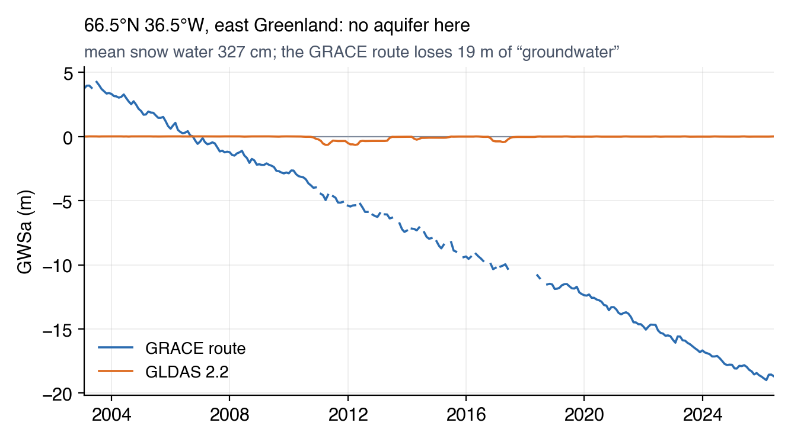
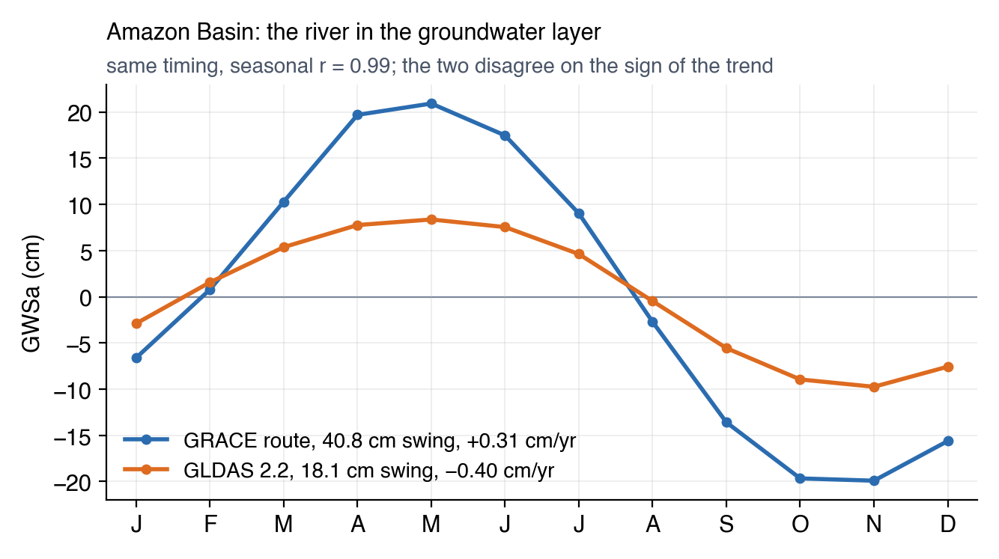

# Known Artifacts

Some of the largest differences between the two datasets are places where one of them, usually the GRACE route, is reporting water that is not
groundwater. The app draws those cells like any other. This page names them so you can recognise one on sight rather than reading it as a
finding.

## Ice sheets and glaciers

The twelve 1° cells where the two groundwater records differ most are all ice:

| Cell | Typical gap | Correlation | Average snow water |
|:---|:---:|:---:|:---:|
| 66.5°N, 36.5°W (east Greenland) | 1019 cm | −0.03 | 327 cm |
| 66.5°N, 35.5°W | 805 cm | 0.02 | 283 cm |
| 66.5°N, 37.5°W | 777 cm | 0.02 | 330 cm |
| 76.5°N, 67.5°W (Ellesmere and Baffin) | 739 cm | 0.13 | 9 cm |
| 78.5°N, 15.5°E (Svalbard) | 734 cm | 0.39 | 24 cm |
| 76.5°N, 68.5°W | 729 cm | 0.19 | 6 cm |

GRACE measures the ice sheet losing mass, year after year. No GLDAS model carries glaciers or ice sheets, so none of them reports that loss as
snow, and the subtraction has nowhere to put it except groundwater. The result is metre-scale groundwater change in cells that hold no aquifer at
all. 2.2 sidesteps the arithmetic without escaping the problem: its Catchment model has no ice either, and the GRACE correction it receives gets
spread across all the model's stores, so it reports a much smaller number for the same reason it flattens trends elsewhere. Neither series means
anything as groundwater here.

One cell makes the point. At 66.5°N 36.5°W the GRACE route reports groundwater falling 19 metres over the record, a straight line interrupted
only by the mission gap, in a place with no aquifer and no groundwater to lose. That line is the Greenland ice sheet. 2.2 sits at zero because
its model has no ice to lose either, and its GRACE correction is spread across stores that cannot hold the loss.

Two river basins in the app's own basin sets, Alsek and Santa Cruz, carry very large GWSa for this reason (see
[Deriving Groundwater Storage](../gldas/deriving-groundwater.md)).

**How to recognise it.** Switch the displayed layer to snow water (SWEa). Where it runs to hundreds of centimetres, or the region sits on an ice
cap at any latitude, the groundwater layer is reporting ice.

## Surface water the models do not carry

In the Amazon the GRACE groundwater swings 40.8 cm through the year against 2.2's 18.1, and its trend runs +0.31 cm/yr against 2.2's −0.40 — the
two datasets do not even agree on the direction. Most of the Amazon's water cycle happens in the river channels and on the floodplain, and no
GLDAS model represents either. On the GRACE route that water has nowhere to go in the subtraction, so it lands in groundwater. The Congo behaves
the same way.

The timing is not in dispute — the two cycles correlate at 0.99, both peaking in May with the flood. The size is: the GRACE route swings
40.8 cm against 18.1 cm, and the extra water is the river itself, rising and falling across the floodplain with nowhere else to go in the
subtraction. The trends then point in opposite directions, so a reader asking whether Amazon groundwater is gaining or losing gets a different
answer from each dataset.

Any basin where a large river rises and falls seasonally over a wide floodplain will do some version of this.

**How to recognise it.** A GRACE groundwater cycle far larger than 2.2's, in a humid basin with a major river, is usually surface water.

## Snow and frozen ground at high latitude

Typical gap between the two groundwater records, by latitude band:

| Band | Typical gap | Average snow water | Cells |
|:---|:---:|:---:|:---:|
| 60°S–30°S | 5.92 cm | 0.33 cm | 540 |
| 30°S–0° | 8.48 cm | 0.01 cm | 2,428 |
| 0°–30°N | 7.41 cm | 0.02 cm | 3,094 |
| 30°N–60°N | 6.49 cm | 2.12 cm | 5,397 |
| 60°N–90°N | 7.75 cm | 18.91 cm | 3,700 |

The northernmost band carries the snow, and the Siberian basins show the GRACE route swinging much harder through the year — the Pechora at
12.1 cm against 2.2's 3.3, West Siberia at 14.0 against 4.6. Two things end up in the GRACE groundwater there: snow mass the model's snow layer
does not match, and water locked in seasonally frozen ground, which no GLDAS model keeps as a store of its own.

The tropical band is the worst of the ice-free bands, and that is the floodplain water above rather than anything frozen.

## Shallow water tables

Where the water table sits close to the surface, part of what the GLDAS 2.1 models count as soil moisture is in fact groundwater, so subtracting
it removes the groundwater signal twice. The clearest case is the Northern Atlantic Coastal Plain, where the GRACE groundwater cycle ends up four
months out of step with 2.2's. [Where Each One Is Trustworthy](trusting-each-one.md) gives the check to run and the aquifers affected.

## Regions where little happens

Across 1° cells where the GRACE groundwater barely moves — under 5 cm of typical variation — the two datasets correlate at a median of 0.19. Two
small signals that fail to line up produce that number whether or not anything is wrong. Before reading a low correlation as a problem, check how
much water is actually moving: the same comparison gives 0.77 in cells that vary by more than 15 cm.

## A short checklist

Before treating a large difference as a result:

1. Plot snow water (SWEa). Ice and snow explain most of the extremes.
2. Plot total water (TWSa) for both datasets. Where the totals agree and only the groundwater disagrees, the two datasets are dividing the column
   differently; the satellite measurement itself is not in question.
3. Compare the seasonal swing of soil moisture (SMa) against total water (TWSa). Where the two are comparable, distrust the timing of the GRACE
   groundwater cycle.
4. Check how much water is moving before reading anything into a correlation.
5. Ask whether a river, a floodplain or a reservoir could account for the water.
