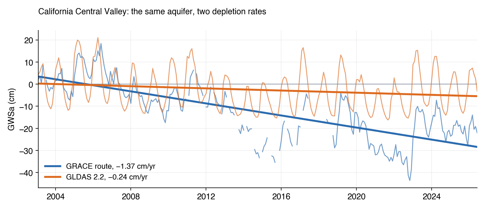
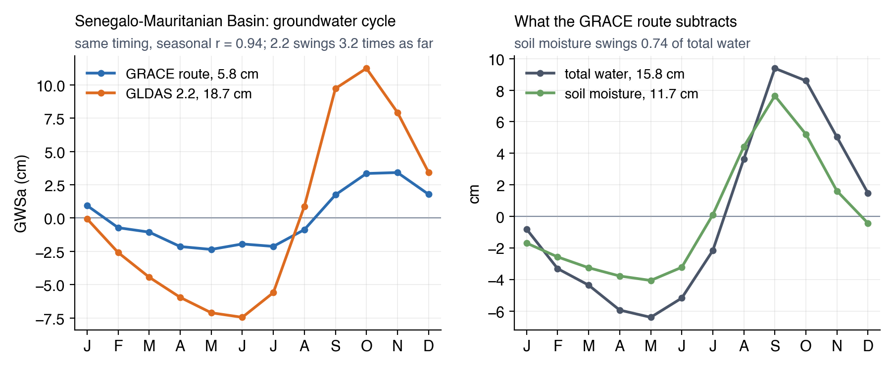
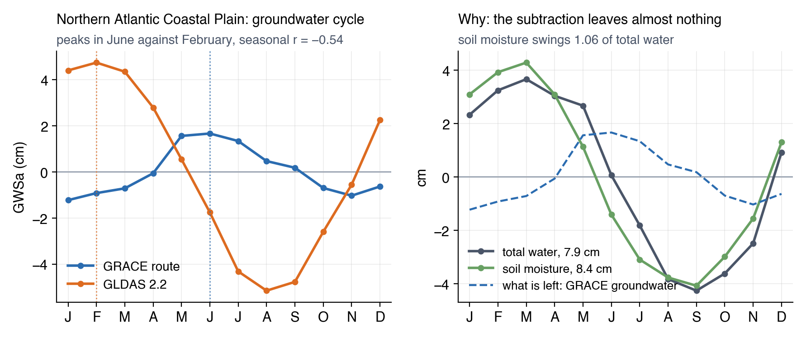

# Where Each One Is Trustworthy

Neither dataset wins everywhere. [Why the Two Datasets Differ](why-they-differ.md) accounts for the disagreement; this page says which series to
quote for which question, and gives the diagnostic to run when you want to decide for yourself in a region the tables below do not cover.

## Agreement follows the size of the signal

Sorting the 1° land cells by how much the GRACE groundwater actually moves, measured by its standard deviation — the typical distance of a month
from that cell's own long-run average:

| How much GRACE groundwater moves | Median correlation | Median gap between the two | Cells |
|:---|:---:|:---:|:---:|
| under 5 cm | 0.19 | 4.58 cm | 5,854 |
| 5–15 cm | 0.51 | 8.32 cm | 7,110 |
| over 15 cm | 0.77 | 27.32 cm | 2,171 |

A quiet cell correlating at 0.2 is two small signals failing to line up, and it says nothing about whether either dataset is sound. The aquifers
anyone would analyse sit in the bottom row. Read a correlation alongside the amount of water in play, never on its own.

## For the size of a trend, use GRACE

Averaged over the 37 WHYMAP large groundwater basins, the 2.2 GWSa trend runs about a quarter of the GRACE one — a median ratio of 0.26 across
the basins losing storage and 0.33 across those gaining it, so the flattening goes both ways:

| Basin | GRACE | GLDAS 2.2 | 2.2 / GRACE |
|:---|:---:|:---:|:---:|
| Ganges-Brahmaputra | −1.53 | −0.44 | 0.29 |
| Indus | −1.45 | −0.21 | 0.14 |
| California Central Valley | −1.37 | −0.24 | 0.18 |
| North Caucasus | −1.03 | −0.68 | 0.66 |
| North China Plain | −0.67 | −0.25 | 0.38 |
| Arabian | −0.65 | −0.10 | 0.16 |
| Tarim | −0.55 | −0.06 | 0.11 |
| Ogallala (High Plains) | −0.45 | −0.22 | 0.49 |
| Sahara Septentrional | −0.44 | −0.10 | 0.23 |

Trends in cm/yr, area-weighted over each basin, February 2003 to June 2026.

The Central Valley is the clearest case. Both datasets see the same droughts and the same wet winters — the 2012–2016 drawdown and the 2023
recovery are in both — but the lines they sit on diverge steadily. Over the 23-year record the GRACE route loses 32 cm of water and 2.2 loses
6 cm: a basin in serious depletion against one drifting gently down.

Wells settle it, and they go further than GRACE does. The Central Valley study found the GRACE record tracking a well-based storage history in
timing while running several times too small, and calibrated a scale factor of about 5 to match it (see
[Central Valley](../case-studies/central-valley.md)). 2.2 is the furthest of the three from what the wells show.

The reason sits in how 2.2 is built. The Catchment model has no pumping in it: nobody irrigates in the model world, so the model by itself will
never deplete an aquifer. Depletion reaches 2.2's groundwater only through the monthly correction GRACE applies to the model, and that correction
gets spread across the model's surface, root-zone and deep stores rather than landing on groundwater alone. Between corrections the model drifts
back toward its own water balance.

Scanlon et al. (2018) found the same flattening in models run without any GRACE correction. Comparing seven of them against three GRACE solutions
over 186 river basins and 2002–2014, they found the models badly understating the large decade-scale trends GRACE sees, in both directions, which
they put down to irrigation and other human water use sitting outside the model physics. 2.2 does receive a GRACE correction, so it is pulled
part of the way back; the ratios above are what remains.

Three basins disagree on sign — the Amazon, the Congo and the Pechora — all of them places where the trend is small beside the seasonal cycle.

## For the shape of the seasonal cycle, compare soil moisture against total water

The two datasets can differ in how big the seasonal swing is and in when it peaks. Across the 37 WHYMAP basins the 2.2 seasonal swing runs a
median 1.23 times the GRACE one; across the 31 USGS principal aquifers, 1.52. In a few places it is several times larger:

| Aquifer | GRACE | GLDAS 2.2 | 2.2 / GRACE |
|:---|:---:|:---:|:---:|
| Willamette Lowland | 4.8 | 33.3 | 7.0 |
| Parisian Basin | 3.0 | 17.3 | 5.7 |
| Denver Basin | 1.2 | 4.7 | 4.0 |
| Northern Atlantic Coastal Plain | 2.9 | 9.9 | 3.4 |
| Bassin Sénégalo-Mauritanien | 5.8 | 18.7 | 3.2 |

Height from the low month to the high month of the average seasonal cycle, in cm, with the long-term trend removed, February 2003 to June 2026.

The Senegalo-Mauritanian Basin separates the two questions cleanly. On timing the two datasets agree almost perfectly: both rise with the summer
rains, both peak in October, and their cycles correlate at 0.94. On size they do not, with 2.2 swinging 3.2 times as far. The right panel shows
where the GRACE route's smaller swing comes from. Total water rises and falls by 15.8 cm over the year, the models' soil moisture by 11.7 cm, so
subtracting one from the other leaves a 5.8 cm remainder. The Catchment model inside 2.2 divides the same column differently and keeps a much
larger share of the cycle in its groundwater store.

Neither swing can be checked against a well here, so the honest reading is that the two datasets disagree about how a wet season is shared
between the soil and the aquifer beneath it.

Timing can part company as well. In the Northern Atlantic Coastal Plain the GRACE groundwater peaks in June and 2.2's in February, four months
apart, and the two seasonal cycles correlate at −0.54 — they run close to opposite. The Sahara Septentrional is half a year apart; the Indus runs
March against September.

One comparison tells you which regions will do this: how big the soil moisture cycle is beside the total water cycle. Across the WHYMAP basins
that ratio correlates at −0.65 with how well the two groundwater cycles agree, and at −0.83 across the USGS aquifers — the harder soil moisture
swings relative to total water, the worse the two datasets agree. Every region whose seasonal cycles run opposite has soil moisture swinging as
hard as total water, or harder:

| Aquifer | Total water swing | Soil moisture swing | Ratio | Seasonal correlation |
|:---|:---:|:---:|:---:|:---:|
| Ogaden-Juba | 2.0 | 3.3 | 1.70 | −0.74 |
| Upper carbonate | 7.2 | 9.9 | 1.37 | −0.60 |
| Sahara Septentrional | 0.5 | 0.7 | 1.35 | −0.83 |
| Cambrian-Ordovician | 9.9 | 11.4 | 1.15 | −0.38 |
| Indus | 5.7 | 6.3 | 1.11 | −0.39 |
| Northern Atlantic Coastal Plain | 7.9 | 8.4 | 1.06 | −0.54 |

Regions where the two datasets agree have ratios between 0.4 and 0.6: soil moisture accounts for about half the total swing, and the groundwater
left over still has a cycle of its own.

The arithmetic explains it. On the GRACE route, groundwater is what is left after soil moisture, snow and canopy water are taken out of the
measured total. Where the model's soil moisture rises and falls as much as the measured total does, and at the same time of year, the two nearly
cancel, and what remains peaks when the soil is at its driest. The groundwater cycle left behind is the small difference between two large
similar numbers, so it is sensitive to any error in either.

The left panel is the case itself: the GRACE route peaks in June, 2.2 peaks in February, and the two cycles correlate at −0.54. The right panel
is the cause. Total water in that aquifer swings 7.9 cm over the year and the models' soil moisture swings 8.4 cm, slightly more, and the two
rise and fall together. Subtracting a curve from one almost exactly like it leaves the dashed remainder: small, and shifted to peak when the
soil is at its driest, which is midsummer.

In the Northern Atlantic Coastal Plain that puts the GRACE groundwater peak four months after the water table there is actually highest, while
2.2's February peak falls where late-winter recharge would put it. Shallow water tables are the likely reason: part of what the GLDAS 2.1 models
count as soil moisture is groundwater, so the subtraction removes the groundwater signal twice. Getirana, Kumar and Rodell (2025) make the
general form of this argument — that a model's compartments are not the physically separate stores the subtraction assumes.

**Prefer 2.2 for seasonal shape where soil moisture swings as hard as total water.** The check takes a minute in the app: plot the SMa and TWSa
layers for your region and compare the heights of their seasonal cycles.

## For recharge, use GRACE

Barbosa et al. (2025) ran the water table fluctuation method on both datasets in the Volta Basin and got 17.4 and 36.1 cm/yr from 2.2 against 5.8
and 10.7 cm/yr from GRACE, with wells giving a median of 10.4. They recommend 2.2 for trends and not for recharge (see
[Volta Basin](../case-studies/volta.md)). A flipped seasonal phase is a second reason for the same conclusion: the method reads a trough and a
peak off the series, and if their months are wrong the recharge estimate is wrong with them.

## Summary

| What you want | Use | Because |
|:---|:---|:---|
| A depletion or recovery rate, in cm/yr or km³/yr | GRACE | 2.2 flattens trends to roughly a quarter |
| The shape and timing of the seasonal cycle | 2.2 where soil moisture swings as hard as total water, otherwise either | the subtraction can flip the timing |
| A region a few cells across | 2.2 | averaged on 0.25° where the other is on 1° |
| An unbroken monthly series | 2.2 | the model runs through the GRACE gaps |
| Recharge by the WTF method | GRACE | Barbosa et al. (2025), plus the phase risk |
| An uncertainty figure per cell | GRACE | 2.2 publishes none |
| Anything before February 2003 | GRACE | the 2.2 record starts there |
| A result you mean to publish | both | and say where they agree and where they do not |

Two independent answers that agree are hard to explain away. Where they disagree, plot the pieces: a gap that lives in soil moisture is a
different problem from one that lives in total water.

## How far any of this is validated

The numbers on this page come from comparing the two published datasets against each other, which establishes how they differ and why, and
settles nothing about which is closer to the water table. The independent support for the recommendations is indirect:

- **Models understate trends.** Scanlon et al. (2018), seven global models against three GRACE solutions over 186 basins.
- **The residual method is structurally shaky.** Getirana, Kumar and Rodell (2025), on the models' stores not being the separable compartments the
  subtraction needs.
- **The two mascon solutions agree at basin scale and diverge on trends.** Scanlon et al. (2016), CSR and JPL over 176 basins.
- **In-situ comparison is harder than it sounds.** Chen, Famiglietti, Scanlon and Rodell (2016) note that converting well levels to storage needs
  a specific yield per well, which is itself uncertain even where the monitoring network is dense. Bhanja et al. (2016) carried out such a
  comparison across India.

None of those studies evaluated these two datasets against each other, and none used this app. Direct well-based validation here extends only to
the [Central Valley](../case-studies/central-valley.md) and Barbosa et al.'s Volta wells. Treat the recommendations above as reasoning from
construction and from measured behaviour, supported by the literature on each mechanism, rather than as a validated ranking.

## References

- Barbosa, S. A., Jones, N. L., Williams, G. P., Teklu, H., Yidana, S. M., Pulla, S. T., et al. (2025). A Multi-Source Approach to Groundwater
  Storage and Recharge Assessment in the Volta Basin. *Science of the Total Environment*.
  [doi:10.1016/j.scitotenv.2025.180421](https://doi.org/10.1016/j.scitotenv.2025.180421){:target="_blank"}
- Bhanja, S. N., Mukherjee, A., Saha, D., Velicogna, I., and Famiglietti, J. S. (2016). Validation of GRACE based groundwater storage anomaly
  using in-situ groundwater level measurements in India. *Journal of Hydrology*, 543, 729–738.
  [doi:10.1016/j.jhydrol.2016.10.042](https://doi.org/10.1016/j.jhydrol.2016.10.042){:target="_blank"}
- Chen, J., Famiglietti, J. S., Scanlon, B. R., and Rodell, M. (2016). Groundwater Storage Changes: Present Status from GRACE Observations.
  *Surveys in Geophysics*, 37, 397–417. [doi:10.1007/s10712-015-9332-4](https://doi.org/10.1007/s10712-015-9332-4){:target="_blank"}
- Getirana, A., Kumar, S., and Rodell, M. (2025). Inconsistencies in GRACE-Based Groundwater Storage Estimation — A Call for a Proper Use of
  Land Surface Models. *Geophysical Research Letters*, 52, e2025GL119197.
  [doi:10.1029/2025GL119197](https://doi.org/10.1029/2025GL119197){:target="_blank"}
- Scanlon, B. R., Zhang, Z., Save, H., Wiese, D. N., Landerer, F. W., Long, D., Longuevergne, L., and Chen, J. (2016). Global evaluation of new
  GRACE mascon products for hydrologic applications. *Water Resources Research*, 52, 9412–9429.
  [doi:10.1002/2016WR019494](https://doi.org/10.1002/2016WR019494){:target="_blank"}
- Scanlon, B. R., Zhang, Z., Save, H., Sun, A. Y., Müller Schmied, H., van Beek, L. P. H., et al. (2018). Global models underestimate large
  decadal declining and rising water storage trends relative to GRACE satellite data. *Proceedings of the National Academy of Sciences*, 115(6),
  E1080–E1089. [doi:10.1073/pnas.1704665115](https://doi.org/10.1073/pnas.1704665115){:target="_blank"}
