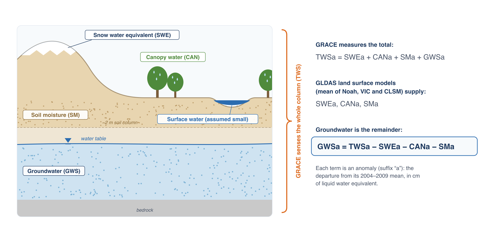
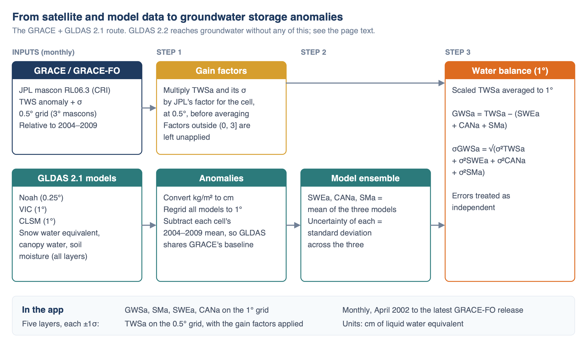

# Deriving Groundwater Storage

The app reaches groundwater two ways. The GRACE + GLDAS 2.1 dataset subtracts modelled storage from a gravity measurement. The GLDAS 2.2
dataset reads a model state that GRACE has corrected. Both report the same quantity on the same baseline, and both are given here, followed by
what the uncertainty covers and when to prefer one over the other.

## The water balance

Total water storage is the sum of every store in a column of the Earth: snow water equivalent (SWEa), water held on vegetation canopies (CANa),
soil moisture (SMa), groundwater (GWSa) and surface water in rivers, lakes and reservoirs.

Both of the app's datasets rest on this identity, and both leave surface water out of it:

$$
\mathrm{TWSa} = \mathrm{SWEa} + \mathrm{CANa} + \mathrm{SMa} + \mathrm{GWSa}
$$

So any change in surface water storage ends up in GWSa, in either dataset — no GLDAS model carries rivers, lakes or reservoirs either. Over most
of the world surface water changes are small next to the other terms. In regions with large reservoirs, wetlands, or rivers with big floods (the
Amazon, the Ganges and Brahmaputra, the Caspian Sea, Lake Victoria, Lake Volta), GWSa includes those changes and overstates the seasonal swing in
groundwater. In the Volta Basin, for example, the lake accounts for about half of the total storage signal
([case study](../case-studies/volta.md)).

What separates the two routes is which term is measured and which is solved for. Route 1 measures TWSa with GRACE and rearranges the identity to
get GWSa. Route 2 reads GWSa out of a model, and TWSa is that same model's own total.

## Route 1: GRACE minus GLDAS 2.1

GRACE measures the total change in water stored in the column, and land surface models estimate the three terms that are not groundwater well
enough to subtract. Rearranging the identity above leaves groundwater as the residual:

$$
\mathrm{GWSa} = \mathrm{TWSa} - (\mathrm{SWEa} + \mathrm{CANa} + \mathrm{SMa})
$$

Nothing in this route models groundwater. Whatever GRACE weighed that the three model terms do not account for is reported as groundwater,
which is the method's strength where those terms are small and its weakness where they are not.

### The GLDAS terms

The app takes snow water equivalent, canopy interception storage and soil moisture from each of the three GLDAS 2.1 models — Noah, VIC and the
Catchment model, described in [The GLDAS Land Surface Models](land-surface-models.md) — converts them from kg/m² to cm of water, and puts all
three on the same 1° grid (Noah is averaged from 0.25° up to 1°). Each model's anomaly is its value minus that cell's mean for 2004–2009, the
same baseline as GRACE.

Soil moisture means the summed layers for Noah and VIC, and the root zone reservoir for the Catchment model, whose published profile reservoir
would bring the model's own groundwater along with it ([why](land-surface-models.md#why-the-catchment-model-needs-separate-handling)).

The three models often disagree, particularly about deep soil moisture. Rather than choose one, the app averages them: SWEa, CANa and SMa are each
the mean of the three models, and the spread between the models (their standard deviation) is used as the uncertainty of each term.

### Processing chain

GRACE TWSa is scaled by the gain factors at 0.5°, averaged to 1°, and combined with the model ensemble to give GWSa on a 1° grid. The app serves
five layers: GWSa, SMa, SWEa and CANa at 1°, and TWSa at 0.5°, on the grid JPL distributes it on. Using 1° for the derived layers follows the
usual practice of combining GRACE with model data at the coarser of the two grids; reporting GWSa at 0.5° would give an impression of detail
that neither dataset has.

No gaps are filled. Each monthly value in the app is the published JPL value, scaled as described below, combined with the GLDAS ensemble for
that month. The 35 months GRACE is missing are missing here too, and the app's gap filling acts on them in the chart alone (see
[Gaps and Gap Filling](../mission/gap-filling.md)).

### Gain factors

The mascon solution is natively 3°, and the 0.5° file repeats each mascon's value across every cell inside it — 36 at the equator, a median of
42 over land, and more toward the poles, where a mascon of the same area spans more longitude — so the published grid on its own
carries no detail finer than a mascon. JPL ships a grid of **gain factors** in the same file to recover some of that detail. They are derived by
putting the CLM land surface model through the same processing GRACE goes through and estimating, cell by cell, the multiplier that restores the
model's original amplitude. The correction is a single multiplication, with the factor constant in time:

$$
g'(x,y,t) = g(x,y,t) \times s(x,y)
$$

JPL does not apply this scaling before distributing the data; the GRACE-FO Level-3 Handbook states that users must apply it, and its own
groundwater example follows the same TWSa-minus-GLDAS approach this app uses and lists the multiplication as a pre-processing step. The app
applies the factors to TWSa at 0.5°, before TWSa is averaged to 1°, since the structure they add is finer than a 1° cell.

Most factors are close to 1: 84% of the cells that get one fall between 0.5 and 1.5. The app draws 60,064 cells at 0.5°, and a cell keeps the
unscaled mascon value in two cases.

**Where JPL publishes no factor.** 3,365 cells, 5.6% of the grid, and 84% of them lie north of 60°N. The factors are not meant for ice, because
CLM represents neither ice sheets nor mountain glaciers. JPL also leaves the ocean unscaled, which the GLDAS land mask removes from the app
anyway. Antarctica never arises: GLDAS runs from 60°S northward, so the app has no Antarctic cells at all.

**Where the factor is implausible**, meaning zero or negative, or greater than 3. 790 cells, 1.3% of the grid, and it is the app's rule rather
than JPL's — the file marks its whole range as valid and sets no bounds.

What these cells have in common is that the regression producing the factor had almost no signal to work with, so its slope is unstable. They
are coastal about three times as often as the cells that are kept (51% within two cells of water, against 19%) and carry year-round snow
thirteen times as often (18.5% against 1.4%). Nearly half are neither, sitting instead in arid interiors — the Kalahari, the Australian
interior, the Karoo, the Atacama — where CLM's storage variation is small enough that the fit divides by nearly nothing. Ice, coastline and
desert are the same failure in three settings, which is why a bound on the factor catches them where a glacier mask alone would not.

The factors in these cells run as far as 24 and −1.35. A negative factor reverses the sign of the anomaly; a factor of 24 turned −292 cm into
−7048 cm at Ellesmere Island. In the arid basins the exclusion is harmless either way — four of the Great Artesian Basin's 806 cells, moving its
series by 0.00 cm — because a small anomaly multiplied by a bad factor is still small.

It matters in at least one place a user would notice. One such cell falls inside the **North Caucasus Basin**, an aquifer in the app's own
region sets. Applying every factor doubled that basin's groundwater series: the standard deviation of its mean went from 13.3 cm unscaled to
23.5 cm, and sits at 13.6 cm once implausible cells are left alone. Nearly all of that apparent amplitude was a handful of degenerate cells
rather than signal. The gain the factors exist to restore survives the rule — California's Central Valley keeps all of it, 10.2 cm to 12.4 cm,
and the Congo nearly all, 7.6 cm unscaled to 7.9 cm against 8.1 cm with every factor applied.

Two glacier basins in the river basin sets, Alsek and Santa Cruz, carry very large GWSa whatever is done with the gain factors. GRACE sees ice
mass loss there and GLDAS does not model glaciers, so the water balance attributes it to groundwater. Those numbers are an artifact of the
method, not of the scaling.

What the factors do not do is make the 0.5° grid 36 independent measurements. The underlying mascon is still one estimate, and the factors
redistribute its amplitude using a model's idea of how storage varies within it. The handbook is explicit that the models behind them carry
biases and "typically do not include groundwater or human activities in their simulations," so a heavily pumped aquifer is exactly where the
redistribution is least informed by the thing being measured.

## Route 2: groundwater from GLDAS 2.2

The Catchment model carries groundwater as a state of its own, and the GLDAS 2.2 run corrects that state every month by assimilating the GRACE
total water storage anomaly. Groundwater therefore arrives as a published variable, `GWS_tavg`, and the derivation is one subtraction:

$$
\mathrm{GWSa}_{22} = \mathrm{GWS} - \overline{\mathrm{GWS}}_{2004\text{–}2009}
$$

The same 2004–2009 baseline as GRACE, so the two datasets' anomalies are about the same zero and can be plotted on one axis.

NASA publishes 2.2 as daily fields; the app averages them to calendar months to match the rest. Everything is converted from kg/m² to cm. The
0.25° store keeps values to a hundredth of a centimetre, because that grid exists for small regions where half a centimetre is part of the
signal and there is no ensemble spread to hide it in. A 1° store, averaged from the same cells the GRACE stores use, feeds the global map at a
tenth of a centimetre, which keeps the first view of a whole-world layer down from 10.5 MB to 7.1 MB.

### Soil moisture, and why it is not what NASA publishes

The Catchment model's published soil moisture already contains the groundwater. `SoilMoist_P_tavg` is the whole profile from the surface down,
and `SoilMoist_P − GWS` is positive everywhere, a median 277 mm of water sitting above the water table. The product's own budget closes on three
terms:

$$
\mathrm{TWS} = \mathrm{SoilMoist\_P} + \mathrm{SWE} + \mathrm{CanopInt}
$$

Served that way, SMa in the 2.2 dataset would mean something different from SMa in the GRACE dataset, and the five layers would not add up in
the chart. The app therefore stores SMa for 2.2 as the anomaly of `SoilMoist_P − GWS`, which is soil moisture above the water table. By NASA's
own definition of the model's groundwater, that difference is the root zone reservoir, which is what the GRACE dataset's ensemble takes from the
same model — see [why the Catchment model needs separate
handling](land-surface-models.md#why-the-catchment-model-needs-separate-handling). With that substitution the five layers close exactly:

$$
\mathrm{TWSa}_{22} = \mathrm{SWEa}_{22} + \mathrm{CANa}_{22} + \mathrm{SMa}_{22} + \mathrm{GWSa}_{22}
$$

Measured on the published 0.25° store, the largest residual anywhere in the record is 0.02 cm, which is two units of its own rounding.

### What the assimilation does and does not do

GRACE sees the whole column and cannot tell which store a discrepancy belongs to, so the scheme spreads each month's correction across the
model's states, groundwater among them. Pumping is absent from the model physics and reaches the groundwater state only through this correction.

That has consequences for reading a 2.2 series.

The record starts in February 2003, ten months after GRACE's April 2002, because that is when the assimilating run was started.

There are no missing months. Where GRACE has a gap the model still runs; it simply goes uncorrected for that month, so the series is continuous
and nothing marks where the correction lapsed.

The grid is finer than the correction. A 0.25° cell is a model cell, and the GRACE information reaching it came from a CSR mascon, 1° equal-area at the equator, so neighbouring
cells differ by what the model says rather than by what was measured — the same caution as the gain factors on the other route, arriving by a
different road.

## Uncertainty

Every layer of the GRACE dataset comes with a one-standard-deviation (1σ) uncertainty, which the time series chart draws as a band around the
line:

- **TWSa:** JPL's published uncertainty for each mascon and month, multiplied by the same gain factor as the data, so the band stays in
  proportion to the value it describes.
- **SWEa, CANa, SMa:** the standard deviation across the three GLDAS models.
- **GWSa:** the four combined, treating them as independent:

$$
\sigma_{\mathrm{GWSa}} = \sqrt{\sigma_{\mathrm{TWSa}}^2 + \sigma_{\mathrm{SWEa}}^2 + \sigma_{\mathrm{CANa}}^2 + \sigma_{\mathrm{SMa}}^2}
$$

The uncertainty band captures the measurement error in GRACE and the disagreement between models. It doesn't capture errors the three models
share, the effect of leaving out surface water, leakage from outside a region (see
[Resolution, Leakage and Small Regions](../mission/resolution-and-leakage.md)), or the uncertainty in the gain factors themselves, which JPL does not
publish. The true uncertainty is larger than the band shows.

One caution about combining them: JPL's TWSa uncertainty is a measurement error, while the three GLDAS terms are the spread across NOAH, VIC and
CLSM, which measures how much the models disagree rather than how wrong they are. Adding them in quadrature treats the two as comparable. Over
most basins the model spread dominates — in the Congo, 3.1 cm from GRACE against 5.7 cm combined.

GLDAS 2.2 carries no uncertainty at all. It is one model run rather than an ensemble, so there is no spread to take, and NASA publishes no
per-month error for the product. The chart draws no band for it. That silence is an absence of an estimate; everything in
[The GLDAS Land Surface Models](land-surface-models.md#accuracy-and-mixing-versions) that makes a land surface model wrong still applies, with
nothing reporting it.

## Which one to use

Neither dataset wins everywhere, and the useful habit is to plot both and look at where they part company.

**The GRACE route is the one to lean on for how much storage changed.** Its groundwater rests on a measurement of mass, and the models enter
only as the terms being subtracted. Where the GLDAS terms are small next to the groundwater signal — most arid and semi-arid aquifers — very
little of the answer depends on the models being right.

**Read the size of a trend from GRACE.** Averaged over the 37 WHYMAP large groundwater basins, the 2.2 GWSa trend runs about a quarter of the
GRACE one — a median ratio of 0.26 across the basins losing storage and 0.33 across those gaining it, so the flattening goes both ways:

| Basin | GRACE | GLDAS 2.2 | 2.2 / GRACE |
|---|---:|---:|---:|
| Ganges-Brahmaputra | −1.53 | −0.44 | 0.29 |
| Indus | −1.45 | −0.21 | 0.14 |
| California Central Valley | −1.37 | −0.24 | 0.18 |
| North Caucasus | −1.03 | −0.68 | 0.66 |
| North China Plain | −0.67 | −0.25 | 0.38 |
| Arabian | −0.65 | −0.10 | 0.16 |
| Tarim | −0.55 | −0.06 | 0.11 |
| Ogallala (High Plains) | −0.45 | −0.22 | 0.49 |
| Sahara Septentrional | −0.44 | −0.10 | 0.23 |

Trends in cm/yr, area-weighted over each basin, February 2003 to June 2026.

Pumping is absent from the Catchment physics, so depletion reaches the 2.2 groundwater store only through the monthly GRACE correction, and that
correction is spread across the surface, root zone and profile stores rather than landing in groundwater alone. Between corrections the model
relaxes toward its own water balance. Barbosa et al. (2025) recommend 2.2 for trends: take the direction and the shape of the trend from it and
the magnitude from GRACE. Three basins disagree on sign — the Amazon, the Congo and the Pechora — all of them places where the trend is small
beside the seasonal cycle.

**The 2.2 route is the one to reach for on a small region**, because it is averaged on a 0.25° grid where the other is on 1°, so a basin a few
cells across is described by sixteen times as many of them. Its continuous record also makes it the easier series to work with year by year.
That buys sampling rather than resolution: the GRACE information inside it still arrived at 1°.

**Prefer the GRACE route for recharge.** Barbosa et al. (2025) ran the water table fluctuation method on both in the Volta Basin and got
17.4 and 36.1 cm/yr from 2.2 against 5.8 and 10.7 cm/yr from GRACE, with wells giving a median of 10.4. They recommend 2.2 for trends and not
for recharge (see [Volta Basin](../case-studies/volta.md)).

**Lean hardest on what both datasets agree about.** A measurement and an independently constructed model that say the same thing are
hard to explain away. Where they disagree, plot the components: a divergence that lives in SMa is a different problem from one that lives in
TWSa.

The 2.2 record starts ten months later than GRACE's, in February 2003, and the GRACE solution behind 2.2 is CSR's while the app's own GRACE
layers are JPL's. Neither is a fault in the data; both will show up whenever the two are overlaid.

### When the seasonal cycle disagrees

The two datasets can differ in the size of the seasonal swing and in its timing, and both differences come out of the subtraction.

Across the 37 WHYMAP basins the 2.2 seasonal amplitude runs a median 1.23 times the GRACE one; across the 31 USGS principal aquifers, 1.52. In a
few places it is several times larger:

| Aquifer | GRACE | GLDAS 2.2 | 2.2 / GRACE |
|---|---:|---:|---:|
| Willamette Lowland | 4.8 | 33.3 | 7.0 |
| Parisian Basin | 3.0 | 17.3 | 5.7 |
| Denver Basin | 1.2 | 4.7 | 4.0 |
| Northern Atlantic Coastal Plain | 2.9 | 9.9 | 3.4 |
| Bassin Sénégalo-Mauritanien | 5.8 | 18.7 | 3.2 |

Peak to trough of the GWSa climatology in cm, trend removed, February 2003 to June 2026.

Timing can part company as well. In the Northern Atlantic Coastal Plain the GRACE GWSa peaks in June and the 2.2 GWSa in February, four months
apart, and the two seasonal cycles correlate at −0.54. The Sahara Septentrional is half a year apart; the Indus runs March against September.

Comparing the seasonal size of SMa against that of TWSa tells you which regions will do this. Across the WHYMAP basins the ratio between those two
amplitudes correlates at −0.65 with how well the two groundwater cycles agree, and at −0.83 across the USGS aquifers. Every region whose seasonal
cycles run opposite has soil moisture swinging as hard as total water, or harder:

| Aquifer | TWSa amplitude | SMa amplitude | SMa / TWSa | seasonal r |
|---|---:|---:|---:|---:|
| Ogaden-Juba | 2.0 | 3.3 | 1.70 | −0.74 |
| Upper carbonate | 7.2 | 9.9 | 1.37 | −0.60 |
| Sahara Septentrional | 0.5 | 0.7 | 1.35 | −0.83 |
| Cambrian-Ordovician | 9.9 | 11.4 | 1.15 | −0.38 |
| Indus | 5.7 | 6.3 | 1.11 | −0.39 |
| Northern Atlantic Coastal Plain | 7.9 | 8.4 | 1.06 | −0.54 |

Regions where the two agree sit between 0.4 and 0.6.

GWSa on the GRACE route is TWSa − SMa − SWEa − CANa. Where the model's soil moisture cycle is as large as the measured total-water cycle and close
to it in phase, the remainder peaks when soil moisture is at its driest, and the groundwater cycle left behind is the small difference of two large
similar numbers. In the Northern Atlantic Coastal Plain that puts the GRACE peak four months after the water table there is actually highest, while
2.2's February peak falls where late-winter recharge would put it. A shallow water table is the likely reason: part of what GLDAS 2.1 counts as
soil moisture is groundwater, and subtracting it removes the signal twice.

**Prefer 2.2 for seasonal shape where SMa swings as hard as TWSa**, which inverts the advice on trends above.

The same comparison explains the regions where GRACE carries the larger amplitude — the Amazon at 40.8 cm against 18.1, West Siberia, the Pechora,
the Tarim. Storage that no GLDAS model carries, river and floodplain water in the Amazon and snow and ice at high latitude, has nowhere to go in
the subtraction and lands in GWSa.

## What GWSa is good for

GWSa is best used to answer regional questions about direction and rate: is storage in this aquifer declining, how fast, and did the decline
slow after a policy change or a run of wet years? It is not suited to decisions at the scale of a well field or a single irrigation district,
and it says nothing about water levels or water quality. Where monitoring wells exist, compare the trend with storage change estimated from the
wells; agreement between the two strengthens both.

That holds for either dataset. Both are a storage change averaged over an area far larger than a well field, both include surface water in the
groundwater term, and a well-based comparison is the strongest check available on either.

## References

- Rodell, M., et al. (2004). The Global Land Data Assimilation System. *Bulletin of the American Meteorological Society*, 85, 381–394.
  [doi:10.1175/BAMS-85-3-381](https://doi.org/10.1175/BAMS-85-3-381){:target="_blank"}
- Li, B., Rodell, M., Kumar, S., Beaudoing, H. K., Getirana, A., Zaitchik, B. F., et al. (2019). Global GRACE data assimilation for groundwater
  and drought monitoring: Advances and challenges. *Water Resources Research*, 55, 7564–7586.
  [doi:10.1029/2018WR024618](https://doi.org/10.1029/2018WR024618){:target="_blank"}
  The GLDAS 2.2 run the second route reads.
- Barbosa, S. A., Jones, N. L., Williams, G. P., Teklu, H., Yidana, S. M., Pulla, S. T., et al. (2025). A Multi-Source Approach to Groundwater
  Storage and Recharge Assessment in the Volta Basin. *Science of the Total Environment*.
  [doi:10.1016/j.scitotenv.2025.180421](https://doi.org/10.1016/j.scitotenv.2025.180421){:target="_blank"}
  The comparison of the two datasets' recharge estimates; see [Volta Basin](../case-studies/volta.md).
- GLDAS data at the NASA GES DISC: [Noah](https://disc.gsfc.nasa.gov/datasets/GLDAS_NOAH025_M_2.1/summary){:target="_blank"},
  [VIC](https://disc.gsfc.nasa.gov/datasets/GLDAS_VIC10_M_2.1/summary){:target="_blank"},
  [CLSM](https://disc.gsfc.nasa.gov/datasets/GLDAS_CLSM10_M_2.1/summary){:target="_blank"},
  [Catchment GRACE-DA1 2.2](https://disc.gsfc.nasa.gov/datasets/GLDAS_CLSM025_DA1_D_2.2/summary){:target="_blank"}
