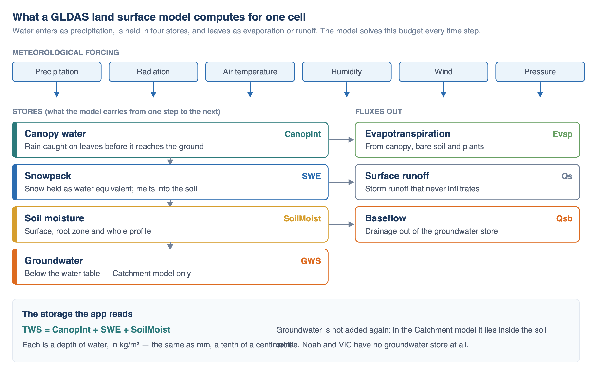
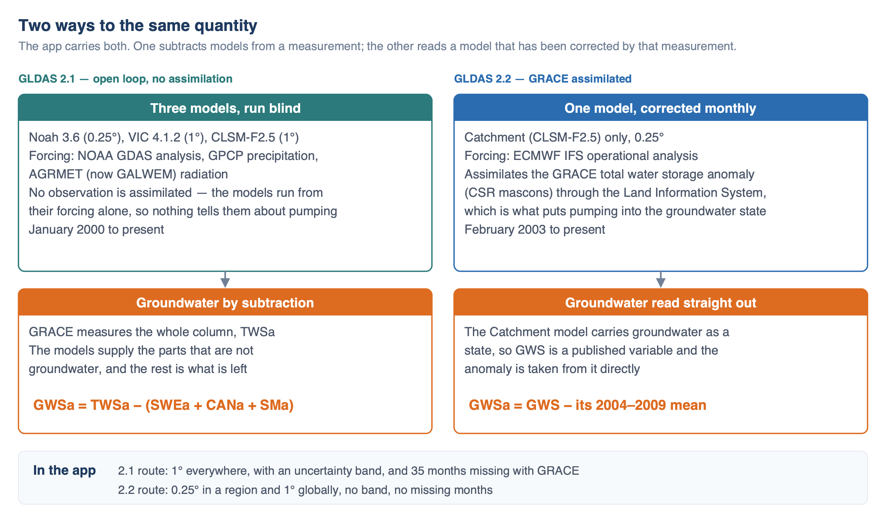

# The GLDAS Land Surface Models

Everything the app shows that is not a gravity measurement comes from GLDAS. The GRACE + GLDAS 2.1 dataset uses three GLDAS models to remove
snow, canopy water and soil moisture from what the satellites measure. The GLDAS 2.2 dataset reads groundwater out of a fourth GLDAS run
directly. This page covers what those models are and what they can and cannot represent;
[Deriving Groundwater Storage](deriving-groundwater.md) gives both derivations in full.

## What GLDAS is

NASA's Global Land Data Assimilation System produces global fields of land surface states and fluxes by driving land surface models with
observed weather (Rodell et al., 2004). The models run **offline**, meaning they are not coupled to an atmosphere: the weather is an input, and
the model's job is to track where water and energy go once they reach the ground. GLDAS runs them through the Land Information System
(Kumar et al., 2006).

The products the app reads cover 60°S to 90°N and all longitudes, on 1° and 0.25° grids. Antarctica is outside the domain, which is why the
global map ends at 60°S. GLDAS publishes 3-hourly and daily output and monthly means built from it; the app uses the monthly means.

GLDAS Version 2 comes in three parts, and the differences between them matter for how the app treats each one:

| | Forcing | Models | Period | Observations assimilated |
|---|---|---|---|---|
| **GLDAS-2.0** | Princeton meteorological dataset | Noah, VIC, Catchment | 1948–2014 | none |
| **GLDAS-2.1** | NOAA GDAS, GPCP, AGRMET | Noah, VIC, Catchment | 2000–present | none |
| **GLDAS-2.2** | ECMWF IFS analysis | Catchment only | 2003–present | GRACE total water storage |

GLDAS-2.0 ends in 2014 and the app does not use it, except that both of the other versions were started from its state rather than from scratch.
GLDAS-2.0 and 2.1 are **open loop**: the models run from their forcing alone and no observation is used to correct them along the way. GLDAS-2.2
is the one product in the family that assimilates data.

## What a land surface model computes

For each cell and each time step, the model takes the weather above the surface and solves a water and energy budget below it. Rain and snow
arrive. Some rain is caught on leaves and evaporates straight back; snow accumulates and later melts; what reaches the ground infiltrates, moves
down through the soil, and leaves again as evaporation, transpiration, surface runoff or drainage. Whatever has not left by the end of the step
is storage, and it is carried into the next step.

The four stores are what the app is built on: canopy water, snow water equivalent, soil moisture and — in one model — groundwater. Each is
reported as a depth of liquid water in kg/m², which is the same as a millimetre, or a tenth of a centimetre. The app converts all of them to
centimetres so they can be added to and subtracted from GRACE.

Three things these models leave out, and all three end up in groundwater in the app:

**No pumping or irrigation.** GLDAS simulates the natural water cycle. Nothing in the model abstracts water from an aquifer, so a GLDAS run on
its own cannot produce the depletion that is the whole subject of this app. This is the single most important fact about the models, and it is
why the 2.1 route subtracts them from a measurement and why the 2.2 route has to assimilate one.

**No surface water.** There are no rivers, lakes or reservoirs. A basin where a large reservoir fills and empties has that change counted
somewhere else, which in practice is groundwater (see the [Volta Basin](../case-studies/volta.md) case study, where the lake is about half the
storage signal).

**No glaciers or ice sheets.** None of the GLDAS models has one, so in Greenland, parts of the Arctic and permanently frozen ground in the
Himalayas, snow water equivalent "accumulates indefinitely" in the README's words, and NASA advises masking those cells. Two glacier basins in
the app's river basin sets, Alsek and Santa Cruz, carry very large groundwater anomalies for exactly this reason.

The models also carry no routing between grid cells. Noah and VIC treat each cell as an independent column. The Catchment model is the
exception within a cell: it divides the land into hydrologic catchments delineated from elevation data and redistributes water across each one
according to topography (Koster et al., 2000; Ducharne et al., 2000).

## The three models of GLDAS 2.1

GLDAS 2.1 started on 1 January 2000 from the GLDAS-2.0 state. It is forced with NOAA's GDAS atmospheric analysis, disaggregated GPCP v1.3 daily
precipitation, and AGRMET radiation fields — which switched to the UK Met Office's GALWEM on 9 June 2025, when the cloud analysis behind AGRMET
was retired. It runs three models, which differ most in how they carry soil water:

| Model | Grid | Soil moisture used by the app |
|---|---|---|
| Noah 3.6 | 0.25° | four layers, 0–200 cm |
| VIC 4.1.2 | 1° | three layers, depths varying by location |
| Catchment (CLSM-F2.5) | 1° | whole soil profile |

None of the three carries a groundwater store the app can use. Noah and VIC have none at all. The Catchment model has one, but run open loop it
has no way to know about pumping, so its groundwater follows rainfall and little else.

The three models often disagree, deep soil moisture most of all. Rather than pick one, the app averages them and uses the spread between them as
the uncertainty on each term. Bringing them together means working at the coarsest of the three grids, which is 1°.

## GLDAS 2.2 and the GRACE correction

GLDAS 2.2 is one daily product: the Catchment model at 0.25°, started on 1 February 2003 from the GLDAS-2.0 Catchment state and forced with the
operational ECMWF Integrated Forecasting System analysis. ECMWF's data agreement prohibits redistributing those fields, so unlike the other
GLDAS products, 2.2 publishes no meteorological variables alongside its model output.

What makes it different is that the total water storage anomaly measured by GRACE is assimilated into the run (Li et al., 2019), through the
assimilation machinery in the Land Information System (Kumar et al., 2016). The Catchment model was chosen for this because of how it handles
water below the surface: it tracks a catchment water deficit that stands in for the depth to the water table, so groundwater is a state the model
carries forward rather than a quantity inferred afterwards. That is what gives the assimilation somewhere to put a correction.

GRACE measures the whole column and cannot see which store a discrepancy belongs to, so the scheme distributes each month's correction across
the model's stores, groundwater among them. Depletion from pumping reaches the 2.2 groundwater state only through this route. The model physics
still has no wells in it.

Two details are worth knowing before comparing the two datasets in the app:

- The GRACE solution assimilated into 2.2 is the **CSR** mascon product (Save et al., 2012, 2016). The app's own GRACE layers use the **JPL**
  mascons. The two routes to groundwater therefore do not rest on the same GRACE solution, and they will not agree exactly even where both are
  working well.
- NASA publishes 2.2 in two streams: a main stream with the GRACE assimilation, running 2–6 months behind, and an early stream without it,
  running about 1.5 months behind. The app reads the main stream, so every month it shows has been corrected.

## Accuracy, and mixing versions

NASA lists four sources of error in GLDAS estimates: uncertainty in the meteorological forcing, which is worst at high latitudes, at high
altitudes and where weather stations are sparse; simplified representations of complex processes in the models; errors in the land surface
parameters describing vegetation, soils and elevation; and inadequate calibration of model parameters. None of these is reported as a number
alongside the data, which is why the app's uncertainty band for the 2.1 route is built from the spread between the three models rather than from
anything NASA publishes.

The README also warns against joining the GLDAS versions into one time series: the forcing datasets are biased relative to one another, and
assimilation changes both the states and the fluxes in 2.2. The app keeps them strictly separate. Each dataset is its own record, with its own
baseline, and the two are drawn as separate series when both are shown on one chart.

## References

- Rodell, M., Houser, P. R., Jambor, U., Gottschalck, J., Mitchell, K., Meng, C.-J., et al. (2004). The Global Land Data Assimilation System.
  *Bulletin of the American Meteorological Society*, 85(3), 381–394.
  [doi:10.1175/BAMS-85-3-381](https://doi.org/10.1175/BAMS-85-3-381){:target="_blank"}

- Li, B., Rodell, M., Kumar, S., Beaudoing, H. K., Getirana, A., Zaitchik, B. F., et al. (2019). Global GRACE data assimilation for groundwater
  and drought monitoring: Advances and challenges. *Water Resources Research*, 55, 7564–7586.
  [doi:10.1029/2018WR024618](https://doi.org/10.1029/2018WR024618){:target="_blank"}
  The study GLDAS 2.2 came out of, and the reference for what the assimilation does to groundwater.

- Kumar, S. V., Zaitchik, B. F., Peters-Lidard, C., Rodell, M., Reichle, R., Li, B., et al. (2016). Assimilation of gridded GRACE terrestrial
  water storage estimates in the North American Land Data Assimilation System. *Journal of Hydrometeorology*, 17(7), 1951–1972.
  [doi:10.1175/JHM-D-15-0157.1](https://doi.org/10.1175/JHM-D-15-0157.1){:target="_blank"}

- Koster, R. D., Suarez, M. J., Ducharne, A., Stieglitz, M., and Kumar, P. (2000). A catchment-based approach to modeling land surface processes
  in a general circulation model: 1. Model structure. *Journal of Geophysical Research*, 105(D20), 24809–24822.
  [doi:10.1029/2000JD900327](https://doi.org/10.1029/2000JD900327){:target="_blank"}

- Ducharne, A., Koster, R. D., Suarez, M. J., Stieglitz, M., and Kumar, P. (2000). A catchment-based approach to modeling land surface processes
  in a general circulation model: 2. Parameter estimation and model demonstration. *Journal of Geophysical Research*, 105(D20), 24823–24838.
  [doi:10.1029/2000JD900328](https://doi.org/10.1029/2000JD900328){:target="_blank"}

- GES DISC (2025). *README Document for NASA GLDAS Version 2 Data Products*.
  [hydro1.gesdisc.eosdis.nasa.gov](https://hydro1.gesdisc.eosdis.nasa.gov/data/GLDAS/GLDAS_CLSM025_DA1_D.2.2/doc/README_GLDAS2.pdf){:target="_blank"}
  The source for the forcing, periods, model versions and cautions on this page.

- GLDAS data at the NASA GES DISC: [Noah](https://disc.gsfc.nasa.gov/datasets/GLDAS_NOAH025_M_2.1/summary){:target="_blank"},
  [VIC](https://disc.gsfc.nasa.gov/datasets/GLDAS_VIC10_M_2.1/summary){:target="_blank"},
  [CLSM](https://disc.gsfc.nasa.gov/datasets/GLDAS_CLSM10_M_2.1/summary){:target="_blank"},
  [Catchment GRACE-DA1 2.2](https://disc.gsfc.nasa.gov/datasets/GLDAS_CLSM025_DA1_D_2.2/summary){:target="_blank"}
