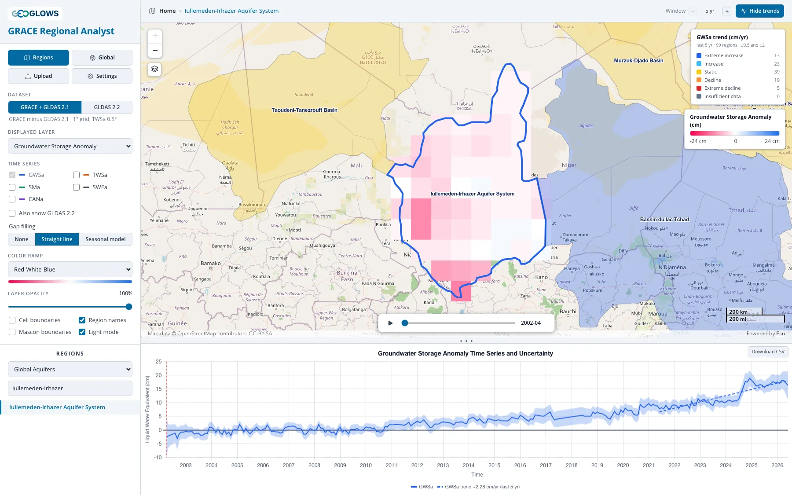

# GRACE Regional Analyst Overview

## What the app does

The GRACE Regional Analyst tracks how groundwater storage has changed since 2002 in any region of the world. It reports a groundwater storage
anomaly: how much more or less water is stored underground in a given month than the 2004–2009 average, as a depth of liquid water in
centimeters.

It reaches that number two different ways, and carries both.

**GRACE + GLDAS 2.1** starts from the total column of water weighed by NASA's GRACE and GRACE Follow-On satellites and subtracts the snow,
canopy water and soil moisture estimated by three land surface models. What is left is groundwater. The record runs from April 2002, and the
part of it that matters most — the storage change itself — is measured rather than modelled.

**GLDAS 2.2** reads groundwater out of a single land surface model, NASA's Catchment model, which carries groundwater as a state of its own and
is corrected every month by assimilating GRACE. The record runs from February 2003, has no missing months, and is served at 0.25° inside a
region, four times finer in each direction than the other dataset, which is what makes smaller basins workable.

Neither is the right answer everywhere, and they disagree in informative ways, so the app will draw both on one chart.
[Deriving Groundwater Storage](gldas/deriving-groundwater.md) gives the two derivations in full and says where each one is worth trusting.

Most aquifers have too few monitoring wells, or wells with too many gaps, to say with confidence whether storage is rising or falling across the
whole system. GRACE sees every aquifer on Earth, every month, with the same instrument. Its resolution is coarse, about 300 km, so it is suited
to aquifers, basins and countries rather than individual well fields, but at that scale it gives a consistent record of storage change where
little else exists.

The app is free and runs in a web browser at
[apps.geoglows.org/grace-anomalies](https://apps.geoglows.org/grace-anomalies){:target="_blank"}. With it you can:

- switch between the two datasets, or plot both on the same chart to compare them
- animate monthly maps of groundwater, total water, soil moisture, snow and canopy water storage anomalies for the whole globe
- pick an aquifer or river basin from one of five published region sets, upload your own boundary as GeoJSON, or draw one on the map
- plot the area-averaged time series for that region, with its uncertainty band where the dataset has one, and compare storage components
- classify regions or grid cells by the trend in storage over the last 5, 10, 15 or 20 years, or the whole record
- color the same map by how far the two datasets disagree — in trend, in month-to-month agreement, or in the size of the seasonal cycle
- fill the months GRACE is missing with a seasonal model fitted to the region's own record
- estimate annual groundwater recharge with the water table fluctuation method
- download the monthly values for any region or cell as a CSV file for your own analysis

## What this training covers

**Part 1, The GRACE Mission,** is about the measurement — what it is, how far it can be pushed, and where it has holes:

- [How GRACE Measures Water Storage](mission/measuring-water-storage.md): how two satellites measure changes in Earth's gravity, and what a
  monthly water storage anomaly is.
- [Resolution, Leakage and Small Regions](mission/resolution-and-leakage.md): what GRACE can and cannot resolve, and how to work with regions
  smaller than its footprint.
- [Gaps and Gap Filling](mission/gap-filling.md): the 35 months the record is missing, the options in the app, and the seasonal model behind
  the **Seasonal model** fill — how it is fitted, how the filled values are computed, and how accurate they are.

**Part 2, GLDAS,** is about the models, which supply everything in the app that is not a gravity measurement:

- [The GLDAS Land Surface Models](gldas/land-surface-models.md): what GLDAS is, what a land surface model computes, the three models behind the
  2.1 dataset, and what the GRACE assimilation in 2.2 changes.
- [Deriving Groundwater Storage](gldas/deriving-groundwater.md): both routes to groundwater, the gain factors applied to the GRACE data, and
  how the uncertainty is estimated.

**Part 3, Comparing the Two Datasets,** is about where the two records disagree and which to use:

- [Why the Two Datasets Differ](compare/why-they-differ.md): the two causes, and the global statistics they produce.
- [What the Differences Look Like](compare/examples.md): the cases, in named aquifers on five continents.
- [Exploring the Differences in the App](compare/exploring.md): the three comparison maps, what each one answers, and how to read them.
- [Which One to Use](compare/which-one-to-use.md): the recommendation for each kind of question, and the checks to run first.
- [How Far This Is Validated](compare/validation.md): what the recommendations rest on, and what they do not establish.

**Part 4, Using the App,** walks through the interface: [the layout](app/interface.md), [the regional view](app/regional-view.md),
[the global view](app/global-view.md), [trend and difference analysis](app/trends.md) and [downloading data](app/downloading-data.md).

**Part 5, Recharge Analysis,** estimates annual groundwater recharge with the water table fluctuation method: [the method](recharge/wtf-method.md)
as applied to GRACE data, then [opening the analysis](recharge/opening.md) and checking the series, [the water years and
picks](recharge/picks.md), and [the results](recharge/results.md).

**Part 6, Case Studies,** summarizes three published studies by the Brigham Young University team that developed the app and its
predecessor, the GRACE Groundwater Subsetting Tool (GGST). Each combines the app's GRACE and GLDAS water balance with other data:
[estimating recharge in Niger](case-studies/niger.md) where wells are scarce, [accounting for a large reservoir in the Volta
Basin](case-studies/volta.md), and [correcting for leakage in California's Central Valley](case-studies/central-valley.md), a narrow,
heavily pumped valley.

## History

The GRACE Regional Analyst replaces the GRACE Groundwater Subsetting Tool (GGST), a Tethys Platform app developed at Brigham Young University
under the NASA SERVIR West Africa project (2019–2023) and used in training workshops in West Africa, Jordan and Palestine. The new app keeps
GGST's method for separating groundwater from total water storage and adds trend classification, published aquifer and basin boundaries,
user-drawn regions, recharge analysis, and the GLDAS 2.2 dataset alongside it with maps of how the two disagree. It runs entirely in the browser, reading the processed data
directly from cloud storage, so no account or login is needed.

## Further reading

These papers established GRACE as a tool for monitoring groundwater storage in large aquifers:

- Rodell, M., Velicogna, I., and Famiglietti, J. S. (2009). Satellite-based estimates of groundwater depletion in India. *Nature*, 460,
  999–1002. [doi:10.1038/nature08238](https://doi.org/10.1038/nature08238){:target="_blank"}
- Famiglietti, J. S., et al. (2011). Satellites measure recent rates of groundwater depletion in California's Central Valley. *Geophysical
  Research Letters*, 38, L03403. [doi:10.1029/2010GL046442](https://doi.org/10.1029/2010GL046442){:target="_blank"}
- Famiglietti, J. S. (2014). The global groundwater crisis. *Nature Climate Change*, 4, 945–948.
  [doi:10.1038/nclimate2425](https://doi.org/10.1038/nclimate2425){:target="_blank"}
- Thomas, A. C., Reager, J. T., Famiglietti, J. S., and Rodell, M. (2014). A GRACE-based water storage deficit approach for hydrological
  drought characterization. *Geophysical Research Letters*, 41, 1537–1545.
  [doi:10.1002/2014GL059323](https://doi.org/10.1002/2014GL059323){:target="_blank"}
