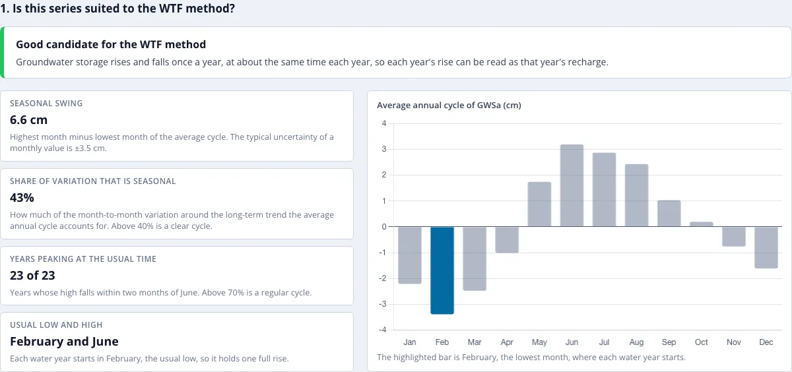

# Apertura del Análisis

## El botón Recharge Analysis { #the-recharge-analysis-button }

El Análisis de Recarga necesita un valor de GWSa en todos los meses, así que un botón **Recharge Analysis** aparece junto a **Download CSV**
encima del gráfico de series de tiempo en cuanto la serie lo tiene: en el conjunto de datos de GRACE, con **Gap filling** en **Seasonal model**
(consulta [Vacíos y Relleno de Vacíos](../mission/gap-filling.md)); en GLDAS 2.2, siempre, ya que su registro no tiene vacíos. Funciona tanto
para una región como para una celda individual de la cuadrícula en la [vista global](../app/global-view.md).

Ejecútalo en los dos conjuntos de datos antes de confiar en cualquiera de los números. Barbosa et al. (2025) hicieron exactamente eso en la
Cuenca del Volta y encontraron que GLDAS 2.2 daba 17.4 y 36.1 cm/año frente a 5.8 y 10.7 cm/año de GRACE, mientras que los pozos daban una
mediana de 10.4 cm/año; recomiendan 2.2 para tendencias y no para recarga (ver [Cuenca del Volta](../case-studies/volta.md)). El método lee el
ascenso de cada año como recarga, y la asimilación de GRACE mete en el estado de agua subterránea de 2.2 una corrección mensual que puede
agrandar ese ascenso.

El botón abre una página a pantalla completa para la serie del gráfico. Su encabezado indica la región o la celda, y **Back to map** (o la tecla Esc)
vuelve al mapa. La página tiene tres secciones numeradas:

1. una verificación de si la serie es adecuada para el método WTF (esta página)
2. los años hidrológicos, con el valle y el pico seleccionados en cada uno (consulta [Años Hidrológicos y Selección de Puntos](picks.md))
3. la recarga de cada año hidrológico, con un gráfico, una tabla y una descarga en CSV (consulta [Resultados](results.md))

Los ejemplos de esta sección usan el Northern Midwest Aquifer System, del conjunto de regiones **Global Aquifers**: un acuífero bajo
la cuenca alta del Mississippi con un ciclo anual marcado y regular. El deshielo y la lluvia de primavera lo recargan cada año, y el almacenamiento se vacía desde
finales del verano hasta el invierno.

## ¿Es adecuada esta serie para el método WTF? { #is-this-series-suited-to-the-wtf-method }

El método interpreta el ascenso de cada año hidrológico como la recarga de ese año, lo cual solo tiene sentido donde el almacenamiento tiene un ciclo anual claro (consulta
[Dónde se aplica el método](wtf-method.md#where-the-method-applies)). La primera sección evalúa ese ciclo en la serie antes de que mires cualquier
valor de recarga.

El veredicto de arriba es uno de tres:

| Veredicto | Significado |
|---|---|
| **Good candidate for the WTF method** | El almacenamiento sube y baja una vez al año, aproximadamente en la misma época cada año. |
| **Use the results with care** | Hay un ciclo anual, pero es débil o irregular comparado con otros cambios en el almacenamiento. Revisa los puntos seleccionados de cada año y apóyate en los promedios plurianuales. |
| **Poor candidate for the WTF method** | Hay poco ciclo anual regular, y es poco probable que las estimaciones de recarga tengan sentido. |

Cuatro valores debajo explican el veredicto:

- **Seasonal swing** (oscilación estacional): el mes más alto menos el mes más bajo del ciclo anual promedio, en cm, mostrado junto con la incertidumbre mediana ±1σ de un
  valor mensual de GWSa. Una oscilación pequeña comparada con la incertidumbre deja mal medido el ascenso de cada año.
- **Share of variation that is seasonal** (fracción estacional de la variación): qué parte de la variación mes a mes alrededor de la tendencia de largo plazo explica el ciclo anual
  promedio. Solo cuentan los meses observados, porque los meses rellenados provienen del mismo modelo y coincidirían con él por construcción.
- **Years peaking at the usual time** (años con pico en la época habitual): el número de años hidrológicos completos cuyo mes más alto (sin la tendencia) cae a menos de dos meses
  del pico habitual.
- **Usual low and high** (mínimo y máximo habituales): los meses más bajo y más alto del ciclo promedio. Cada año hidrológico comienza en el mínimo habitual, de modo que contiene un
  ascenso completo.

El veredicto combina el segundo y el tercer valor:

| Veredicto | Fracción estacional | Años con pico en la época habitual |
|---|---|---|
| Good | al menos 40% | y al menos 70% |
| Poor | menos de 10% | o menos de 50% |
| Use with care | cualquier valor intermedio | |

El gráfico junto a los valores muestra el ciclo anual promedio de GWSa, una barra por mes calendario, con el mes más bajo resaltado.

Para el Northern Midwest Aquifer System, la oscilación estacional es de 6.6 cm frente a una incertidumbre típica de ±3.5 cm, el ciclo anual explica el 43% de
la variación, y los 23 años hidrológicos tienen su pico a menos de dos meses de junio. El almacenamiento es más bajo en febrero, así que cada año hidrológico va de febrero a
enero del año siguiente.

El Valle Central de California recibe un veredicto distinto. Su almacenamiento sí tiene un ciclo anual, pero las sequías y los periodos húmedos plurianuales, y el
bombeo intenso durante las sequías, son tan grandes como la oscilación estacional:

Un veredicto **Use the results with care** no detiene el análisis. Lee el resto de la página con más cuidado: revisa los puntos seleccionados de cada año en el
editor y apóyate en los promedios plurianuales. Con un veredicto **Poor candidate**, los ascensos anuales son en su mayoría ruido o cambios plurianuales, y los
valores de recarga no deberían usarse.

Si la serie es demasiado corta, o algún mes calendario tiene muy pocas observaciones para ajustar el modelo estacional, la página lo indica y no muestra resultados.
